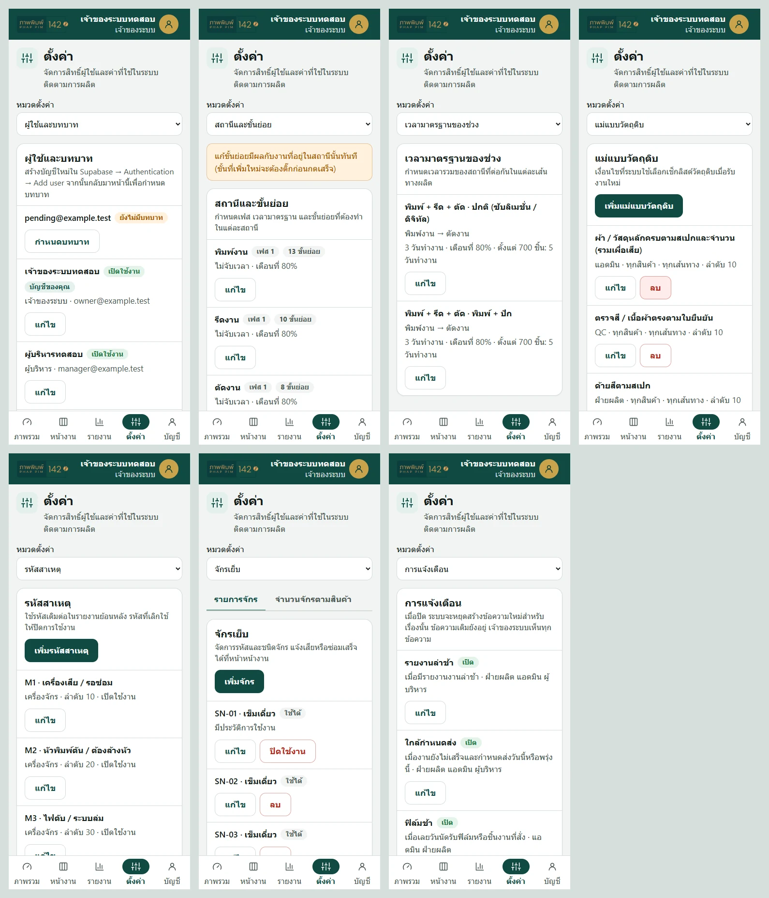
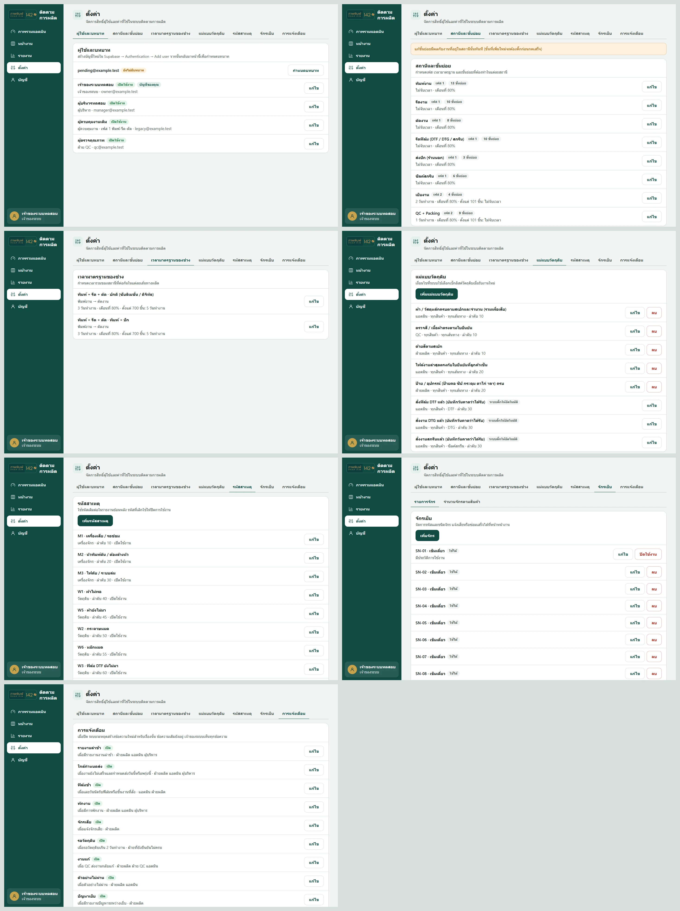

# ส่งงาน C2 · หน้าตั้งค่าเจ้าของระบบ

Branch `codex/c2-settings` · เริ่มจาก `0543c81` ตาม worktree ที่ได้รับ

## เปลี่ยนอะไร

- เปิดใช้หน้าตั้งค่า 7 แท็บที่ `#/settings` ได้แก่ ผู้ใช้และบทบาท สถานีและขั้นย่อย เวลามาตรฐานของช่วง แม่แบบวัตถุดิบ รหัสสาเหตุ จักรเย็บ และการแจ้งเตือน
- โหลดค่าตามแท็บ บันทึกทีละรายการ ป้องกันการกดซ้ำ และถามก่อนทิ้งแบบแก้ไขที่ยังไม่บันทึก แสดงเส้นทางผลิต 8 เส้นจากฐานข้อมูลแบบอ่านอย่างเดียว และแสดงสูตรจักรเป็นรายการชนิดต่อสินค้าที่เลือก
- เพิ่ม migration `20261119100000_settings.sql` ให้ RPC `owner_list_users` คืนบัญชี Auth รวมคนที่ยังไม่มีโปรไฟล์ เฉพาะ owner และคง RLS ของตารางตั้งค่าเดิม เพิ่มการป้องกันการปิดหรือลดบทบาทตัวเอง การแก้ข้อมูลที่ขั้นย่อยและแม่แบบอัตโนมัติอ้างถึง และการลบจักรที่มีประวัติ
- จักรที่มีประวัติสามารถปิดใช้งานผ่าน `set_machine_status` เดิม หากใช้กับงานอยู่ ระบบจะพักงานตามกฎเดิม เวลามาตรฐานปกติของช่วงการผลิตยังต้องมีค่าตาม schema ส่วนสถานีและเวลาของงานใหญ่เว้นว่างได้ตามเงื่อนไขในใบสั่งงาน
- โหลดหน้าตั้งค่าเมื่อเปิดหน้า เพื่อให้ bundle หลักยังต่ำกว่าเกณฑ์เตือนของ build

## ผลตรวจจริงในเครื่อง

| รายการ | ผล |
|---|---|
| `app` · lint และ build | ผ่าน ไม่มีคำเตือนจาก build |
| `app` · `npm test` | Vitest ผ่าน 105/105 (C2 เพิ่ม 21) และ `node:test` ผ่าน 99/99 |
| `supabase/tests` · `npm test` | PGlite ผ่าน 476/476 รวมตรวจสิทธิ์ owner, production, anon และยืนยันว่า `job_live.sla.station_sla_days` เปลี่ยนเป็น 2 ทันทีหลังตั้งเวลาสถานีพิมพ์ |
| Chrome 375 / 768 / 1440 px | ครบ 7 แท็บต่อความกว้าง รวม 21 หน้าจอ ไม่ล้น ปุ่มหลักที่วัดสูง 48 px และ console error 0 บนเส้นทางปกติ |
| Chrome · บันทึกและตรวจสิทธิ์ | ส่งคำสั่งเขียน 15 ครั้งผ่าน API จำลองที่ใช้ PGlite ในเครื่อง ครบทั้ง 7 แท็บ ตรวจการยกเลิกการออกจากแท็บเมื่อมีข้อมูลค้าง การตรวจข้อมูล ช่องที่ล็อก สถานะว่างและโหลดใหม่หลังจำลองข้อผิดพลาด และบัญชี manager จำลองเห็น “หน้านี้สำหรับเจ้าของระบบ” โดยหน้าไม่เรียก `owner_list_users` |
| ตรวจรวมกับ `main` ที่ `de8f9f4` (S8) บนสำเนาชั่วคราว | lint และ build ผ่าน Vitest 105/105, `node:test` 106/106 และ PGlite 483/483 |

## ภาพหน้าจอจากบัญชีและข้อมูลทดสอบ

**375 px · ครบ 7 แท็บ**

**1440 px · ครบ 7 แท็บ**

## ยังไม่ได้ทำและเรื่องส่งต่อ

- การเข้าใช้ด้วยบัญชี manager และ owner บนระบบจริง การลง migration จริง และผล CI บน GitHub รอรอบของ Claude และเจ้าของโปรเจกต์ การทดสอบครั้งนี้อยู่ในเครื่องทั้งหมด
- `main` เดินหน้าระหว่างทำงานไปที่ `de8f9f4` โดยเพิ่ม S8 ส่วน commit ตั้งต้น `0543c81` มีใบสั่งงานและเอกสารเดิมของ Claude อยู่แล้ว งาน C2 ตรวจขอบเขตจาก commit ตั้งต้นและทดสอบโค้ดรวมกับ `main` บนสำเนาชั่วคราว
- ไม่พบบั๊กนอกขอบเขตจากกรณีที่ตรวจ
