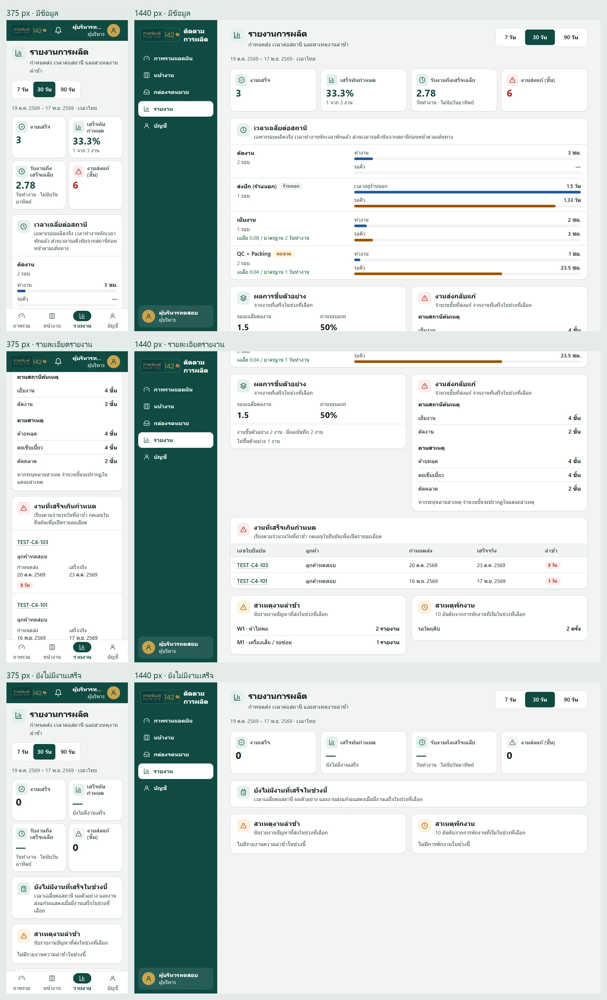

# ส่งงาน C4 · รายงานการผลิต

Branch `codex/c4-reports` · ฐาน worktree `bc27d91` (ใบสั่งงาน C4 ฉบับอัปเดต)

## เปลี่ยนอะไร

- เปิดหน้า `#/reports` สำหรับผู้บริหารและเจ้าของระบบตามสิทธิ์เดิม เลือกช่วง 7 / 30 / 90 วัน ค่าเริ่มต้น 30 วัน นับวันที่เลือกย้อนหลังรวมวันนี้ตามเวลาไทย
- เพิ่มสรุปงานเสร็จ สัดส่วนทันกำหนด เวลาเฉลี่ยจากรับงาน และจำนวนชิ้นส่งแก้ แสดงผลตัวอย่างเฉพาะงานที่เลือกขึ้นตัวอย่าง พร้อมแยกจำนวนงานที่ข้ามตัวอย่างและจำนวนที่มีผลบันทึก
- แสดงเวลาทำงานหลังหักพักและเวลารอคิวตามสถานีก่อนหน้าในเส้นทางของแต่ละงาน แสดงส่งปักเป็นร้านนอกและตัดออกจากการหาคอขวด ตัวเลขเทียบมาตรฐานใช้วันทำงานตามหลักเดียวกับ `private.work_days`
- แยกงานแก้ตามสถานีและสาเหตุ นับรายงานความล่าช้าและเหตุพักตามเวลาที่ส่งรายงานหรือเปิดพัก แม้งานนั้นยังไม่เสร็จ และแสดงตารางงานเกินกำหนดพร้อมลิงก์ `#/board?job=<id>`
- ชั้นรายงานอ่านเฉพาะคอลัมน์ที่ใช้และแบ่งหน้า ดึงประวัติของงานที่เสร็จในช่วงแม้บันทึกก่อนวันเริ่มรายงาน

## ผลตรวจในเครื่อง

| รายการ | ผล |
|---|---|
| `app` · lint และ build | ผ่านโดยไม่มีคำเตือน |
| `app` · `npm test` | Vitest 130/130 โดย C4 เพิ่ม 25 กรณี และ `node:test` 108/108 |
| `supabase/tests` · `npm test` | PGlite 493/493 |
| Chrome · ผู้บริหารจำลอง | 375 / 768 / 1440 px มีข้อมูล และ 375 / 1440 px ไม่มีข้อมูล หน้าไม่ล้น ปุ่มช่วงวันที่สูงอย่างน้อย 48 px และ console error 0 บนเส้นทางปกติ |
| Chrome · ตัวเลขและสิทธิ์ | เทียบตัวอย่าง 3 งานได้ทันกำหนด 33.3% เฉลี่ย 2.78 วันทำงาน ส่งแก้ 6 ชิ้น คอขวดเป็น QC + Packing รอเฉลี่ย 23.5 ชม. ตรวจตัวกรอง 7 / 30 / 90 วัน ลองใหม่หลังจำลองข้อผิดพลาด และตรวจว่าฝ่ายผลิตถูกกันออกจากหน้ารายงาน |
| Chrome · ลิงก์ | งานที่บอร์ดโหลดอยู่เปิด Drawer ถูกใบ งานเก่ามีข้อจำกัดตามรายการด้านล่าง |

ใช้ Chrome กับ API จำลองและ PGlite ที่รัน migration ในเครื่อง เลียนแบบบัญชีผู้บริหารและ RLS จริงของโครงการ

## ยังไม่ได้ทำและบั๊กนอกขอบเขต

- **ลิงก์งานเสร็จเกิน 14 วัน:** ตาราง C4 แสดงงานและสร้างลิงก์ถูกต้อง แต่ `app/src/data/useFactoryData.ts` โหลดงานเสร็จย้อนหลัง 14 วัน และ Drawer ใน `app/src/pages/Dashboard.tsx` หาใบงานจากข้อมูลชุดนั้น ทดสอบใน Chrome แล้วว่าลิงก์พาไปบอร์ดแต่ Drawer ของงานเก่าไม่เปิด ส่งให้ Claude เพิ่มการอ่าน `job_live` ตาม ID เมื่อเปิดลิงก์ตรงและใบงานไม่มีในรายการที่โหลดอยู่
- การอ่านด้วยบัญชี `manager@pp142.test` บนระบบจริงและ GitHub Actions ยังไม่ได้ทดสอบ รอบนี้ตรวจด้วยบัญชีจำลองในเครื่องทั้งหมด
