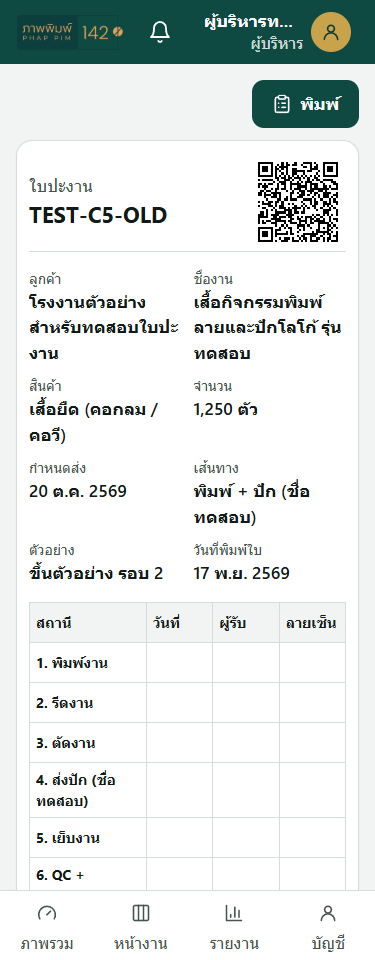
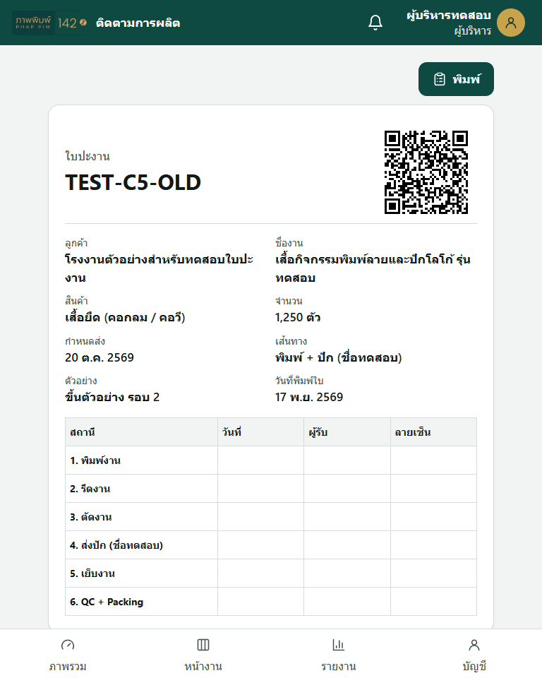
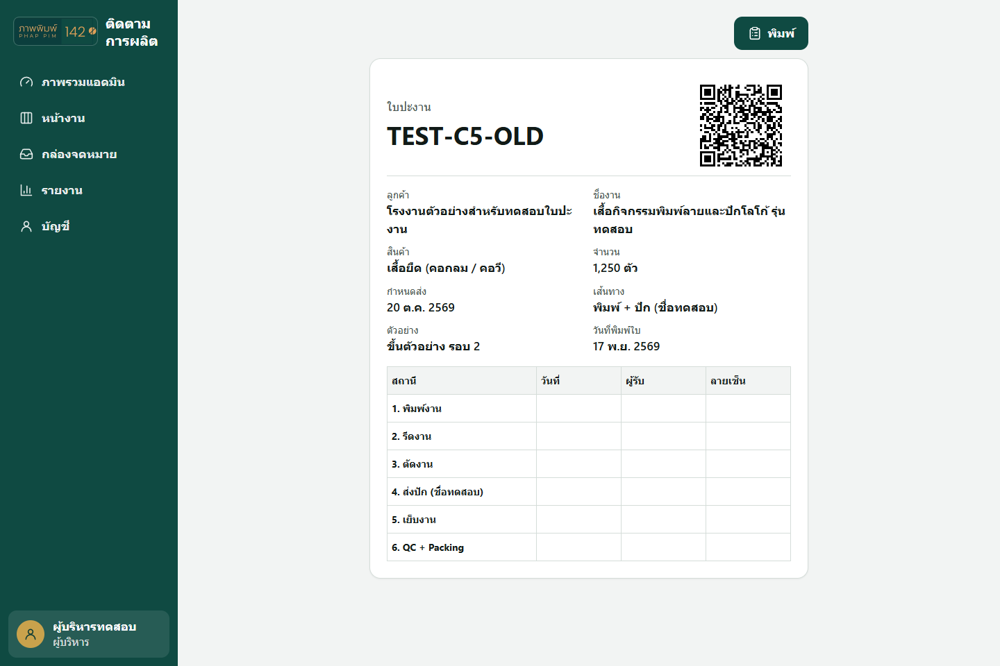

# ส่งงาน C5 — ใบปะงาน + QR

Branch `codex/c5-qr-label` · ใบสั่งงาน [C5](../codex/C5.md)

## เปลี่ยนอะไร

- เพิ่มหน้า `#/label?id=<id>` และลิงก์ **พิมพ์ใบปะงาน** ในหัวแผงรายละเอียดงาน หน้าใบปะงานอ่านข้อมูลเฉพาะคอลัมน์ที่ใช้และเรียงสถานีตาม `route_stations.seq` โดยใช้ชื่อสินค้า เส้นทาง และสถานีจากฐานข้อมูล แสดงกำหนดส่งและวันที่พิมพ์เป็น พ.ศ. พร้อมช่องวันที่ ผู้รับ และลายเซ็นของแต่ละสถานี
- สร้าง QR แบบ byte mode UTF-8 ระดับ M รองรับเวอร์ชัน 1–10 เป็น SVG สีดำบนขาว มีขอบว่าง 4 โมดูล ลิงก์งานจริงใช้เวอร์ชัน 5 ขนาด 37×37 โมดูล
- ลิงก์ `#/board?job=<id>` ใช้งานจากชุดที่โหลดไว้ก่อน เมื่อไม่มีจึงอ่านเฉพาะงานตาม ID โดยตัดงานยกเลิกออก งานที่อ่านเพิ่มอยู่ในแผงรายละเอียดเท่านั้น ตัวนับ รายการบอร์ด และการคาดการณ์ยังมาจากข้อมูลชุดเดิม

## ทดสอบและผลจริง

| การทดสอบ | ผล |
| --- | --- |
| `npm run lint` และ `npm run build` | ผ่าน ไม่มี warning |
| `npm test` ใน `app` | Vitest 143 ผ่าน และ node:test 108 ผ่าน |
| `npm test` ใน `supabase/tests` | PGlite ในหน่วยความจำ ผ่าน 493 ข้อ |
| ตัวสร้าง QR | เมทริกซ์ตรงกับชุดอ้างอิง 4 ข้อความ ครอบคลุมลิงก์งาน ภาษาไทยแบบ UTF-8 พร้อม ECI และเวอร์ชัน 10 ตรวจขีดจำกัดแต่ละเวอร์ชัน โครงสร้าง finder และ timing รวมถึง format ระดับ M [Nayuki QR Code generator](https://www.nayuki.io/page/qr-code-generator-library) |
| Chrome บน Windows ที่ 375 / 768 / 1440 px | ใบปะงานไม่ล้นข้าง ปุ่มพิมพ์สูงอย่างน้อย 48 px และเรียก `window.print()` ชื่อเส้นทางและชื่อสถานีที่เปลี่ยนใน fixture ขึ้นตามฐานข้อมูล ลำดับครบ 6 สถานี ไม่มี console error ในเส้นทางใช้งานปกติ |
| งานเก่าและสถานะขอบเขต | ใช้ลิงก์จาก QR เปิดงานจำลองที่เสร็จเกิน 14 วันได้จากหน้าภาพรวมและหลังล็อกอิน ปุ่มเปิดใบปะงานในแท็บเดิม งานเก่าไม่ขึ้นในบอร์ด ทดสอบงานที่มีในรายการ งานยกเลิก งานที่ไม่พบ ID ผิด และกรณีจำลองการอ่านใบปะงานล้มเหลว |
| พิมพ์ PDF จาก Chrome | เส้นทางพิมพ์ + ปักครบ 6 สถานี ได้ A5 แนวตั้ง 1 หน้า ขอบ 8 มม. QR กว้าง 42 มม. รวมขอบว่าง ส่วนเมทริกซ์วัดจากภาพ PDF ประมาณ 34.5 มม. |
| อ่าน QR จาก PDF | ZXing-C++ และ OpenCV บน Windows อ่านจากภาพ PDF ที่ 240 DPI ได้ URL ตรงกัน นำ hash จาก URL ที่อ่านได้มาเปิดบนแอป loopback แล้วเปิดรายละเอียด `TEST-C5-OLD` ถูกตัวหลังล็อกอิน |

ทดสอบผ่าน Chrome ที่ชี้ไปยัง loopback เท่านั้น โดยใช้บัญชี manager จำลองและ PGlite ในหน่วยความจำ

## หลักฐาน

- [PDF ใบปะงาน A5 หนึ่งหน้า](c5-qr-label/label-a5.pdf)
- [แผงรายละเอียดงานเก่าที่เปิดจากลิงก์ QR](c5-qr-label/old-job-drawer.png)

| 375 px | 768 px | 1440 px |
| --- | --- | --- |
|  |  |  |

## ยังไม่ได้ทำ

- สแกนจาก iPhone และ Android จริงยังไม่ได้ทดสอบ จึงยังไม่มีภาพจากมือถือ ตรวจการถอดรหัสด้วย ZXing-C++ และ OpenCV ตามผลข้างต้น
- การเปิดด้วยบัญชี `@pp142.test` และงาน `TEST-N1` / `TEST-P1` / `TEST-D1` บนระบบจริงยังไม่ได้ทดสอบ ตามขอบเขตที่ห้ามแตะฐานข้อมูลจริง

## บั๊กนอกขอบเขต

ไม่พบระหว่างทดสอบ C5
