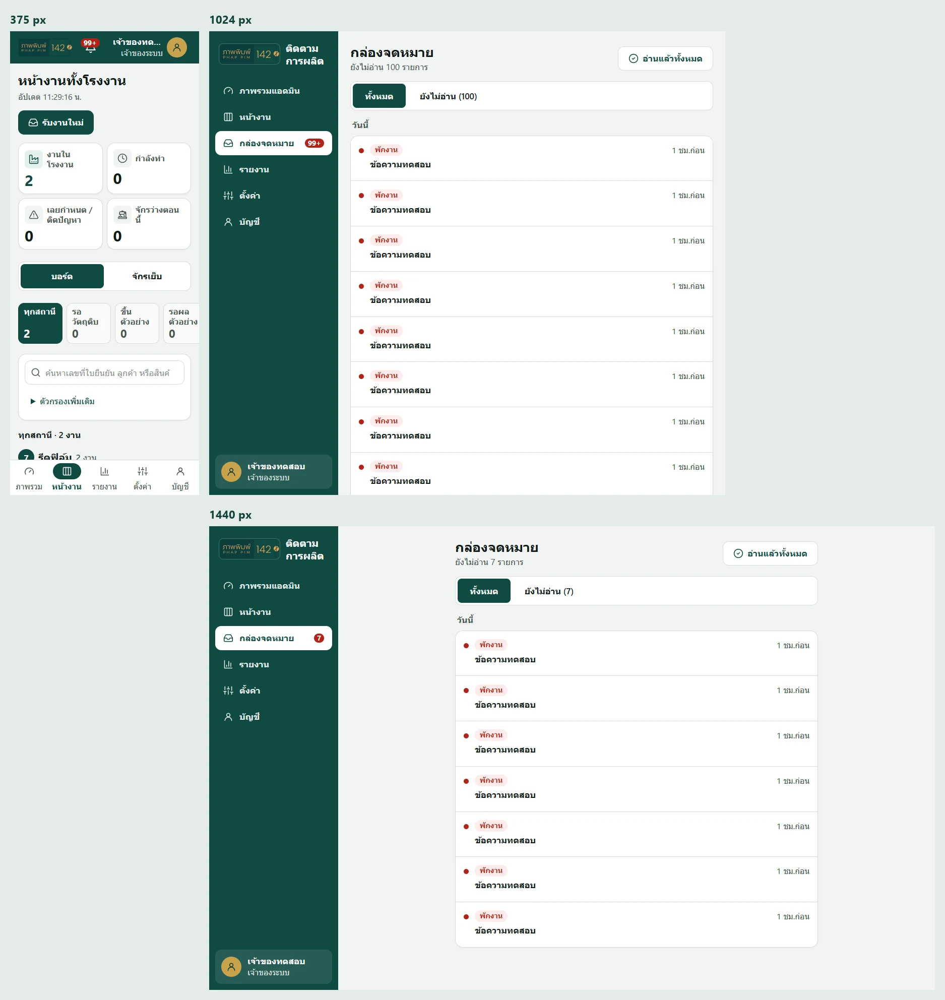

# ส่งงาน C6 · ประวัติงานและเวลาต่อสถานี

Branch `codex/c6-history-fixes` · ฐาน worktree `e2b4d6e` (ใบสั่งงาน C6)

## เปลี่ยนอะไร

- เพิ่ม `20261119150000_station_visits_end.sql` ให้ `station_visits` ใช้เวลา `station_done` ก่อน หากหาไม่พบ ใช้เหตุการณ์แรกของงานเดียวกันที่ส่งกลับแก้ ส่งตัวอย่าง งานเสร็จ หรือเริ่ม visit ที่ใหม่กว่า เรียงด้วยเวลาและรหัส event เมื่อเวลาเท่ากัน คงคอลัมน์และ `security_invoker` เดิม
- ไทม์ไลน์อ่าน `jobs.unit` ของใบงานและใช้ในข้อความรับงาน ผ่าน QC และส่งกลับแก้ แสดง “ชิ้น” เมื่อหน่วยว่าง
- ปุ่มรับฟิล์มและข้อความหลังบันทึกใช้ `spaced()` ปรับหัวเมนูซ้ายให้ชื่ออยู่ 2 บรรทัด โดยกระดิ่งยังอยู่ในหัวเมนู

## ผลตรวจในเครื่อง

| รายการ | ผล |
|---|---|
| `app` · lint และ build | ผ่าน ไม่มีคำเตือนจาก build |
| `app` · `npm test` | Vitest 105/105 และ `node:test` 108/108 |
| `supabase/tests` · `npm test` | PGlite 493/493 เดินงานผ่าน RPC รวมจบปกติ ส่งกลับแก้ พักแล้วทำต่อ ส่งตัวอย่าง และจบงาน รวมข้อมูลเดิมที่ไม่มี `station_done` |
| Chrome · 375 / 768 / 1024 / 1440 px | หน้าไม่ล้นและ console error 0 หัวเมนูซ้าย 2 บรรทัดที่ 1024 และ 1440 px พร้อมกระดิ่งสูง 48 px และป้าย 99+ |
| Chrome · ข้อความและการรับฟิล์ม | ประวัติแสดง “บันทึกผ่าน QC 5 ผืน” ปุ่มและข้อความหลังบันทึกตรงทั้ง “ได้รับฟิล์ม DTF แล้ว” และ “ได้รับงานสกรีนแล้ว” โดยบันทึกผ่าน RPC จำลองเท่านั้น |

## ยังไม่ได้ทำและบั๊กนอกขอบเขต

- งานนี้ใช้ PGlite และ API จำลองในเครื่อง ผลบนระบบจริงจะเปลี่ยนเมื่อ Claude ลง migration หลังรีวิว ผล GitHub Actions รอรอบเปิด PR
- ไม่พบบั๊กนอกขอบเขตจากกรณีที่ตรวจ งานต่อคือ C4 ซึ่งอ่านเวลาจาก `station_visits` ตามใบสั่งงาน
