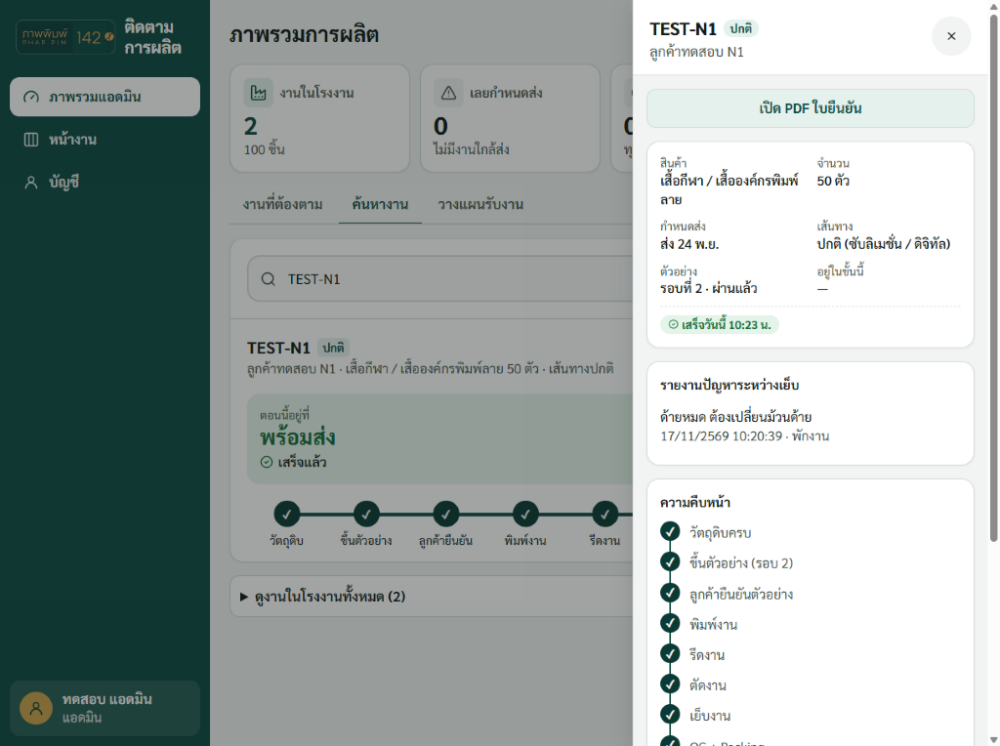
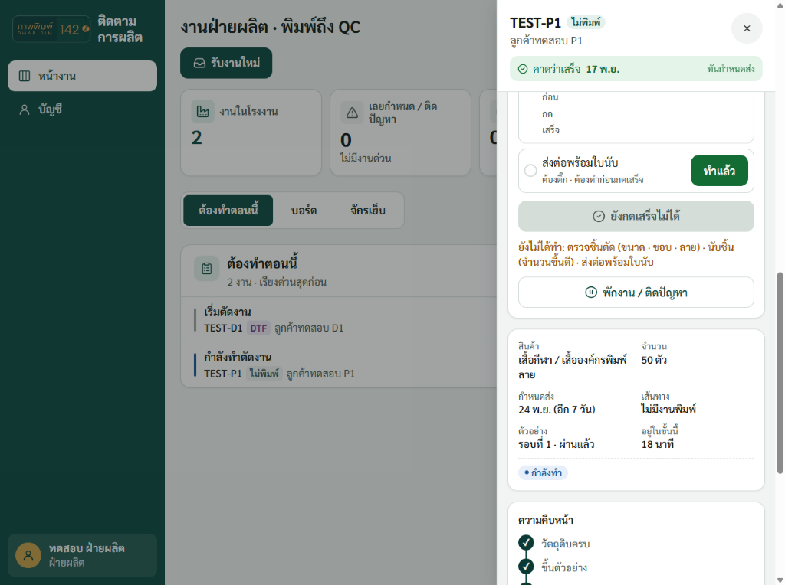
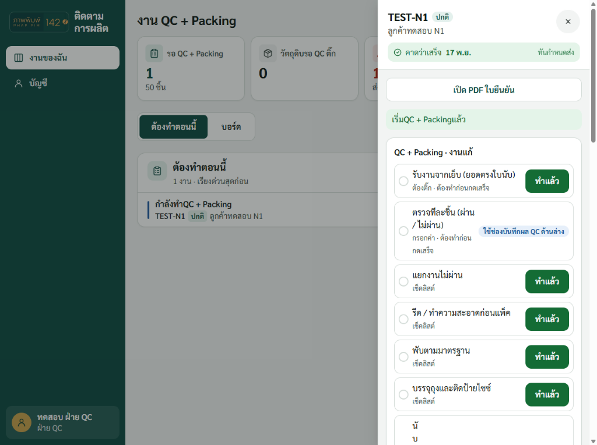
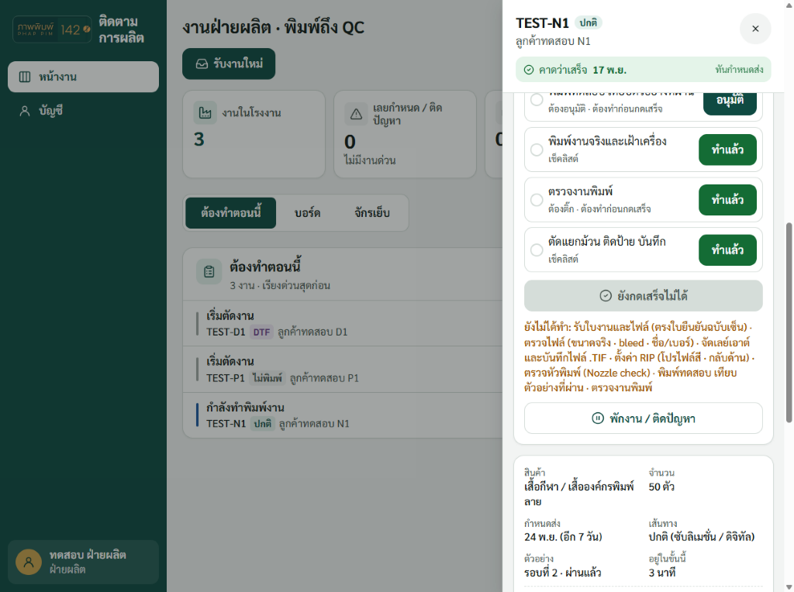
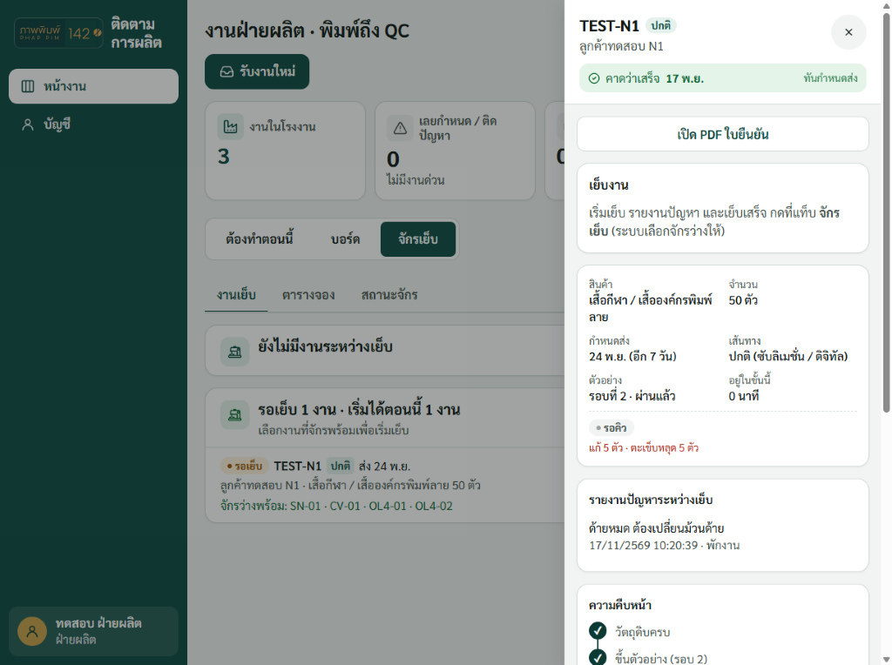
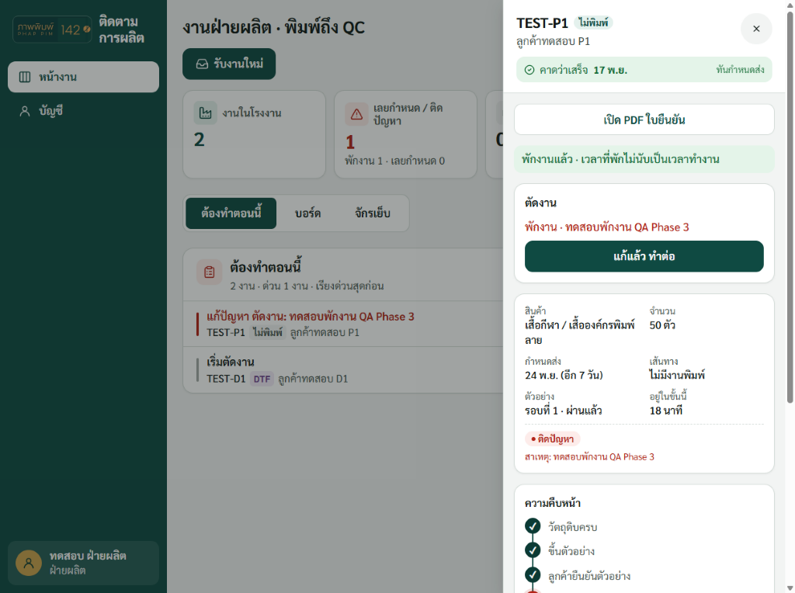
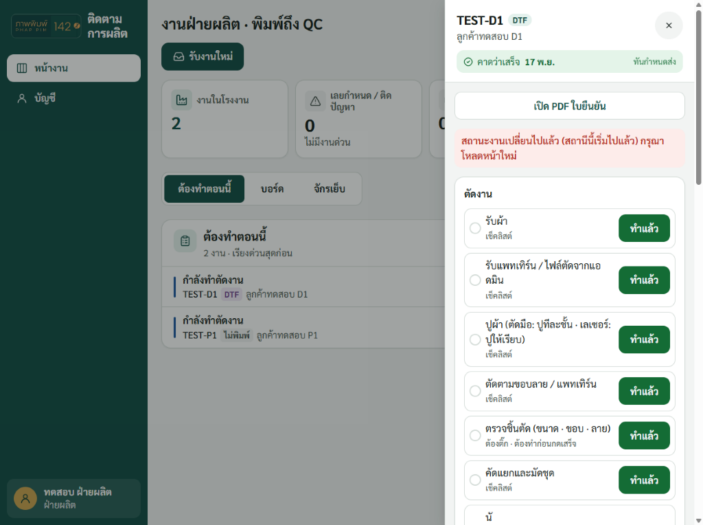
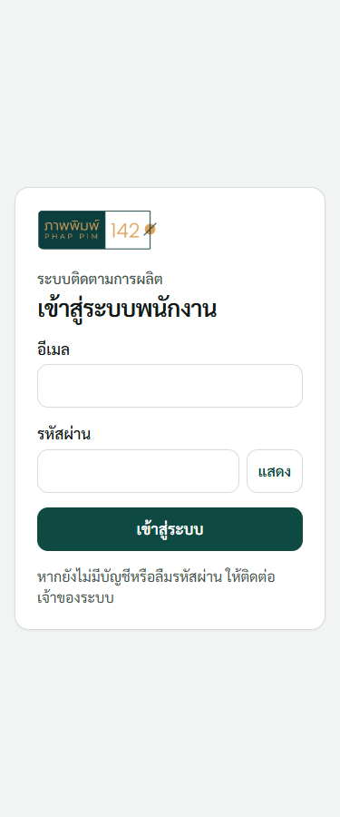
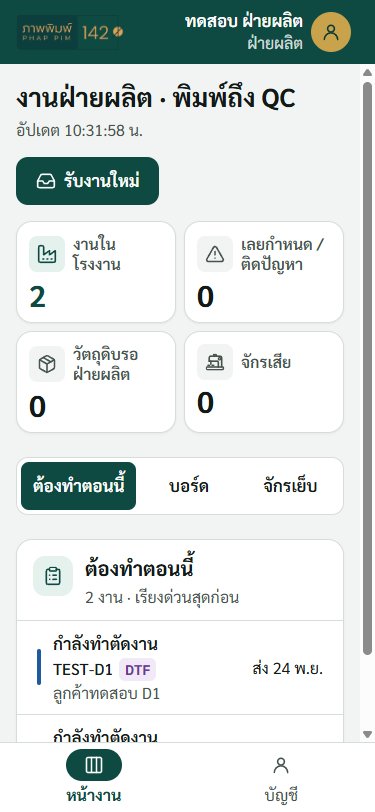
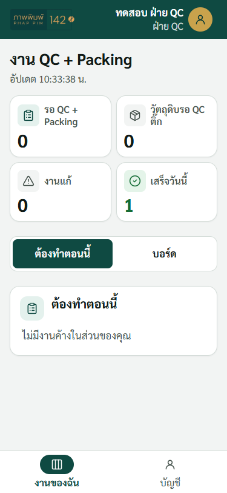

# รายงานทดสอบระบบจริง (G1) — รอบ 1

> วันที่ทดสอบ: 17 พ.ย. 2569 · ทดสอบที่ `http://localhost:5174/` (จาก branch `antigravity/g1-walkthrough`, commit `7d7b92c` เชื่อมต่อฐานข้อมูลจริง)
> บัญชีทดสอบที่ใช้: `production@pp142.test`, `admin@pp142.test`, `qc@pp142.test`, `manager@pp142.test` (ไม่ได้ใช้บัญชีเจ้าของระบบจริง · งานทดสอบทั้งหมดขึ้นต้น `TEST-`)

---

## 1. สรุปผลการตรวจตามเช็คลิสต์

### 1.1 รายการตรวจทั้งระบบ (`แผน-1-สัปดาห์.md` หัวข้อ 4.3)
| ข้อ | รายการตรวจ | ผล | หมายเหตุ |
|---|---|---|---|
| 1 | รับงานเส้นทางปกติ (`TEST-N1`) + DTF (`TEST-D1`) + ไม่พิมพ์ (`TEST-P1`) | ✅ ผ่าน | รับงานโดย `production@pp142.test` พร้อมแนบ PDF (พบ Bug #3 KPI ไม่อัปเดตทันทีหลังรับงาน) |
| 2 | ติ๊กวัตถุดิบทีละฝ่าย (ผลิต / แอดมิน / QC) · ลองขึ้นตัวอย่างก่อนครบ | ✅ ผ่าน | แต่ละฝ่ายติ๊กได้เฉพาะรายการของตัวเอง · ก่อนครบทุกฝ่าย งานค้างที่ `รอวัตถุดิบ` และไม่มีปุ่มขึ้นตัวอย่าง |
| 3 | ตัวอย่างไม่ผ่าน 1 รอบ → ผ่าน · ตรวจประวัติรอบ | 🟡 ผ่านบางส่วน | รอบ 2 แสดง badge `รอบที่ 2` ถูกต้อง แต่ **ไม่แสดงประวัติ/หมายเหตุที่ตัวอย่างไม่ผ่านรอบ 1** (Bug #2) |
| 4 | เดินทุกสถานี · กดเสร็จก่อนติ๊กขั้นบังคับ · DTF ก่อนได้ฟิล์ม · ไม่พิมพ์ข้ามพิมพ์/รีด | ✅ ผ่าน | กดเสร็จก่อนติ๊กขั้นบังคับถูกปฏิเสธพร้อมบอกรายการที่ขาดภาษาไทย · DTF ก่อนรับฟิล์มถูกบล็อก · `TEST-P1` ข้ามพิมพ์/รีด |
| 5 | เย็บ: เริ่ม → รายงานปัญหาระหว่างงาน (พักงาน) → เย็บต่อ → เย็บเสร็จโดยไม่ต้องติ๊กขั้นย่อย | ✅ ผ่าน | พัก/ทำต่อ/ส่ง QC ทำงานถูกต้อง ไม่บังคับติ๊กขั้นย่อย |
| 6 | QC ไม่ผ่าน 5 ชิ้น → กลับเย็บพร้อมป้าย `"งานแก้"` → กลับ QC → ผ่าน | 🟡 ผ่านบางส่วน | เดินงานครบถึง `เสร็จ / พร้อมส่ง` (พบ Bug #7 ป้าย `"งานแก้"` ไม่แสดงบนการ์ดแท็บ `ต้องทำตอนนี้` และ `จักรเย็บ`) |
| 7 | พักงาน → เวลาทำงานไม่นับช่วงพัก (`TEST-P1` ที่ `ตัดงาน`) | ✅ ผ่าน | ขึ้นแบนเนอร์ `พักงานแล้ว · เวลาที่พักไม่นับเป็นเวลาทำงาน` และกลับมากด `แก้แล้ว ทำต่อ` ได้ |
| 8 | ปรับเวลามาตรฐานให้สั้นเพื่อทดสอบ → การ์ดส้ม → แดง → กดเสร็จไม่ได้จนกว่าจะรายงาน | ⬜ ยังไม่ได้ทำ | หน้าตั้งค่า (S9/C2) ยังไม่เสร็จ และกติกา G1 ห้ามแก้ข้อมูลผ่าน Supabase Dashboard |
| 9 | เปิด 2 แท็บพร้อมกัน → อัปเดตภายใน 2 วินาที · กดปุ่มเดียวกันพร้อมกัน → รับครั้งเดียว | 🟡 ผ่านบางส่วน | 2 แท็บบัญชีเดียวกัน (`production@pp142.test`): อีกแท็บอัปเดตใน **162–174 ms** หลัง RPC เสร็จ · กด `เริ่มตัดงาน` พร้อมกัน 2 แท็บ รับครั้งเดียว (204) อีกแท็บขึ้นแจ้งเตือนไทย (400) ไม่แครช · **ข้อจำกัด:** เครื่องมือเบราว์เซอร์เปิดได้ 1 context จึงยังไม่ได้ลอง 2 บัญชีต่างกันพร้อมกัน |
| 10 | ค้นหา SC (`TEST-N1`) → ขั้นปัจจุบันถูก · ไทม์ไลน์ครบ · เปิด PDF ได้ | ❌ ไม่ผ่าน | ค้นหาเจอสถานะถูกต้อง · ไทม์ไลน์ทุกการกดยังเป็นข้อความรอ S8 · **คลิก `เปิด PDF ใบยืนยัน` แล้วไม่เปิดไฟล์** (Bug #1) |

### 1.2 การตรวจเพิ่มเติม (`แบ่งงาน-Codex-Antigravity.md` ข้อ 5.1)
- **สิทธิ์ตามบทบาท (`admin` / `manager` / `qc` / `production`):** ✅ `admin` และ `manager` กดรับงานหรือปุ่มสถานีไม่ได้ (`บทบาทนี้ดูได้อย่างเดียว`)
- **ตัดเน็ต / ปิด Wi-Fi (`ขาดการเชื่อมต่อ`):** ⬜ ยังไม่ได้ทำ (เครื่องมือ `webview_browser` ไม่มีคำสั่งจำลอง offline)
- **ขนาดจอ 375 / 768 / 1440 px:** ✅ ไม่มีหน้าล้นด้านข้าง (`scrollWidth === clientWidth`) · ปุ่มหลักสูง ≥ 48 px · ตัวอักษรหลัก ≥ 16 px (`17px`) · console error = `0` ในทุกบทบาทที่ทดสอบ (Login, Admin, Manager, Production, QC)

---

## 2. รายการบั๊กที่พบ

### บั๊ก #1: กดปุ่ม `เปิด PDF ใบยืนยัน` แล้วไม่เปิดไฟล์และไม่ดาวน์โหลด
- **ระดับ:** 1 (ทำงานต่อไม่ได้ / ฟังก์ชันหลักไม่ทำงาน)
- **บทบาท:** `admin@pp142.test` (และทุกบทบาทที่มีปุ่มนี้)
- **ขนาดจอ:** `1440x900` (Console error: `0`)
- **ขั้นตอนทำซ้ำ:**
  1. ล็อกอินด้วย `admin@pp142.test` ไปที่ `ภาพรวมแอดมิน` → `ค้นหางาน`
  2. ค้นหา `TEST-N1` → คลิกผลลัพธ์ → คลิก `รายละเอียดเต็ม`
  3. คลิกปุ่ม `เปิด PDF ใบยืนยัน`
- **ผลที่ได้:** Network ส่ง `POST .../storage/v1/object/sign/confirmations/TEST-N1/...pdf` ได้ `200 OK` แต่ไม่มีแท็บใหม่เปิดขึ้น ไม่มีไฟล์ดาวน์โหลด และไม่มีข้อความแจ้งเตือน/ลิงก์สำรอง (คาดว่า `window.open` หลัง `await` ถูก browser popup blocker บล็อก)
- **ผลที่ควรเป็น:** เปิด PDF ในแท็บใหม่/ตัวแสดง PDF หรือดาวน์โหลดได้ทันที (หรือเปิดแท็บว่างรอไว้ก่อน `await` / แสดงลิงก์ให้กดซ้ำถ้าโดนบล็อก)
- **ภาพหน้าจอ:** 

---

### บั๊ก #2: ประวัติและหมายเหตุที่ตัวอย่างไม่ผ่านรอบ 1 ไม่แสดงในรายละเอียดงาน
- **ระดับ:** 2 (ใช้งานได้แต่ข้อมูลสำคัญหาย/ไม่ครบตามเช็คลิสต์)
- **บทบาท:** `admin@pp142.test`
- **ขนาดจอ:** `1440x900` (Console error: `0`)
- **ขั้นตอนทำซ้ำ:**
  1. บนงาน `TEST-N1` บันทึกผลตัวอย่าง `ไม่ผ่าน` ในรอบ 1 พร้อมกรอกสิ่งที่ต้องแก้
  2. เดินงานขึ้นตัวอย่างรอบ 2 จนเสร็จและกด `ตัวอย่างผ่าน`
  3. เปิดแผง `รายละเอียดเต็ม` ของ `TEST-N1`
- **ผลที่ได้:** แสดงแค่ข้อความสถานะปัจจุบัน (`ขึ้นตัวอย่าง (รอบ 2)` / `ตัวอย่างรอบที่ 2 · ผ่านแล้ว`) ไม่แสดงรายการประวัติรอบ 1 ที่ไม่ผ่านและหมายเหตุสิ่งที่ต้องแก้
- **ผลที่ควรเป็น:** แสดงประวัติรอบตัวอย่างที่ผ่านมา (เช่น รอบ 1 ไม่ผ่าน + เหตุผล/สิ่งที่ต้องแก้, รอบ 2 ผ่าน)

---

### บั๊ก #3: การ์ดตัวเลข KPI ไม่อัปเดตทันทีหลังรับงานใหม่
- **ระดับ:** 2 (ใช้ได้แต่ข้อมูลบนจอช้า/สับสน)
- **บทบาท:** `production@pp142.test`
- **ขนาดจอ:** `1440x900` (Console error: `0`)
- **ขั้นตอนทำซ้ำ:**
  1. ล็อกอินด้วย `production@pp142.test` ที่หน้า `#/board` (ขณะนั้น KPI เป็น 0)
  2. กด `รับงานใหม่` กรอกข้อมูล `TEST-N1` พร้อมแนบ PDF แล้วกดยืนยัน
- **ผลที่ได้:** ขึ้น toast `"รับงาน TEST-N1 แล้ว · รอทุกฝ่ายติ๊กวัตถุดิบ"` แต่การ์ด KPI `งานในโรงงาน` และ `วัตถุดิบรอฝ่ายผลิต` ยังคงแสดง `0` จนกว่าจะรีเฟรชหรือมีการอัปเดตถัดไป
- **ผลที่ควรเป็น:** ตัวเลข KPI ควรอัปเดตเป็น `1` ทันทีหลังรับงานสำเร็จ

---

### บั๊ก #4: แถวขั้นย่อยแบบ `กรอกค่า` ในแผงรายละเอียด บีบข้อความภาษาไทยจนขึ้นบรรทัดใหม่ทีละ 1–3 ตัวอักษร
- **ระดับ:** 2 (ใช้ได้แต่อ่านยากมาก)
- **บทบาท:** `production@pp142.test`, `qc@pp142.test`
- **ขนาดจอ:** `1440x900` (แผงด้านข้าง) (Console error: `0`)
- **ขั้นตอนทำซ้ำ:**
  1. เริ่มสถานี `รีดงาน`, `ตัดงาน`, `รีด DTF` หรือ `QC + Packing`
  2. ดูแถวขั้นย่อยที่มีช่อง `<input type="number">` + ปุ่ม `บันทึก` (เช่น `นับชิ้น (จำนวนชิ้นดี)`, `นับยอดรวม`, `อุ่นเครื่องรีดโรล`)
- **ผลที่ได้:** ช่องกรอกและปุ่ม `บันทึก` กินความกว้างเกือบทั้งหมด ทำให้ข้อความชื่อขั้นย่อยทางซ้ายถูกบีบจนตัดบรรทัดแนวตั้งทีละ 1–3 ตัวอักษร อ่านไม่ออก
- **ผลที่ควรเป็น:** จัดวางให้ชื่อขั้นย่อยอ่านได้เต็มบรรทัด (เช่น วางช่องกรอก+ปุ่มไว้บรรทัดล่างในการ์ด หรือลดความกว้างช่องกรอก)
- **ภาพหน้าจอ:**  · 

---

### บั๊ก #5: กด `ออกจากระบบ` ค้าง URL ที่ `#/system` และ request logout ถูก abort
- **ระดับ:** 2 (ใช้งานได้แต่ network error / URL ไม่เปลี่ยน)
- **บทบาท:** `production@pp142.test`, `admin@pp142.test`
- **ขนาดจอ:** `1440x900`
- **ขั้นตอนทำซ้ำ:**
  1. ไปที่เมนู `บัญชี` (`#/system`)
  2. กดปุ่ม `ออกจากระบบ`
- **ผลที่ได้:** หน้าจอเปลี่ยนเป็นฟอร์มล็อกอิน แต่ URL ยังค้างที่ `#/system` และใน Network log พบ `POST .../auth/v1/logout?scope=local` สถานะ `net::ERR_ABORTED`
- **ผลที่ควรเป็น:** คำขอ logout จบสมบูรณ์และเปลี่ยน URL ไปหน้าหลัก/ล็อกอินสะอาดๆ

---

### บั๊ก #6: `QC + Packing` ในรอบ `ขึ้นตัวอย่าง` กดเสร็จได้โดยไม่บังคับติ๊กขั้นย่อยที่เขียนว่า `ต้องทำก่อนกดเสร็จ`
- **ระดับ:** 3 (ความสอดคล้องของ UX)
- **บทบาท:** `production@pp142.test`
- **ขนาดจอ:** `1440x900` (Console error: `0`)
- **ขั้นตอนทำซ้ำ:**
  1. บนงาน `TEST-D1` เริ่มสถานี `ขึ้นตัวอย่าง · QC + Packing`
  2. ดูปุ่ม `QC + Packingเสร็จ` ก่อนติ๊ก `รับงานจากเย็บ` และ `ลงลังและติดใบปะหน้า` (ซึ่งมีป้าย `ต้องติ๊ก · ต้องทำก่อนกดเสร็จ`)
- **ผลที่ได้:** ปุ่มเสร็จกดได้ทันทีโดยไม่ต้องติ๊กขั้นย่อยดังกล่าว (ต่างจาก `พิมพ์งาน`/`รีดงาน`/`ตัดงาน` และต่างจาก `QC + Packing` รอบผลิตจริง)
- **ผลที่ควรเป็น:** บังคับติ๊กให้ตรงตามป้าย `ต้องทำก่อนกดเสร็จ` หรือเอาป้ายออกหากรอบตัวอย่างไม่บังคับ

---

### บั๊ก #7: ป้าย `"งานแก้"` ไม่แสดงบนการ์ดในแท็บ `ต้องทำตอนนี้` และ `จักรเย็บ`
- **ระดับ:** 3 (ความสะดวก/ความชัดเจนหน้างาน)
- **บทบาท:** `production@pp142.test`
- **ขนาดจอ:** `1440x900` (Console error: `0`)
- **ขั้นตอนทำซ้ำ:**
  1. ส่งงาน `TEST-N1` จาก QC กลับไปแก้ที่ `เย็บงาน`
  2. ล็อกอินด้วย `production@pp142.test` แล้วดูแท็บ `ต้องทำตอนนี้`, `บอร์ด`, และ `จักรเย็บ`
- **ผลที่ได้:** ป้าย `"งานแก้"` แสดงใน `บอร์ด` (`รอคิวงานแก้`) และในแผงรายละเอียดงาน แต่ **ไม่แสดง** บนการ์ดรายการในแท็บ `ต้องทำตอนนี้` และ `จักรเย็บ` ทำให้ดูเหมือนงานเย็บปกติ
- **ผลที่ควรเป็น:** แสดงป้าย `"งานแก้"` บนการ์ดใน `ต้องทำตอนนี้` และ `จักรเย็บ` ด้วย เพื่อให้ช่างเย็บเห็นทันที

---

### บั๊ก #8: คำซ้ำ `"ฝ่ายฝ่ายผลิต"` · เว้นวรรคหายก่อนคำว่า `แล้ว`/`เสร็จ` · ข้อความภายใน `(S8)` / `.json` โผล่หน้าจอ
- **ระดับ:** 3 (ความเรียบร้อยของข้อความไทย)
- **บทบาท:** ทุกบทบาท
- **ขนาดจอ:** `1440x900`
- **ผลที่ได้:**
  - รายการวัตถุดิบแสดง `"ฝ่ายฝ่ายผลิต"` / `"รอฝ่ายฝ่ายผลิต"` (คำว่า `ฝ่าย` ซ้ำ)
  - Toast/สถานะไม่มีเว้นวรรค เช่น `"เริ่มรีด DTFแล้ว"`, `"ยืนยันรีด DTFเสร็จทั้งก้อน?"`, `"QC + Packingเสร็จ · ส่งต่อแล้ว"`, `"กำลังทำQC + Packing"`
  - หน้าต่างรับงานพูดถึง `ไฟล์ .json` และส่วนท้ายรายละเอียดงานแสดงข้อความภายในว่า `... จะเพิ่มในหน้ารายละเอียดงาน (S8)`
- **ผลที่ควรเป็น:** แก้เป็น `ฝ่ายผลิต`, เพิ่มเว้นวรรคหน้า/หลังคำภาษาอังกฤษให้เหมาะสม, และซ่อน/ปรับข้อความภายใน `(S8)` กับ `.json` ให้เป็นภาษาผู้ใช้จริง

---

## 3. หลักฐานภาพหน้าจอเพิ่มเติม (กรณีที่ผ่าน)
- กดเสร็จก่อนติ๊กขั้นบังคับถูกบล็อกพร้อมบอกรายการที่ขาด: 
- รายละเอียดงานแก้งานเย็บหลัง QC ส่งกลับ: 
- พักงานระหว่างสถานีตัดงาน: 
- กดเริ่มสถานีพร้อมกัน 2 แท็บแล้วแท็บที่ 2 ถูกปฏิเสธด้วยข้อความไทย: 
- ตัวอย่างหน้าจอ 375 px (Login / Production / QC):  ·  · 
