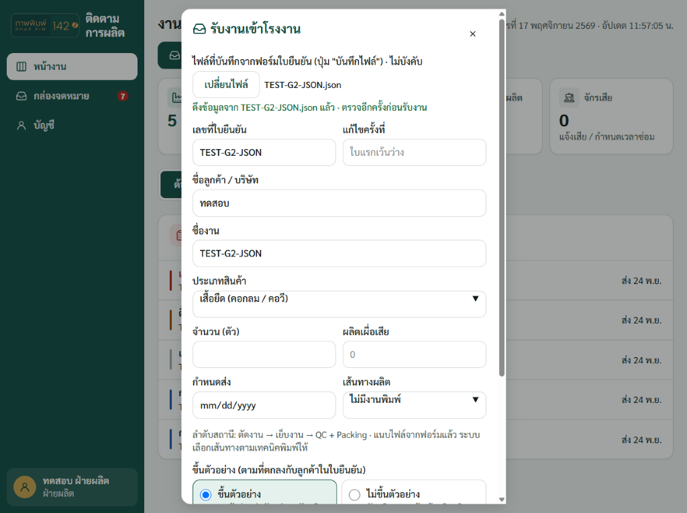
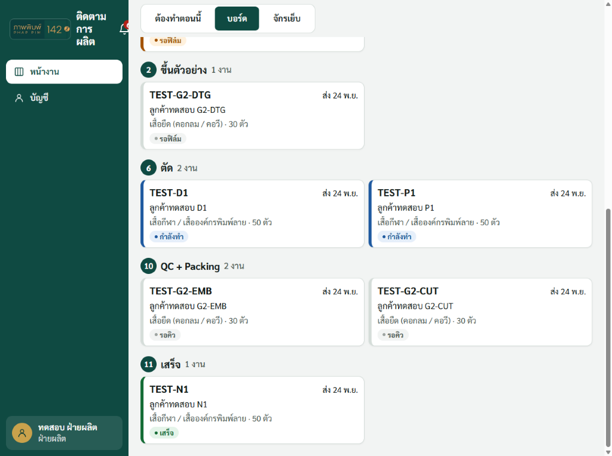

# รายงานทดสอบระบบจริง (G1) — รอบ 2

> วันที่ทดสอบ: 17 พ.ย. 2569 · ทดสอบที่ `https://pp142.pages.dev/` (และ `production-confirmation.html` บนเครื่อง)
> บัญชีทดสอบที่ใช้: `production@pp142.test`, `admin@pp142.test`, `qc@pp142.test`, `manager@pp142.test` (ไม่ได้ใช้บัญชีเจ้าของระบบจริง · งานทดสอบขึ้นต้น `TEST-`)
> หมายเหตุ: ไม่ได้ตรวจหัวข้อ `"เวลาที่ใช้ต่อสถานี"` (รอ C6 ตามใบสั่งงาน)

---

## 1. ตารางสรุปผลการตรวจ

### ก. ตรวจซ้ำบั๊กรอบ 1 (`docs/qa/รอบ-1.md`)
| บั๊ก | รายการตรวจซ้ำ | ผล | หมายเหตุ |
|---|---|---|---|
| #1 เปิด PDF | กด `"เปิด PDF ใบยืนยัน"` แล้วมีลิงก์ `"ถ้าไฟล์ไม่เปิดขึ้นมา กดที่นี่"` · กดลิงก์แล้วเปิด PDF ได้ | ✅ ผ่าน | เปิดไฟล์ PDF ในแท็บใหม่ได้จริง (`TEST-N1`) |
| #2 ประวัติตัวอย่าง | รายละเอียด `TEST-N1` แสดงรอบ 1 ไม่ผ่าน + สิ่งที่ต้องแก้ · รอบ 2 ผ่าน | ✅ ผ่าน | แสดง `แก้ไขสีโลโก้ให้เข้มขึ้น` ในรอบ 1 และ `ผ่าน` ในรอบ 2 ([ภาพ](img/r2-sample-history.png)) |
| #3 ตัวเลขสรุปหลังรับงาน | รับงานใหม่แล้วตัวเลข `"งานในโรงงาน"` / `"วัตถุดิบรอฝ่ายผลิต"` ขึ้นทันทีโดยไม่รีเฟรช (ลอง 2 ครั้ง) | ✅ ผ่าน | ทดสอบรับ `TEST-G2-DTG` (`2→3`, `0→1`) และ `TEST-G2-EMB` (`3→4`, `1→2`) อัปเดตทันทีทั้ง 2 ครั้ง |
| #4 ชื่อขั้นย่อยถูกบีบ | สถานีตัด / QC ที่ `768` และ `1440 px` ชื่อขั้นอ่านได้เต็มบรรทัด ช่องกรอกตัวเลขลงบรรทัดใหม่ | ✅ ผ่าน | ตรวจทั้งสถานีตัดและ QC ที่ `768px` และ `1440px` ([ภาพตัด](img/r2-cut-substep-768.png) · [ภาพ QC](img/r2-qc-substep-768.png)) |
| #5 ออกจากระบบ | ออกจาก `#/system` แล้ว URL กลับ `#/` · ล็อกอินใหม่ไปหน้าหลักของบทบาท | ✅ ผ่าน | ออกจากระบบแล้ว URL กลับ `#/` · ล็อกอิน `admin@pp142.test` ไป `#/` ทันที |
| #6 QC รอบตัวอย่าง | ขั้นที่ไม่บังคับขึ้น `"ไม่บังคับในรอบนี้"` | ✅ ผ่าน | ตรวจใน `TEST-G2-DTG` รอบตัวอย่าง ([ภาพ](img/r2-sample-qc-optional.png)) |
| #7 ป้ายงานแก้ | ขึ้นบนการ์ด `"ต้องทำตอนนี้"` และคิวรอเย็บ | ✅ ผ่าน | แสดงป้ายสีแดง `"งานแก้ 5"` ทั้งใน `"ต้องทำตอนนี้"` และ `"จักรเย็บ"` ([ภาพต้องทำตอนนี้](img/r2-rework-badge-todo.png) · [ภาพจักรเย็บ](img/r2-rework-badge-sewing.png)) |
| #8 ข้อความ | ไม่มี `"ฝ่ายฝ่าย"` · `"เริ่ม QC + Packing แล้ว"` มีเว้นวรรค · ไม่มี `(S8)` / `.json` | ✅ ผ่าน | ตรวจทั่วหน้าหลัก รายละเอียดงาน ไทม์ไลน์ กล่องจดหมาย และบอร์ด ไม่พบข้อความตกค้าง |

### ข. เส้นทางใหม่และการเลือกขึ้นตัวอย่าง
| ข้อ | รายการตรวจ | ผล | หมายเหตุ |
|---|---|---|---|
| 1 | `TEST-G2-DTG` (DTG · ขึ้นตัวอย่าง): `"บันทึกสั่งงาน DTG"` → วัตถุดิบครบ → ขึ้นตัวอย่าง · บล็อกรีดฟิล์มก่อนรับของ · `"ได้รับงาน DTG แล้ว"` แล้วเริ่มได้ | ✅ ผ่าน | ปุ่มรีดฟิล์มถูกบล็อก `"เริ่มไม่ได้ · ยังไม่ได้รับงาน DTG"` จนกว่าแอดมินกดรับ |
| 2 | `TEST-G2-EMB` (ปัก · ไม่ขึ้นตัวอย่าง): วัตถุดิบครบ → เข้าผลิตจริงทันที · ตัด → ส่งปัก (บล็อกก่อนกรอกรับกลับ) → กรอกส่ง/รับกลับ/ตรวจ → เย็บ | ✅ ผ่าน | เข้า `ตัดงาน` ทันที ไม่มีขั้นตัวอย่าง · ส่งปักบล็อกจนกว่าจะกรอกส่ง/รับกลับ/ติ๊กตรวจ |
| 3 | `TEST-G2-CUT` (ตัดงานลูกค้า · ไม่ขึ้นตัวอย่าง): ตัด → QC + Packing → เสร็จ (ไม่ผ่านเย็บ) | ✅ ผ่าน | เดินครบถึง `เสร็จ / พร้อมส่ง` โดยข้ามสถานีเย็บ |
| 4 | `TEST-G2-SCR` (ซิลค์สกรีน): ไม่เลือกขึ้นตัวอย่าง → ปุ่มรับงานบอกว่ายังขาด · ตั้งนัดรับเมื่อวาน → กล่องจดหมายมี `"งานสกรีน เลยกำหนด"` | ✅ ผ่าน | ปุ่มขึ้น `"ยังขาด: ขึ้นตัวอย่างหรือไม่"` ([ภาพ](img/r2-intake-missing-sample.png)) · แจ้งเตือน `"งานสกรีน เลยกำหนด TEST-G2-SCR"` ขึ้นในกล่องจดหมายภายใน ~5 นาที |
| 5 | ฟอร์มใบยืนยัน (`production-confirmation.html`) + นำเข้าไฟล์ `.json` ตอนรับงาน | 🟡 ผ่านบางส่วน | ในฟอร์ม `production-confirmation.html` ช่องขึ้นตัวอย่างบังคับและเส้นทางเปลี่ยนตาม DTG / ปัก / ปัก+ซับ ถูกต้อง **แต่เมื่อนำไฟล์ `.json` ที่ส่งออกมามาแนบในหน้ารับงาน เส้นทางผลิตกลายเป็น `"ไม่มีงานพิมพ์"` และช่องจำนวนว่างเปล่า** (บั๊ก #1) |

### ค. กล่องจดหมาย
| รายการตรวจ | ผล | หมายเหตุ |
|---|---|---|
| กระดิ่งขึ้นตัวเลขยังไม่อ่าน (`375px` แถบบน · `1440px` เมนูซ้าย) | 🟡 ผ่านบางส่วน | `375px` แสดงถูกต้อง · `1440px` ใน `admin`/`qc`/`manager` และหลังรีเฟรช `production` แสดงในเมนูซ้ายถูกต้อง แต่พบปัญหาไอคอนกระดิ่งหัว sidebar ถูกตัดขอบขวาใน `production` ก่อนรีโหลด (บั๊ก #2) |
| พักงาน / QC ส่งกลับแก้ / ตัวอย่างไม่ผ่าน → ข้อความขึ้นในไม่กี่วินาทีโดยไม่รีเฟรช | ✅ ผ่าน | พักงาน (`TEST-G2-DTG`) ขึ้นในกล่องจดหมายภายใน 3 วินาที · QC ส่งกลับแก้ (`TEST-G2-EMB`) ตัวเลขขึ้นทันที |
| ผู้รับถูกต้อง (`qc` เห็น `"งานส่งแก้"` ไม่เห็น `"จักรเสีย"` · `manager` เห็น `"งานติดปัญหา"`) | ✅ ผ่าน | ตรวจแล้วตรงตามบทบาท |
| กดข้อความ → เปิดรายละเอียดงานทันที · `"อ่านแล้วทั้งหมด"` ใช้ได้ · บัญชีอื่นยังเห็นว่ายังไม่อ่าน | ✅ ผ่าน | กดแล้วเปิดงานทันที · กด `"อ่านแล้วทั้งหมด"` บน `admin` เหลือ 0 ขณะที่ `production` ยังค้าง 5 |

### ง. รายละเอียดงาน (S8)
| รายการตรวจ | ผล | หมายเหตุ |
|---|---|---|
| ไทม์ไลน์มีชื่อคนกด + เวลาไทย ตรงกับที่กดจริง | ✅ ผ่าน | แสดงชื่อจริงของบัญชีทดสอบและเวลาไทยครบทุกการกด |
| `"แจ้งว่ากดผิด"` มีเฉพาะฝ่ายผลิต · ต้องกรอกเหตุผล · รายการเดิมขีดฆ่าพร้อมเหตุผลไม่หายไป · `admin`/`qc`/`manager` ไม่มีปุ่มนี้ | ✅ ผ่าน | ทดสอบบน `TEST-G2-CUT` รายการเดิมถูกขีดฆ่าพร้อมเหตุผลสีส้ม · บทบาทอื่นปุ่ม = 0 |
| ลิงก์ `#/board?job=<id>` เปิดแผงงานเองทันที · ปิดแผงแล้วรีเฟรชไม่เปิดซ้ำ | ✅ ผ่าน | ทดสอบกับ `TEST-G2-SCR` เปิดแผงอัตโนมัติ · ปิดแล้ว `?job=` หาย รีเฟรชไม่เปิดซ้ำ |
| เวลาที่ใช้ต่อสถานี | ⬜ ยังไม่ได้ตรวจ | ข้ามตามใบสั่งงาน (รอ C6) |

### จ. ค้างจากรอบ 1
| รายการตรวจ | ผล | หมายเหตุ |
|---|---|---|
| 2 บัญชีต่างกันพร้อมกัน (หน้าต่างปกติ + ไม่ระบุตัวตน) | ⬜ ยังไม่ได้ทำ | ข้อจำกัดของเครื่องมือเบราว์เซอร์ทดสอบ (เปิดได้ 1 context จึงทดสอบ 2 แท็บต่างบัญชีพร้อมกันไม่ได้) |
| ปิดเน็ต → แถบแดง `"ขาดการเชื่อมต่อ"` → เปิดคืน → หายเอง | ⬜ ยังไม่ได้ทำ | ข้อจำกัดของเครื่องมือเบราว์เซอร์ทดสอบ (`webview_browser` ไม่มีคำสั่งจำลอง offline) |
| การ์ดส้ม → แดง | ⬜ ข้าม | ข้ามตามใบสั่งงาน (ต้องใช้บัญชีเจ้าของระบบแก้เวลามาตรฐาน) |

---

## 2. รายการบั๊กที่พบในรอบ 2

### บั๊ก #1: แนบไฟล์ `.json` จาก `production-confirmation.html` ตอนรับงานแล้วเส้นทางเป็น `"ไม่มีงานพิมพ์"` และจำนวนไม่เข้า
- **ระดับ:** 1 (ข้อมูลผิดเมื่อรับงานจากใบยืนยัน `.json` — เสี่ยงรับงานผิดเส้นทางในวันทดลองจริง)
- **บทบาท:** `production@pp142.test`
- **ขนาดจอ:** `1219x909` (Desktop)
- **ขั้นตอนทำซ้ำ:**
  1. เปิด `production-confirmation.html` เลือกสินค้า `เสื้อยืด`, กรอกจำนวน `M = 20`, เลือก `งานปัก` + `ซับลิเมชั่น พิมพ์ทั้งตัว (All-over)` (หน้าฟอร์มแสดงเส้นทาง `พิมพ์ + ปัก`), เลือก `ขึ้นตัวอย่าง (ลูกค้าจ่ายค่าตัวอย่าง)` แล้วกด `บันทึกไฟล์` (`.json`)
  2. ล็อกอิน `production@pp142.test` ที่ `https://pp142.pages.dev/#/board` → กด `รับงานใหม่` → แนบไฟล์ `.json` ที่ได้
- **ผลที่ได้:**
  - `เลขที่ใบยืนยัน`, `ชื่อลูกค้า`, `ชื่องาน`, `ประเภทสินค้า` (`เสื้อยืด`), และ `ขึ้นตัวอย่าง` ถูกดึงมาถูกต้อง
  - **แต่ `เส้นทางผลิต` ถูกตั้งเป็น `"ไม่มีงานพิมพ์"` (`plain`: ตัดงาน → เย็บงาน → QC + Packing)** แทนที่จะเป็น `"พิมพ์ + ปัก"`
  - **และช่อง `จำนวน (ตัว)` ว่างเปล่า** (ไม่ดึง `20` มาใส่)
- **ผลที่ควรเป็น:** ดึงเส้นทางผลิตเป็น `"พิมพ์ + ปัก"` และจำนวน `20` ตัวมาใส่ให้อัตโนมัติตรงกับข้อมูลในไฟล์ `.json`
- **ภาพหน้าจอ:** 

---

### บั๊ก #2: ไอคอนกระดิ่งและตัวเลขแจ้งเตือนที่หัว sidebar ฝั่งเดสก์ท็อป (`1440px`) ถูกตัดขอบขวา
- **ระดับ:** 3 (ความสวยงามบนหน้าจอ)
- **บทบาท:** `production@pp142.test`
- **ขนาดจอ:** `1440x900`
- **ขั้นตอนทำซ้ำ:**
  1. ล็อกอินด้วย `production@pp142.test` ที่ขนาดจอ `1440x900` (สังเกตพบก่อนรีโหลดหน้า เมื่อเมนูซ้ายยังไม่มีแถว `กล่องจดหมาย` แต่มีปุ่มกระดิ่งอยู่ที่หัว sidebar ข้างคำว่า `ติดตาม การผลิต`)
- **ผลที่ได้:** ปุ่มกระดิ่งและตัวเลขแจ้งเตือนสีแดง (`6`) ล้นขอบขวาของ sidebar ความกว้าง `256px` จนถูกตัดครึ่ง
- **ผลที่ควรเป็น:** ปุ่มกระดิ่งและตัวเลขต้องอยู่ภายในกรอบ sidebar โดยไม่ถูกตัดขอบ (หรือแสดงเมนู `กล่องจดหมาย` ในรายการนำทางด้านซ้ายอย่างสม่ำเสมอ)
- **ภาพหน้าจอ:** 
