# รีวิว UI/UX ทั้งระบบ (24 พ.ย. 2569)

ตรวจด้วยสกิล UI Design Review (UXKIN `ui-review`) บน**ระบบจำลองในเครื่องเท่านั้น** (`tools/qa-r14` · PGlite · build ชี้ `127.0.0.1:5214`) · ไม่แตะเว็บจริง / บัญชีจริง / ฐานข้อมูลจริง · ไม่แก้โค้ด
ข้อมูลตัวอย่าง: `tools/manual-shots/seed.mjs` (8 งาน หลายสถานี · 1 งานพักงานและเลยกำหนด) · ภาพทั้งหมดอยู่ที่ `docs/qa/img/ui-review/`

**ตรวจอะไร:** owner · manager · admin · production · supervisor · staff (สถานีตัด) · QC · ที่ 375 / 768 / 1440 px · เน้นจอหน้างาน (คิวพนักงาน, QC, บอร์ดฝ่ายผลิตบนมือถือ)
**เทียบกับ:** กฎหน้าเว็บใน `AGENTS.md` + หลัก UI ใน `docs/แผน-1-สัปดาห์.md` หัวข้อ 6 + กติกาภาษาพม่าใน `docs/ส่งต่องาน-Claude.md`
**ไม่นับเป็นปัญหา:** แถบ "ขาดการเชื่อมต่อ" และ error WebSocket (ระบบจำลองไม่มี Realtime) · หน้าล้นที่ 375 px จากชื่อลูกค้ายาว (อีก session แก้ `.truncate` แล้ว ยังไม่ commit)
**ยังไม่ได้ดู:** หน้าฟอร์มรับงานใหม่ / ใบยืนยัน · หน้าม็อคอัพ · รายงาน · ตั้งค่า · โหมดมืด (แอปไม่มี) · ใช้คีย์บอร์ดอย่างเดียว

## สิ่งที่ดีอยู่แล้ว
- ปุ่มทุกปุ่มที่วัดบนจอหน้างานสูง 48 px ขึ้นไป · ตัวอักษรหลัก 16–17 px · ไม่มีหน้าล้นด้านข้างที่ 375 px ในทุกหน้าที่ดู
- ปุ่มที่กดไม่ได้บอกเหตุผลจริง ทั้งไทยและพม่า (QC "ยังกดเสร็จไม่ได้: QC ตรวจผ่าน 0/30…" · งานพัก "รอผู้บริหารหรือฝ่ายผลิตกด 'แก้แล้ว ทำต่อ'")
- มีหน้ากำลังโหลด และหน้าโหลดไม่สำเร็จพร้อมปุ่มลองอีกครั้ง (ทดสอบด้วยการจำลองเซิร์ฟเวอร์ช้า/ล่มจริง)
- สีตัวเลขสรุปถูกความหมาย (แดง = เลยกำหนด/ติดปัญหา · ฟ้า = กำลังทำ) · แถบซ้ายของการ์ดใช้สีเดียวกัน

---

## ต้องแก้ (ขวางงานหลักหน้างาน)

### 1. ปุ่ม "เสร็จ" / "บันทึกผ่าน" อยู่ใต้จอบนมือถือ — ต้องเลื่อนทุกครั้ง
**จอ:** ลิ้นชักรายละเอียดงาน · staff / QC / production · 375 px
**เห็นอะไร:** เปิดงานแล้วครึ่งจอบนเป็นกรอบรูปม็อคอัพว่าง ๆ (~350 px) + ข้อความ "ยังไม่มี PDF ใบยืนยัน…" · ปุ่มหลักเริ่มที่ y ≈ 800 (staff "ตัดงานเสร็จ"), 762 (production "พิมพ์งานเสร็จ"), 870 (QC "บันทึกผ่าน") บนจอสูง 812 px = มองไม่เห็นปุ่มเลยตอนเปิด
**ทำไมสำคัญ:** เป็นสิ่งเดียวที่พนักงานต้องทำบนจอนี้ ("1 การ์ด = 1 สิ่งที่ต้องทำต่อ") · ทุกงานต้องเลื่อน · งานที่ยังไม่มีม็อคอัพ (ส่วนใหญ่ช่วงนี้) ยิ่งเปลืองที่
**วิธีแก้:** `app/src/pages/Dashboard.tsx` บรรทัด ~662–673 ย้าย `{actions}` ขึ้นไปก่อนกล่องม็อคอัพ · ถ้า**ไม่มี**รูป ใช้ `MockupThumb size="sm"` แถวเดียวกับข้อความ "ยังไม่มีรูปม็อคอัพ" แทน `size="lg"` · ถ้ามีรูป คงรูปใหญ่ไว้ใต้ปุ่ม
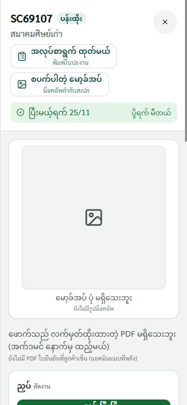 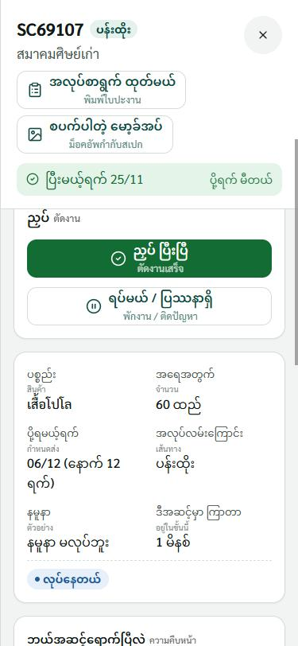 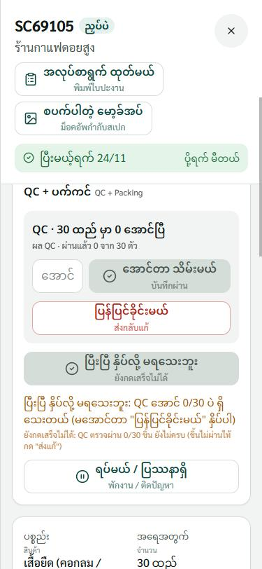 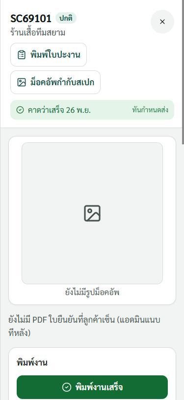

### 2. หน้าแรกพนักงาน / QC: รายการงานอยู่ใต้จอ ทั้งมือถือและแท็บเล็ต
**จอ:** `#/board` staff (สถานีตัด) และ QC · 375 และ 768 px
**เห็นอะไร:** ก่อนถึงการ์ดงานใบแรกต้องผ่าน ตัวเลขสรุป 4 ช่อง (ช่องละ 127–143 px) → ปุ่มสลับ บอร์ด/ต้องทำตอนนี้ → แถบเลือกสถานี → กล่องค้นหา+ตัวกรอง · มือถือ: การ์ดแรกที่ y ≈ 1,000 (ต้องเลื่อนเกินหนึ่งจอ) · แท็บเล็ต 768×1024: การ์ดแรกที่ y ≈ 935 เห็นแค่ขอบบน
**ทำไมสำคัญ:** พนักงานที่มีสถานีเดียว แถบเลือกสถานี ("ทุกสถานี 2" / "3 ตัด 2") ซ้ำกันทั้งคู่ · มีงานไม่กี่ใบ ไม่จำเป็นต้องค้นหา · สิ่งที่ต้องเห็นก่อนคือ "งานถัดไป"
**วิธีแก้:** (ไม่สร้างส่วนประกอบใหม่)
- ซ่อนแถบเลือกสถานีเมื่อผู้ใช้มีสถานีเดียว · ซ่อนกล่องค้นหาเมื่องานในจอ ≤ 5 ใบ (หรือย่อเป็น `
` ปิดไว้)
- บนจอเล็ก ให้ `StatTile` ของ staff/QC ไม่แสดงบรรทัดรอง (`noteOnPhone` = false มีอยู่แล้ว) และใช้ 4 ช่องแถวเดียวแบบย่อ หรือแสดงแค่ 2 ช่องที่ต้องรู้ (กำลังทำ · เลยกำหนด/ติดปัญหา)
- พิจารณาให้แท็บ "ต้องทำตอนนี้" เป็นค่าเริ่มต้นของ staff (เหมือน supervisor)
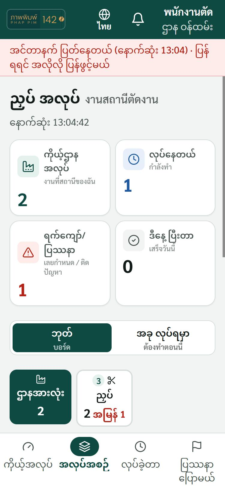 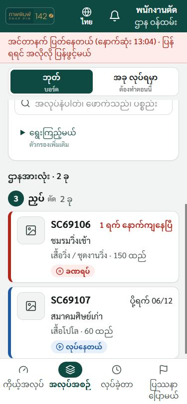 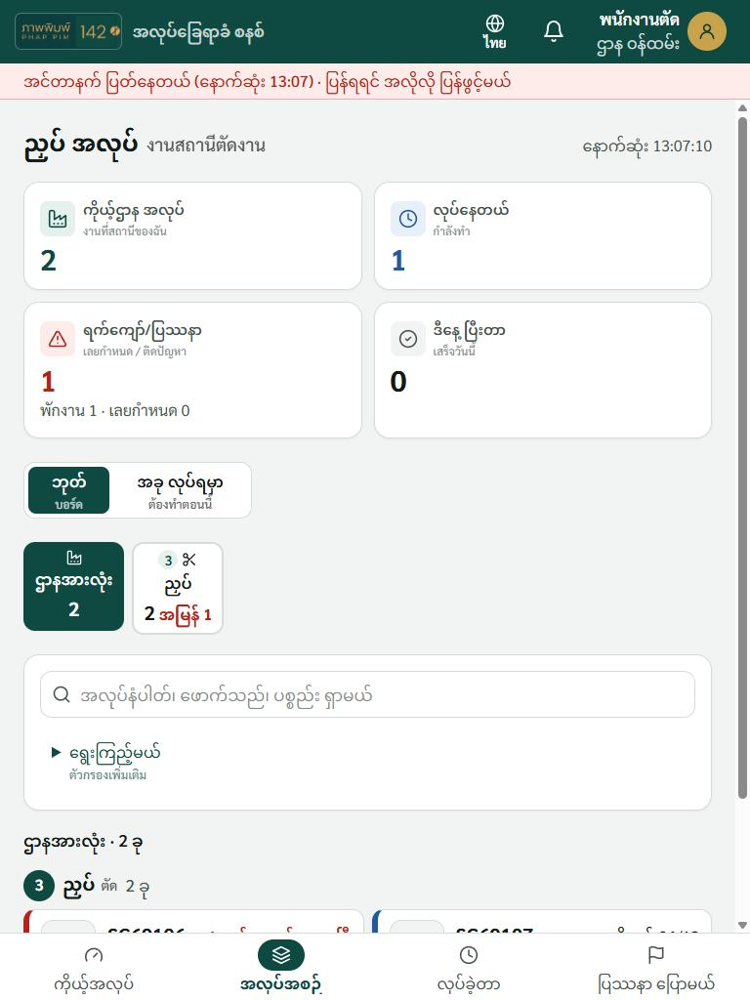 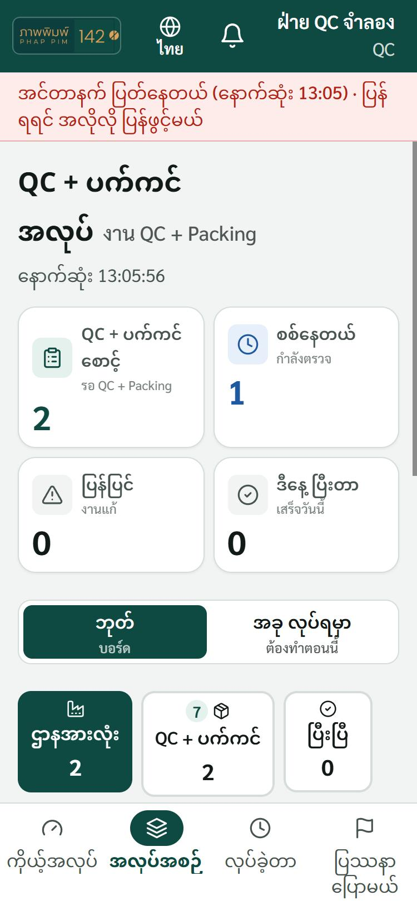

### 3. ตัวเลข "เลยกำหนด" ขัดกันเองระหว่างหน้า (และไม่แปลพม่า)
**จอ:** ช่อง "เลยกำหนด / ติดปัญหา" บนบอร์ด staff / production · 768 / 1440 px
**เห็นอะไร:** SC69106 เลยกำหนดส่ง 1 วันและพักงานอยู่ · บอร์ดเขียนบรรทัดรอง **"พักงาน 1 · เลยกำหนด 0"** · แต่หน้าภาพรวมของ owner/manager/admin เขียน "ตัด: ติดปัญหา 1 · **เลยกำหนด 1**" และการ์ดเดียวกันเขียน "ล่าช้า 1 วัน"
**สาเหตุ:** `app/src/proto/summary.ts:33` นับงานพักก่อน แล้วเอา "เลยกำหนด = ทั้งหมด − พัก" → งานที่ทั้งพักและเลยกำหนดถูกนับเป็นพักอย่างเดียว · ข้อความเป็น template string ธรรมดา ไม่ผ่าน `w()`/`t()` → โหมดพม่าเห็นไทยล้วน (ภาพ 10)
**ทำไมสำคัญ:** หัวหน้าเห็น "เลยกำหนด 0" แล้วเข้าใจว่าไม่มีงานช้า
**วิธีแก้:** นับสองค่าแยกกัน (`hold` และ `isOverdue`) ให้ทับกันได้ เช่น "พักงาน 1 · เลยกำหนด 1" · คืนค่าเป็น `Word` (`i18n/word.ts`) ให้แปลได้ · เพิ่มทดสอบกรณีงานพัก+เลยกำหนด
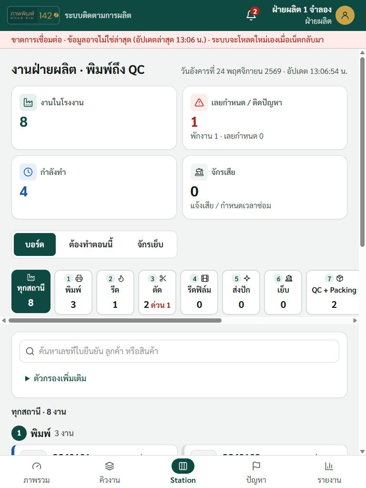 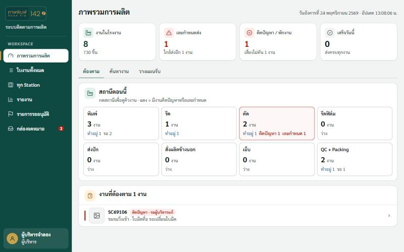

---

## ควรแก้ (ผิดกฎคำศัพท์/ภาษา · ดูไม่เสร็จ)

### 4. ภาษาอังกฤษในเมนู: WORKSPACE · Station · Roles & Permissions · Station Assignment · Audit Log
**จอ:** เมนูซ้าย (1440) และแถบล่าง (375/768) · ทุกบทบาท · แถบล่างของ production / supervisor / admin เขียน **"Station"**
**กฎ:** ข้อความบนจอเป็นไทยทั้งหมด · คำศัพท์ = "สถานี" (`แผน-1-สัปดาห์` หัวข้อ 6) · ในหน้าเดียวกันก็ใช้ "ทุกสถานี" อยู่แล้ว
**วิธีแก้:** `app/src/auth/menus.ts` — `WORKSPACE` → "เมนู" (หรือเอาหัวข้อออกเมื่อมีกลุ่มเดียว) · `Station` → "สถานี" · "ทุก Station" → "ทุกสถานี" · "ติดตาม Station" → "ติดตามสถานี" · "Station ที่ดูแล" → "สถานีที่ดูแล" · "คิวงาน Station" → "คิวงานสถานี" · "Roles & Permissions" → "บทบาทและสิทธิ์" · "Station Assignment" → "จับคู่สถานี" · "Audit Log" → "บันทึกการเปลี่ยนแปลง" (รวมลิงก์ "ดู Audit Log" ในหน้าภาพรวมระบบ) · ใน `app/src` ยังมีคำว่า "Station" อีก ~37 ไฟล์ ควรไล่ด้วย
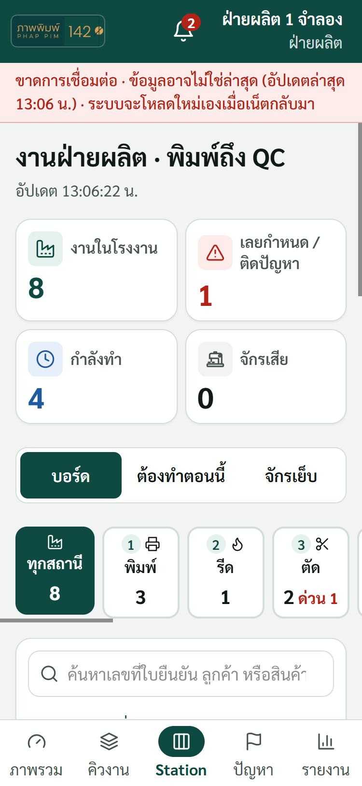 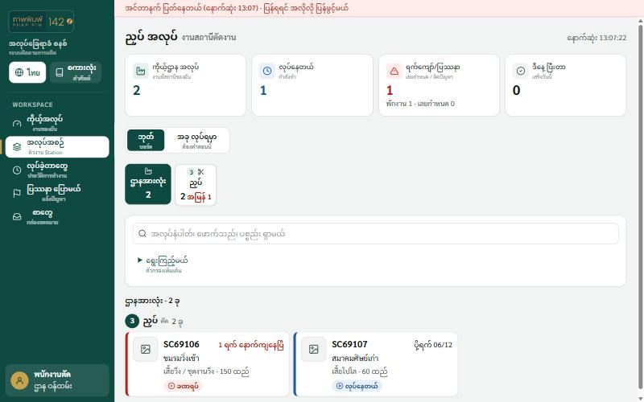 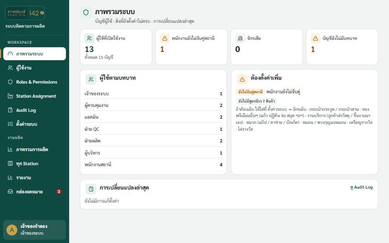

### 5. จอพม่ายังมีจุดที่ไม่มีไทยใต้ หรือเป็นไทยล้วน
**จอ:** staff / QC โหมดพม่า · 375 / 768 px
| จุด | เห็นอะไร | กฎ | แก้ |
|---|---|---|---|
| แถบเมนูล่าง (มือถือ) | พม่าอย่างเดียว ("ကိုယ့်အလုပ်", "အလုပ်အစဉ်"…) | แท็บ = `<Tr>` สองบรรทัด | ใช้ `<Tr>` ไทยตัวเล็กใต้ (เมนูข้างบนจอ 1440 มีไทยใต้แล้ว) |
| หน้าเข้าใช้งานไม่ได้ (`App.tsx:71, 77`) | ข้อความแดงและปุ่ม "ตรวจสอบอีกครั้ง" เป็นไทยล้วน แต่หัวข้อเป็นพม่า | ปุ่ม/ข้อความแจ้งผล = สองบรรทัด | `<Tr th=…>` + เพิ่มใน `my.ts` |
| หน้าแจ้งปัญหา หัวข้อ "ปัญหาที่แจ้งไว้ (1)" | ไทยล้วน | หัวข้อ = `<Tr inline>` | ห่อ `<Tr inline>` + คำแปล |
| บรรทัดรองช่องเลยกำหนด | "พักงาน 1 · เลยกำหนด 0" ไทยล้วน | — | ดูข้อ 3 |
 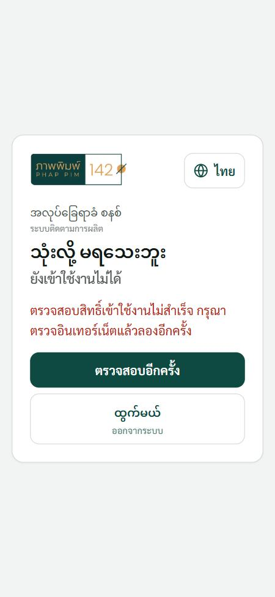 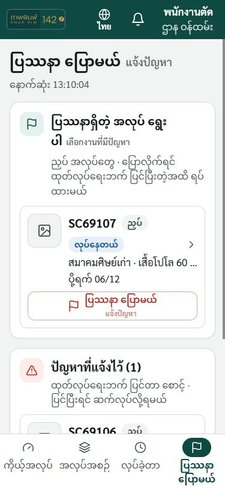

### 6. พนักงานที่ยังไม่ได้จับคู่สถานี เห็นตัวเลข 0 ทั้งจอ + "ไม่พบงานตามที่เลือก"
**จอ:** `staff_empty` · `#/board` · 375 px
**เห็นอะไร:** หัวข้อบอกว่า "ยังไม่ได้จับคู่สถานี" แต่ใต้ลงมาเป็นตัวเลขสรุป 0 สี่ช่อง แถบสถานี ช่องค้นหา และท้ายสุด "ไม่พบงานตามที่เลือก" (ฟังเหมือนตั้งตัวกรองผิด)
**วิธีแก้:** เมื่อไม่มีสถานี แสดง `Card` เดียว: "ยังไม่ได้จับคู่สถานี · บอกหัวหน้าหรือเจ้าของให้จับคู่ที่หน้า 'จับคู่สถานี'" (สองภาษา) และซ่อนตัวเลข/ค้นหา
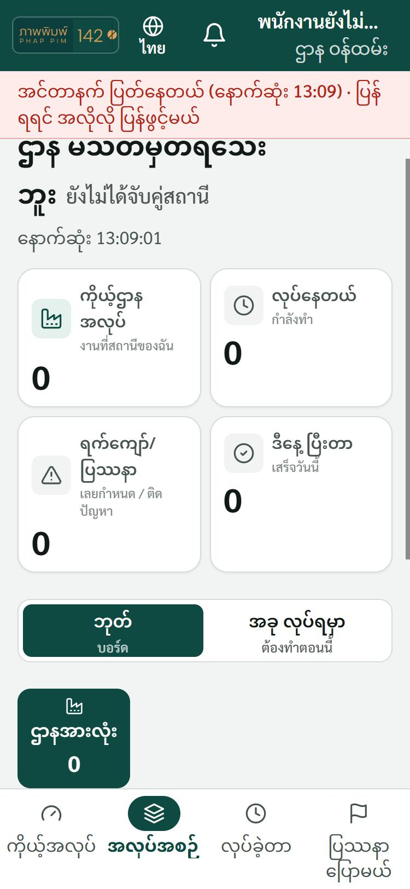

### 7. supervisor: เมนู "คิวงาน" กับ "Station" เปิดเนื้อหาเดียวกัน
**จอ:** supervisor เฟส 1 · 375 px
**เห็นอะไร:** `#/queue` และ `#/board` แสดงหน้าเดียวกัน (แท็บ "ต้องทำตอนนี้") · เปิดแอป (`#/`) แล้วถูกส่งไป `#/board` เมนูที่ไฮไลต์จึงเป็น "Station" ไม่ใช่ "ภาพรวม"
**วิธีแก้:** `#/board` ของ supervisor เปิดแท็บ "บอร์ด" เป็นค่าเริ่มต้น (ให้ต่างจาก "คิวงาน") หรือรวมเหลือเมนูเดียว · ให้ `#/` ของ supervisor ไป `#/dept` (ภาพรวมแผนก) ตามชื่อเมนูแรก
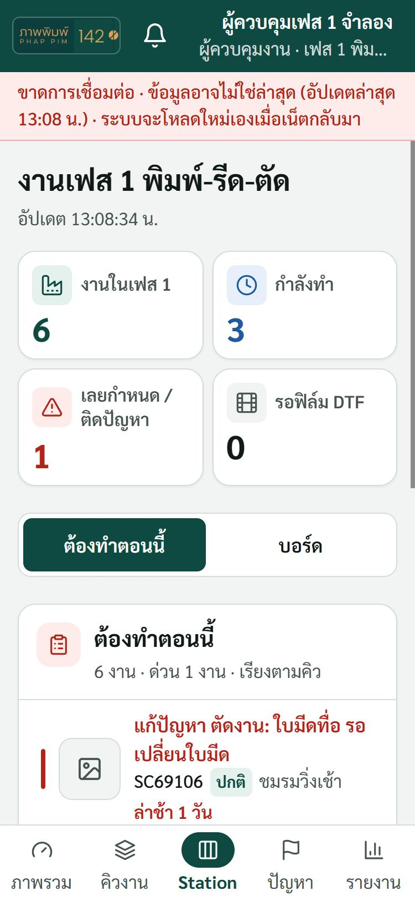 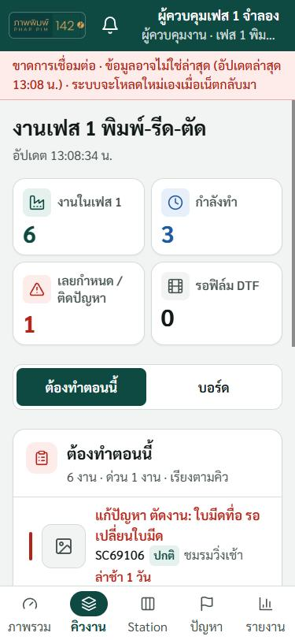

### 8. คำเรียก "ช้า" ไม่เป็นคำเดียว + "แจ้งปัญหา" vs "รายงานปัญหา"
**เห็นอะไร:** งานเดียวกันถูกเรียก "เลยกำหนด" (ตัวเลขสรุป) · "ล่าช้า 1 วัน" (ต้องทำตอนนี้) · "ด่วน 1" (แถบสถานี) · "เลยกำหนดส่ง" (ภาพรวม) · เมนูใช้ "แจ้งปัญหา" แต่คำศัพท์ในแผนคือ "รายงานปัญหา" (ในโค้ดใช้ทั้งสองคำ 7 / 15 ไฟล์)
**วิธีแก้:** เลือก "เลยกำหนด" สำหรับงานที่เกินวันส่ง (ใช้ "ด่วน" เฉพาะความหมาย "ใกล้ครบ" ถ้าต้องการ) · เลือก "รายงานปัญหา" หรือแก้คำในแผนให้เป็น "แจ้งปัญหา" (เจ้าของตัดสิน) แล้วไล่ให้ตรงกันทั้งระบบ + `my.ts`
 

### 9. ช่องกรอกจำนวน QC ผ่าน แคบจนอ่านไม่ออก ไม่มีป้ายชื่อ
**จอ:** ลิ้นชักงาน · QC · 375 px
**เห็นอะไร:** ช่องกว้าง 73 px · placeholder "အောင်တဲ့ အရေအတွက်" ถูกตัดเหลือ "အောင်" · ไม่มีป้ายชื่อที่มองเห็น (มีแค่ aria-label) · ไม่บอกว่าเต็มกี่ตัว (ต้องไปอ่านบรรทัดบน) · ไม่มีไทย
**วิธีแก้:** ให้ช่องกรอกเต็มแถวบนมือถือ (ปุ่ม "บันทึกผ่าน" ลงบรรทัดถัดไป) · ป้าย `<Tr th="จำนวนที่ผ่าน" />` เหนือช่อง · ต่อท้ายช่องด้วย "/ 30 ตัว"

---

## ดีถ้าแก้ (เก็บงาน)

10. **ป้ายเส้นทาง "ปกติ" / "ปัก" เป็นเขียวอ่อน** (`RouteBadge` ใช้ tone `brand`) — ข้าง ๆ แถบเขียว "ทันกำหนดส่ง" ทำให้ดูเหมือน "เสร็จ/ทัน" · แก้: ใช้ tone `neutral` สำหรับทุกเส้นทางที่ไม่ใช่ DTF (ภาพ 08, 03)
11. **"รอคิว" เป็นสีเทา** ขณะที่กฎเขียนว่า "ส้ม = รอ" — ผมเห็นว่าเทาถูกแล้ว (งานรอคิวเป็นเรื่องปกติ ถ้าส้มทั้งจอจะไม่มีความหมาย) **ข้อเสนอ:** แก้ถ้อยคำกฎเป็น "ส้ม = ใกล้ครบ / รอของจากข้างนอก (ฟิล์ม ตัวอย่าง วัตถุดิบ)" · เจ้าของตัดสิน (ภาพ 07)
12. **แถบสถานีที่ 768 px เลื่อนข้าง** — 4 ช่องท้าย (ขึ้นตัวอย่าง · รอผลตัวอย่าง · สั่งผลิตข้างนอก · เสร็จ) ตกขอบขวา เห็นแค่แถบเลื่อนบาง ๆ · แก้: ให้ขึ้นบรรทัดใหม่ (`flex-wrap`) ตั้งแต่ `md` (ภาพ 09)
13. **admin `#/jobs`:** ปุ่มเลขงานด่วน (SC69106…) สูง 32 px (ต่ำกว่า 44) · หัวหน้าเขียน "ภาพรวมการผลิต" แต่เมนูที่กดคือ "ใบงาน / จัดการใบงาน" · แก้: `min-h-11` และตั้งหัวข้อตามเมนู (ภาพ 16)
14. **owner "ต้องตั้งค่าเพิ่ม"** เป็นย่อหน้ายาวต่อกันด้วย "→ · /" อ่านยาก · แก้: ทำเป็นรายการทีละบรรทัด มีลิงก์ไปหน้าตั้งค่าที่เกี่ยวข้อง (ภาพ 12)
15. **ต้องตรวจต่อ (ยังไม่ได้เห็นจริง):** หน้าโหลดงานไม่สำเร็จแสดงข้อความจากเซิร์ฟเวอร์ตรง ๆ (ภาพ 22 เป็นข้อความจำลองภาษาไทย) — ถ้าเน็ตหลุดจริง เบราว์เซอร์จะคืน "Failed to fetch" ภาษาอังกฤษ ควรลองตัดเน็ตในเครื่องแล้วดูว่าขึ้นอะไร

---

## ภาพประกอบอื่น
- หน้ากำลังโหลด: `img/ui-review/20-staff-loading-375.jpg` · โหลดไม่สำเร็จ: `21-staff-error-375.jpg`, `22-staff-load-error-375.jpg`
- staff "ต้องทำตอนนี้": `24-staff-todo-375.jpg` · owner ภาพรวมการผลิต: `13-owner-production-1440.jpg` · admin 1440: `15-admin-overview-1440.jpg`

## ลำดับที่แนะนำ
ข้อ 1–3 ก่อน (กระทบทุกงานทุกวันบนหน้างาน) · ข้อ 4–5 แก้รวดเดียวได้ (ไฟล์ `menus.ts` + `my.ts`) · ข้อ 11 และ 8 ต้องให้เจ้าของเลือกคำ/กฎก่อน

---

## สถานะการแก้ (24 พ.ย. · ยังไม่ commit)
ตรวจซ้ำบนระบบจำลองในเครื่องที่ 375 / 768 / 1440 px (20 หน้า × 3 ขนาด ไม่มีหน้าล้นด้านข้าง ไม่มีคำเก่าค้าง · ลองบันทึก QC ผ่าน 30 ตัวจริงในเครื่องแล้ว) · ทดสอบฐานข้อมูล 106 ผ่าน · ภาพหลังแก้อยู่ที่ `docs/qa/img/ui-review/after/` · `npm run build` `npm run lint` `npm test` (vitest 535 + node 148 ทดสอบ) ผ่าน · ไม่แตะ SQL

| ข้อ | สถานะ | แก้อย่างไร |
|---|---|---|
| 1 | แก้แล้ว | ลิ้นชักงาน: ปุ่มของสถานีขึ้นก่อนม็อคอัพ · ไม่มีรูป = แถวเล็ก · ข้อความ "ยังไม่มี PDF" ย้ายไปท้าย (คนหน้างาน) · ปุ่ม "ตัดงานเสร็จ" จาก y≈800 → 337 (`after/02`) |
| 2 | ดีขึ้นบางส่วน | พนักงาน/QC ที่มีสถานีเดียวเปิดมาเจอคิวสถานีตัวเองเลย (`startStation` + ทดสอบ) · ตัวเลขสรุปของ staff/QC วางตัวเลขข้างชื่อ · **แต่บนมือถือ 375 px การ์ดงานใบแรกยังอยู่ที่ y≈775 (ขอบล่างจอ) และปุ่มเสร็จในคิวอยู่ y≈1265** เพราะหัวสถานี (ไอคอน ชื่อ ช่องเครื่อง ตัวเลข 4 ช่อง) สูงมาก · ถ้าจะแก้ต่อต้องย่อหัวสถานี (`StationHeader`) |
| 3 | แก้แล้ว | `summary.ts` นับพักงานและเลยกำหนดแยกกัน ("พักงาน 1 · เลยกำหนด 1") + แปลพม่าได้ + ทดสอบใหม่ (`after/06`) |
| 4 | แก้แล้ว | เมนูไทยทั้งหมด: เมนู · สถานี · ทุกสถานี · บทบาทและสิทธิ์ · จับคู่สถานี · บันทึกการเปลี่ยนแปลง (`after/05`, `after/07`) |
| 5 | แก้แล้ว | แถบเมนูล่างพม่า+ไทยสองบรรทัด (ปุ่มแจ้งปัญหาใช้ชื่อสั้น "ปัญหา") · หน้าเข้าใช้งานไม่ได้ · หัวข้อ "ปัญหาที่แจ้งไว้ (n)" |
| 6 | แก้แล้ว | พนักงานยังไม่จับคู่สถานีเห็นกล่องเดียวบอกให้ไปจับคู่ (`after/04`) |
| 7 | แก้แล้ว | `#/board` เปิดแท็บ "บอร์ด" เสมอ · เปิดแอป supervisor ไฮไลต์ "คิวงาน" · เพิ่ม `#/sewing` ให้ตัวเลขจักรของภาพรวมแผนก · หน้า `#/sewing` ไฮไลต์เมนู "คิวงาน" |
| 8 | แก้แล้ว | "ล่าช้า X วัน" → "เลยกำหนด X วัน" · "ด่วน n" บนแถบสถานี → ไอคอนเตือน + ตัวเลข · หัวรายการต้องทำ "เลยกำหนด / ติดปัญหา n งาน" · เจ้าของเลือก **"รายงานปัญหา"** → เปลี่ยนเมนู ปุ่ม หัวหน้า ข้อความแจ้งผล หน้าคำศัพท์ และคู่มือใน `docs/คู่มือ/` (คำพม่าเดิม ပြဿနာ ပြောမယ်) |
| 9 | แก้แล้ว | ช่อง QC มีป้าย "จำนวนที่ผ่าน" กว้างเต็มแถว + "/ 30 ตัว" (`after/03`) |
| 10 | แก้แล้ว | ป้ายเส้นทางเป็นสีเทา (DTF คงสีเดิม) |
| 11 | ไม่แก้ | รอเจ้าของตัดสินกฎสี "รอ" |
| 12 | แก้แล้ว | แถบสถานีขึ้นบรรทัดใหม่ตั้งแต่ 768 px (`after/06`) |
| 13 | แก้บางส่วน | ปุ่มเลขงานสูง 44 px · หัวหน้า `#/jobs` ยังเป็น "ภาพรวมการผลิต" (หน้าเดียวกันหลายแท็บ) |
| 14 | แก้แล้ว | "ต้องตั้งค่าเพิ่ม" เป็นรายการ + ลิงก์ไปตั้งค่า |
| 15 | ยังไม่ได้ตรวจ | ต้องลองตัดเน็ตจริง |
