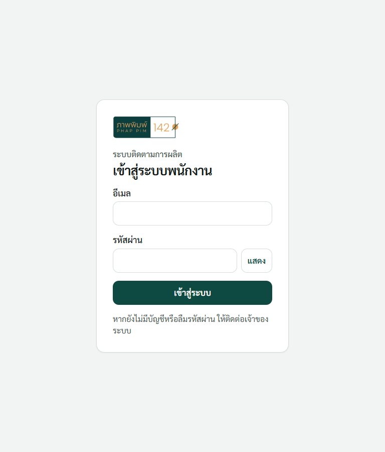
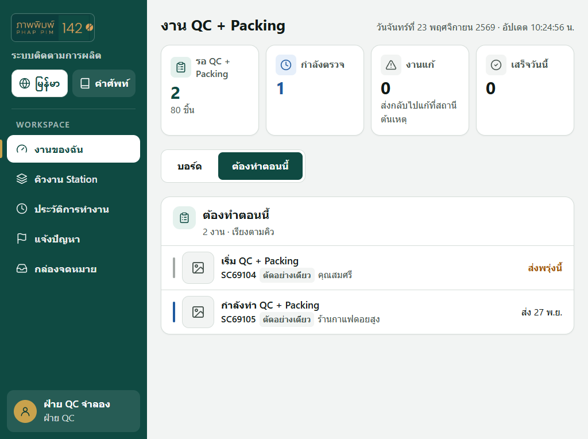

# คู่มือใช้งาน: ฝ่าย QC

> สำหรับทีม QC · เว็บ: `https://pp142.pages.dev`
> หน้าที่หลัก: ตรวจรับงานและบันทึกผล **QC + Packing** · ส่ง **งานแก้** กลับเย็บ

---

## 1. ล็อกอิน · กล่องจดหมาย · ออกจากระบบเมื่อส่งเครื่องต่อ

1. เปิดเว็บ `https://pp142.pages.dev` กรอกอีเมลและรหัสผ่าน แล้วกด **เข้าสู่ระบบ**

2. กดไอคอน **กระดิ่งมุมขวาบน** (หรือเมนู **กล่องจดหมาย** บนจอใหญ่) เพื่อเปิด **กล่องจดหมาย** ดูแจ้งเตือนงานที่รอฝ่าย QC

3. หน้า **บัญชี** (กดชื่อมุมขวาบน) แสดงชื่อ บทบาท และ **บัญชีนี้ทำอะไรได้** (ชื่อไม่ใช่คุณ = เพื่อนยังไม่ออกจากระบบ) · เปลี่ยนรหัสผ่านได้ที่หน้านี้ · เมื่อส่งเครื่องต่อหรือเลิกงาน กด **ออกจากระบบ** ทุกครั้ง

---

## เมนูของคุณ (ฝ่าย QC และพนักงานสถานี)

เมนูแต่ละบทบาทไม่เหมือนกัน · จอใหญ่อยู่แถบซ้าย · มือถืออยู่แถบล่าง (เกิน 5 เมนูกด **เพิ่มเติม**) · **บัญชี** อยู่ที่ชื่อ/รูปคนมุมขวาบน · **กล่องจดหมาย** ที่กระดิ่ง

| เมนู | ใช้ทำอะไร |
|---|---|
| **งานของฉัน** | สิ่งที่ต้องทำตอนนี้ (เดิมคือแท็บ **ต้องทำตอนนี้**) |
| **คิวงาน Station** | หน้าคิวสถานี (เดิมคือ **หน้างาน → บอร์ด**) · QC เห็นสถานี QC + Packing · พนักงานสถานีเห็นเฉพาะสถานีที่เจ้าของจับคู่ให้ |
| **ประวัติการทำงาน** | สิ่งที่คุณกดใน 7 วันล่าสุด แยกตามวัน · กดรายการเพื่อเปิดงาน |
| **แจ้งปัญหา** | เลือกงานที่สถานีของคุณ → พิมพ์ปัญหา → **แจ้งปัญหา** (งานพักรอฝ่ายผลิตแก้) · ด้านล่างเห็นปัญหาที่แจ้งไว้ว่ายังรอแก้อยู่ไหม |

---

## 2. หน้าหลักของฝ่าย QC

เมนู **คิวงาน Station** ของฝ่าย QC มี 2 แท็บ (เปิดแอปมาเจอ **บอร์ด** ก่อน · เมนู **งานของฉัน** = แท็บต้องทำตอนนี้):
- **ต้องทำตอนนี้**: งานที่รอตรวจ **QC + Packing** (ไม่มีขั้นติ๊กวัตถุดิบแล้ว) · การ์ด **ส้ม** = ใกล้ครบเวลามาตรฐาน · **แดง** = เกินเวลา ต้องส่งรายงานปัญหาก่อนกดเสร็จ
- **บอร์ด**: กดปุ่มสถานี **QC + Packing** ครั้งเดียว (เครื่องจำไว้) → เปิด **หน้าคิวสถานี** QC: **กำลังทำ** · **คิวรอเริ่ม** เรียงตามคิว (ไม่ใช่ตามกำหนดส่ง)

---

## 3. เดินสถานี QC + Packing

1. เมื่อฝ่ายผลิตเย็บเสร็จ งานจะ**ต่อท้ายคิว** **QC + Packing**
2. ที่หน้าคิวสถานี กดปุ่มใหญ่ **เริ่ม QC + Packing** บนการ์ด **คิว 1** (หรือเปิดรายละเอียดงานแล้วกดก็ได้) · เริ่มงานที่ไม่ใช่คิว 1 ต้องกด **เริ่มก่อนคิว** และใส่เหตุผล
   - งานที่เริ่มแล้วอยู่ส่วน **กำลังทำ** · กด **บันทึกผล QC / Packing** เพื่อเปิดรายละเอียดงานไปกรอกจำนวน · กด **พักงาน** บนการ์ดได้เลย (ในรายละเอียดงานสามารถเปิดดู **ใบยืนยัน** PDF, **รอบตัวอย่าง**, **เวลาที่ใช้ต่อสถานี**, และ **ไทม์ไลน์ทุกการกด** ได้)

3. กรอกจำนวนชิ้นที่ตรวจผ่าน (ไม่มีเช็คลิสต์ **ขั้นย่อย** ให้ติ๊กแล้ว):
   - ต้องบันทึกยอดผ่าน **ครบตามจำนวนสั่ง** จึงจะกดปุ่ม **QC + Packing เสร็จ** ได้
   - ถ้ามีชิ้นไม่ผ่าน ให้ใช้ปุ่ม **ส่งกลับแก้**
4. เมื่อผ่านครบตามจำนวน กด **QC + Packing เสร็จ** แล้วยืนยัน → งานจะเปลี่ยนเป็น **เสร็จ / พร้อมส่ง**

---

## 4. ส่งงานแก้กลับไปเย็บ (เมื่อตรวจไม่ผ่าน)

1. ในหน้า **QC + Packing** กดปุ่ม **ส่งกลับแก้**
2. กรอกจำนวนชิ้นที่ต้องแก้ (เช่น 5 ชิ้น), เลือก **สถานี** ปลายทาง (**เย็บงาน**), และพิมพ์สาเหตุที่ต้องแก้ให้ชัดเจน
3. กดยืนยัน **ส่งกลับแก้**
4. ระบบจะส่งงานกลับไปที่คิวเย็บพร้อมติดป้าย **งานแก้** (สีแดง) ให้ฝ่ายผลิตเห็นทันที
5. เมื่อฝ่ายผลิตเย็บแก้เสร็จและส่งกลับมาที่ QC อีกรอบ งานจะขึ้นป้าย **งานแก้** ให้ตรวจซ้ำจนผ่าน

---

## 5. พักงาน และรายงานปัญหา

- หากมีปัญหาทั่วไประหว่างทำหรือต้องหยุดตรวจกลางคัน กด **พักงาน / ติดปัญหา** ในรายละเอียดงาน **พิมพ์สาเหตุ** แล้วกดยืนยัน เพื่อไม่ให้นับเวลาพักรวมในเวลาทำงาน
- ฝ่าย QC **กดแก้แล้วเองไม่ได้** · เมื่อแก้ปัญหาแล้ว แจ้ง **ผู้บริหาร** หรือ **ฝ่ายผลิต** ให้กด **แก้แล้ว ทำต่อ** (การ์ดจะขึ้นว่า รอผู้บริหารหรือฝ่ายผลิตกด)
- ฟอร์ม **รายงานปัญหา** จะขึ้นเองในรายละเอียดงานเมื่อใกล้หรือเกินเวลามาตรฐานเท่านั้น (ไม่ใช่ปุ่มที่กดได้ทุกเวลา) · ถ้างานขึ้นแถบสีแดง (**เกินเวลามาตรฐาน**) ต้องกรอก **รายงานปัญหา** (และพิมพ์ช่อง **ต้องการความช่วยเหลือจากใคร (ถ้ามี)** หากต้องการความช่วยเหลือ) ก่อนจึงจะกดจบ **สถานี** ได้

---

## 6. รับงาน และเย็บ / จักร

- ฝ่าย QC ไม่สามารถกด **รับงาน** ใหม่ หรือกดปุ่มของ **สถานี** อื่น (พิมพ์, รีด, ตัด, รีดฟิล์ม, ส่งปัก, เย็บ) ได้

---

## 7. เน็ตหลุด · มีระบบรุ่นใหม่ ทำอย่างไร

- **เน็ตหลุด:** ถ้าเห็นแถบสีแดง **ขาดการเชื่อมต่อ** ด้านบน ให้งดกดปุ่มส่งผลหรือจบงานชั่วคราว รอ Wi-Fi กลับมา แถบแดงจะหายไปเอง แล้วตรวจดูสถานะงานอีกครั้งก่อนกดต่อ
- **มีระบบรุ่นใหม่:** ถ้าหน้าจอดูแปลกหรือไม่ตรงคู่มือ ให้ปัดรีเฟรชหรือปิดเปิดแอปใหม่ และถ้าเห็นแถบ **มีระบบรุ่นใหม่** ให้กดโหลดทันที
