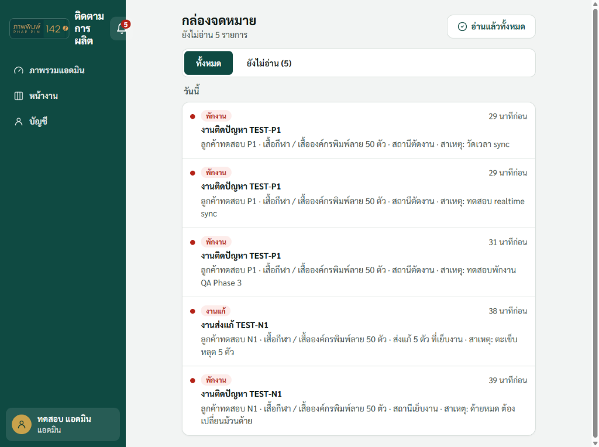
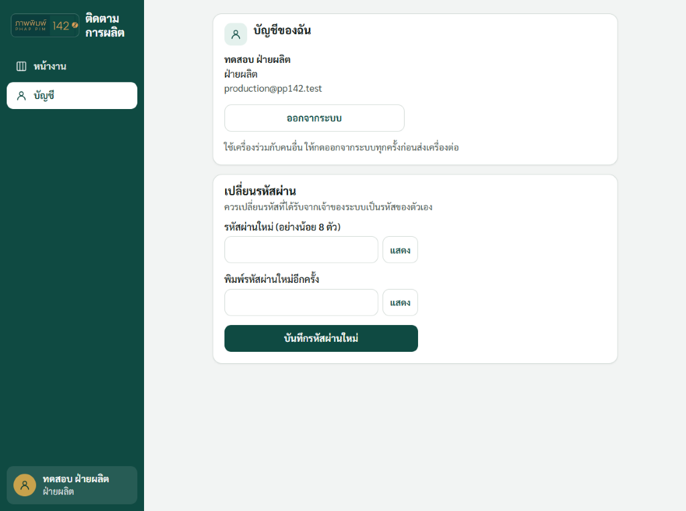
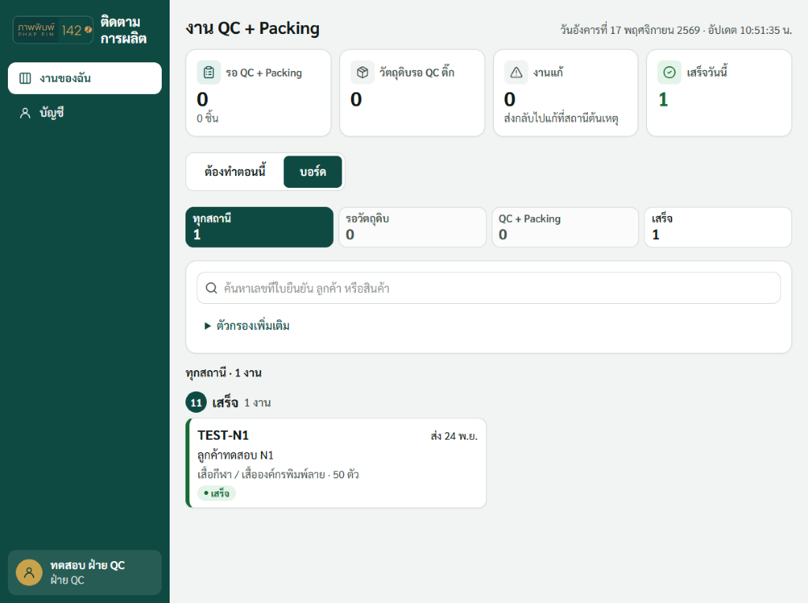
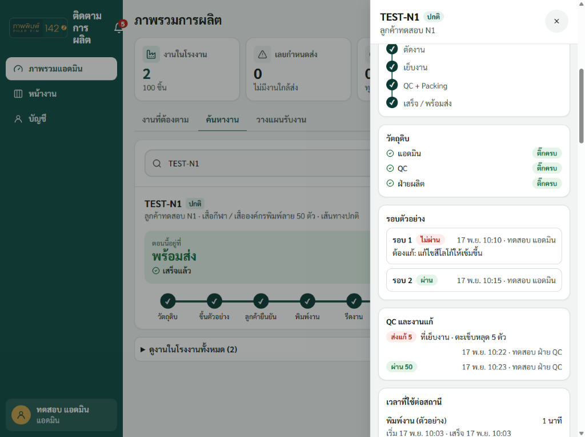

# คู่มือใช้งาน: ฝ่าย QC

> สำหรับทีม QC · เว็บ: `https://pp142.pages.dev`
> หน้าที่หลัก: ติ๊ก **วัตถุดิบ** ฝั่ง QC · ตรวจรับงานและบันทึกผล **QC + Packing** · ส่ง **งานแก้** กลับเย็บ

---

## 1. ล็อกอิน · กล่องจดหมาย · ออกจากระบบเมื่อส่งเครื่องต่อ

1. เปิดเว็บ `https://pp142.pages.dev` กรอกอีเมลและรหัสผ่าน แล้วกด **เข้าสู่ระบบ**

2. กดไอคอน **กระดิ่งมุมขวาบน** เพื่อเปิด **กล่องจดหมาย** ดูแจ้งเตือนงานที่รอฝ่าย QC

3. เมื่อส่งเครื่องต่อหรือเลิกงาน กดเมนู **บัญชี** → **ออกจากระบบ** ทุกครั้ง

---

## 2. หน้าหลักของฝ่าย QC

หน้า **หน้างาน** ของฝ่าย QC มี 2 แท็บ:
- **ต้องทำตอนนี้**: งานที่รอฝ่าย QC ติ๊ก **วัตถุดิบ** หรือรอตรวจ **QC + Packing**
- **บอร์ด**: ดูภาพรวมทุก **สถานี** เพื่อเตรียมรับงานที่กำลังจะมาถึง QC

---

## 3. ติ๊กวัตถุดิบฝั่ง QC

1. เปิดงานที่อยู่สถานะ **รอวัตถุดิบ**
2. ตรวจสอบสีและเนื้อผ้าตาม **ใบยืนยัน** (สามารถกด **เปิด PDF ใบยืนยัน** หรือกดลิงก์สำรอง **ถ้าไฟล์ไม่เปิดขึ้นมา กดที่นี่** ในรายละเอียดงาน)
3. กด **ครบแล้ว** ที่รายการฝั่ง QC
4. เมื่อครบทุกฝ่าย:
   - งานที่เลือก **ขึ้นตัวอย่าง** → จะไป **ขึ้นตัวอย่าง**
   - งานที่เลือก **ไม่ขึ้นตัวอย่าง** → จะเข้า **ผลิตจริงทันที**

---

## 4. เดินสถานี QC + Packing

1. เมื่อฝ่ายผลิตเย็บเสร็จ งานจะถูกส่งมาที่ **QC + Packing**
2. เปิดรายละเอียดงาน แล้วกด **เริ่ม QC + Packing** (ในรายละเอียดงานดู **รอบตัวอย่าง**, **เวลาที่ใช้ต่อสถานี**, และ **ไทม์ไลน์ทุกการกด** ได้)

3. ทำตาม **ขั้นย่อย** บังคับให้ครบ (รับงานจากเย็บ, นับยอดรวม, ลงลังและติดใบปะหน้า, บันทึกผ่าน)
4. ถ้างานผ่านทั้งหมด ให้กด **QC + Packing เสร็จ** แล้วยืนยัน → งานจะเปลี่ยนเป็น **เสร็จ / พร้อมส่ง**

---

## 5. ส่งงานแก้กลับไปเย็บ (เมื่อตรวจไม่ผ่าน)

1. ในหน้า **QC + Packing** กดปุ่ม **ส่งกลับแก้**
2. กรอกจำนวนชิ้นที่ต้องแก้ (เช่น 5 ชิ้น), เลือก **สถานี** ปลายทาง (**เย็บงาน**), และพิมพ์สาเหตุที่ต้องแก้ให้ชัดเจน
3. กดยืนยัน **ส่งกลับแก้**
4. ระบบจะส่งงานกลับไปที่คิวเย็บพร้อมติดป้าย **งานแก้** (สีแดง) ให้ฝ่ายผลิตเห็นทันที
5. เมื่อฝ่ายผลิตเย็บแก้เสร็จและส่งกลับมาที่ QC อีกรอบ งานจะขึ้นป้าย **งานแก้** ให้ตรวจซ้ำจนผ่าน

---

## 6. พักงาน และรายงานปัญหา

- หากต้องหยุดตรวจกลางคัน (เช่น รอคำตอบเรื่องสเปก) กด **พักงาน / ติดปัญหา** ในรายละเอียดงาน **พิมพ์สาเหตุ** แล้วกดยืนยัน เพื่อไม่ให้นับเวลาพักรวมในเวลาทำงาน
- เมื่อพร้อมตรวจต่อ กด **แก้แล้ว ทำต่อ**
- ถ้างานค้างจนขึ้นแถบสีแดง (**เกินเวลามาตรฐาน**) ต้องกด **รายงานปัญหา** ก่อน จึงจะกดจบ **สถานี** ได้

---

## 7. รับงาน และเย็บ / จักร

- ฝ่าย QC ไม่สามารถกด **รับงาน** ใหม่ หรือกดปุ่มของ **สถานี** อื่น (พิมพ์, รีด, ตัด, รีดฟิล์ม, ส่งปัก, เย็บ) ได้

---

## 8. เน็ตหลุดทำอย่างไร

1. ถ้าเห็นแถบสีแดง **ขาดการเชื่อมต่อ** ด้านบน ให้งดกดปุ่มส่งผลหรือจบงานชั่วคราว
2. รอ Wi-Fi กลับมา แถบแดงจะหายไปเอง
3. ตรวจดูสถานะงานบนหน้าจออีกครั้ง ก่อนกดบันทึกผล **QC + Packing**
