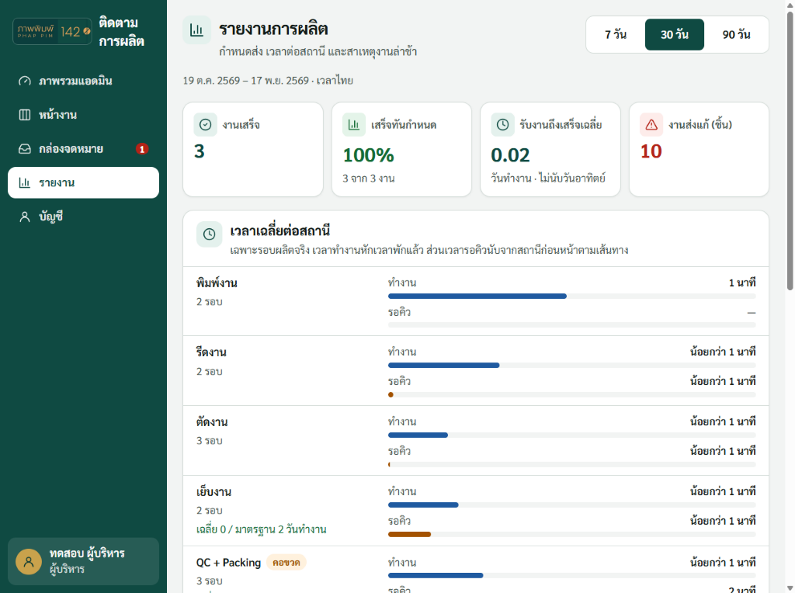
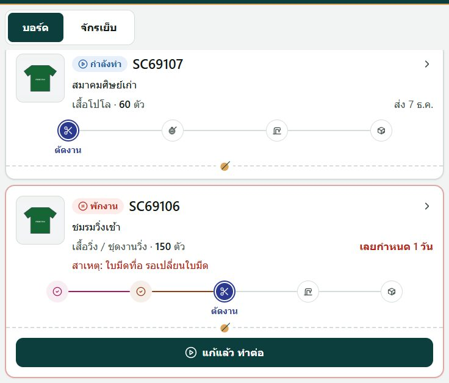

# คู่มือใช้งาน: ผู้บริหาร

> สำหรับผู้บริหาร · เว็บ: `https://pp142.pages.dev`
> สิทธิ์การใช้งาน: **ดูภาพรวม ค้นหางาน ดูบอร์ดสด และดูรายงาน** · **แทรกงานด่วนเข้าคิว** ได้ (ต้องใส่เหตุผล) · กดเริ่ม/เสร็จสถานีแทนหน้างานไม่ได้

---

## 1. ล็อกอิน · กล่องจดหมาย · ออกจากระบบเมื่อส่งเครื่องต่อ

1. เปิดเว็บ `https://pp142.pages.dev` กรอกอีเมลและรหัสผ่าน แล้วกด **เข้าสู่ระบบ**

2. กดไอคอน **กระดิ่งมุมขวาบน** (หรือเมนู **กล่องจดหมาย** บนจอใหญ่) เพื่อเปิด **กล่องจดหมาย** ดูแจ้งเตือนสำคัญของโรงงาน

3. หน้า **บัญชี** (กดชื่อมุมขวาบน) แสดงชื่อ บทบาท และ **บัญชีนี้ทำอะไรได้** · เปลี่ยนรหัสผ่านได้ที่หน้านี้ · หากใช้งานบนอุปกรณ์ส่วนกลาง เมื่อเสร็จให้กด **ออกจากระบบ** ทุกครั้ง

---

## เมนูของคุณ (ผู้บริหาร)

เมนูแต่ละบทบาทไม่เหมือนกัน · จอใหญ่อยู่แถบซ้าย · มือถืออยู่แถบล่าง (เกิน 5 เมนูกด **เพิ่มเติม**) · **บัญชี** อยู่ที่ชื่อ/รูปคนมุมขวาบน · **กล่องจดหมาย** ที่กระดิ่ง

| เมนู | ใช้ทำอะไร |
|---|---|
| **ภาพรวมการผลิต** | ภาพรวมทั้งโรงงาน (เดิมคือ **ภาพรวม**) |
| **ใบงานทั้งหมด** | ค้นหางาน + ตารางงานทุกงาน |
| **ทุก Station** | บอร์ดทั้งโรงงาน + จักรเย็บ (เดิมคือ **หน้างาน**) |
| **รายงาน** | รายงาน 7 / 30 / 90 วัน |
| **รายการรออนุมัติ** | รายการที่ผู้บริหารควรรู้: งานติดปัญหา (กด **แก้แล้ว ทำต่อ** ได้) · รายงานเกินเวลามาตรฐาน · การแทรกคิว / เริ่มข้ามคิว พร้อมเหตุผล → กด **รับทราบ** แล้วรายการหายไป (งานไม่หยุดรอ) |

---

## 2. ดูภาพรวมโรงงานแบบสด

1. หน้า **ภาพรวม** แสดงสรุปงานทั้งหมด งานที่ติดปัญหา งานเกินเวลามาตรฐาน และงานที่เสร็จแล้ว
2. ข้อมูลอัปเดตสดอัตโนมัติ ไม่ต้องกดรีเฟรช
3. ใช้แท็บ **งานที่ต้องตาม** เพื่อดูงานที่กำลังมีปัญหาหรือเกินเวลามาตรฐาน · ป้าย **คาดไม่ทัน X วัน** = ยังไม่เลยกำหนดส่งแต่คาดว่าเสร็จไม่ทัน (พิจารณาแทรกคิว)
4. การ์ด **สถานีตอนนี้**: จำนวนงานแต่ละสถานี (ทำอยู่ / รอ / ติดปัญหา / ข้างนอก / เลยกำหนด) · กรอบแดง = มีงานติดปัญหาหรือเลยกำหนด · **กดสถานีเพื่อเปิดคิวของสถานีนั้น**
5. การ์ด **งานที่ส่งออกข้างนอก**: งานที่อยู่บริษัทภายนอก เรียงตามวันที่ของจะถึง · เลยกำหนดเป็นสีแดง (แอดมินเป็นคนตามและรับของกลับ)

---

## 3. ดูงานแต่ละสถานี ค้นหางาน และรายละเอียด

1. ไปที่เมนู **ทุก Station** → **บอร์ด** เพื่อดูความหนาแน่นของงานในแต่ละ **สถานี** (พิมพ์, รีด, ตัด, รีดฟิล์ม, ส่งปัก, เย็บ, QC + Packing)
   - กดปุ่มสถานีเพื่อเปิด **หน้าคิวสถานี** (งานเรียงตามคิว ไม่ใช่ตามกำหนดส่ง) · ด้านบนเป็น **แถบสถานี** เลข 1–7 (พิมพ์ → QC + Packing) กดเปลี่ยนสถานีได้ทันที · หัวสถานีมีป้าย **เครื่อง x/y** (ส้ม **เต็ม** = เริ่มงานใหม่ไม่ได้จนกว่าจะมีงานเสร็จหรือพักงาน)
   - **แทรกงานด่วน**: บนการ์ดงานในคิวรอเริ่ม กด **แทรกเป็นคิวแรก (งานด่วน)** → ใส่เหตุผล → **แทรกเป็นคิวแรก** (เหตุผลบันทึกในประวัติงาน · แจ้งหัวหน้าหน้างานด้วย)
2. ไปที่ **จักรเย็บ** เพื่อดูคิว **งานเย็บ**, **ตารางจอง**, และ **สถานะจักร**
3. ใช้ **ค้นหางาน** เพื่อตรวจสถานะ **ใบยืนยัน** รายใบ ดู **รอบตัวอย่าง**, **เวลาที่ใช้ต่อสถานี**, **ไทม์ไลน์ทุกการกด**, **งานแก้**, **พักงาน**, **รายงานปัญหา**, และเปิดไฟล์ PDF **ใบยืนยัน** (ถ้าไฟล์ไม่เปิดขึ้นมา กดลิงก์สำรอง **ถ้าไฟล์ไม่เปิดขึ้นมา กดที่นี่**)

---

## 4. ดูหน้ารายงาน

กดเมนู **รายงาน** เพื่อติดตามภาพรวมผลงานของโรงงาน (เลือกดูเป็นช่วง 7 วัน / 30 วัน / 90 วัน):
- **เวลาเฉลี่ยต่อสถานี**: ดูเวลารอคิวและเวลาทำงานจริงของแต่ละ **สถานี** (หักเวลา **พักงาน** แล้ว)
- **คอขวด**: ระบบชี้จุดที่งานใช้เวลานานที่สุดให้เห็นทันที
- **% ทันกำหนด**: อัตราส่วนงานที่ส่งเสร็จทันตามกำหนดส่งและเวลารับงานถึงเสร็จเฉลี่ย
- **งานแก้**: จำนวนชิ้นและสาเหตุที่มีการส่ง **งานแก้** กลับจาก QC
- **รายงานปัญหา**: สรุปปัญหาและงานที่กำลังเกินเวลามาตรฐาน (**คลิกที่รายการงานเกินกำหนดในหน้านี้เพื่อเปิดรายละเอียดงานได้ทันที**)

---

## 5. สิทธิ์ที่ไม่สามารถกดได้ (ดูได้อย่างเดียว)

ผู้บริหารกดได้ 2 อย่าง: **แทรกเป็นคิวแรก (งานด่วน)** และ **แก้แล้ว ทำต่อ** (ปิดปัญหาของงานที่พักอยู่ หลังตัดสินวิธีแก้แล้ว · ยกเว้นงานเย็บ ฝ่ายผลิตกด **แก้แล้ว เย็บต่อ** เพราะต้องจ่ายจักร) · แอดมินไม่มีหน้าที่แก้ปัญหาของสถานี · ไม่สามารถกด **รับงาน**, ส่งออกบริษัทภายนอก, เดิน **สถานี**, กดเย็บ/จองจักร, บันทึก **QC**, **พักงาน**, หรือ **รายงานปัญหา** แทนหน้างานได้ หน้าจอจะขึ้นข้อความว่า **บทบาทนี้ดูได้อย่างเดียว**

---

## 5.5 ม็อคอัพกำกับสเปก

- **แอดมินอนุมัติม็อคอัพใช้ผลิตเอง** ไม่ต้องรอผู้บริหาร · ผู้บริหารเปิดดูได้ที่รายละเอียดงาน → **ม็อคอัพกำกับสเปก** · ฉบับที่ค้างรออนุมัติ ผู้บริหารอนุมัติ / ส่งกลับแก้ได้
- ดูประวัติฉบับ (ใครอนุมัติ เมื่อไร แก้เพราะอะไร) ท้ายหน้า · **พิมพ์ / PDF** ได้ทุกฉบับ

## 6. เน็ตหลุด · มีระบบรุ่นใหม่ ทำอย่างไร

- **เน็ตหลุด:** หากขึ้นแถบสีแดง **ขาดการเชื่อมต่อ** แปลว่าสัญญาณเน็ตขาดชั่วคราว รอจนเน็ตกลับมา แถบแดงจะหายไปและตัวเลขบนจอจะอัปเดตล่าสุดให้อัตโนมัติ (หรือกดรีเฟรช 1 ครั้งเพื่อความมั่นใจ)
- **มีระบบรุ่นใหม่:** ถ้าหน้าจอดูแปลกหรือไม่ตรงคู่มือ ให้ปัดรีเฟรชหรือปิดเปิดแอปใหม่ และถ้าเห็นแถบ **มีระบบรุ่นใหม่** ให้กดโหลดทันที
