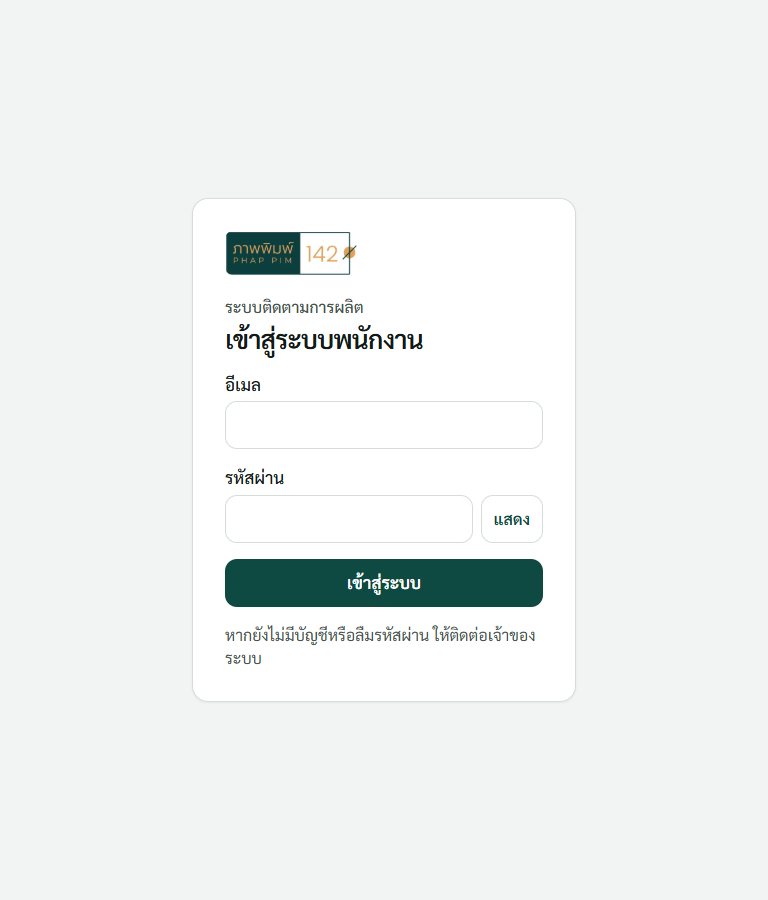
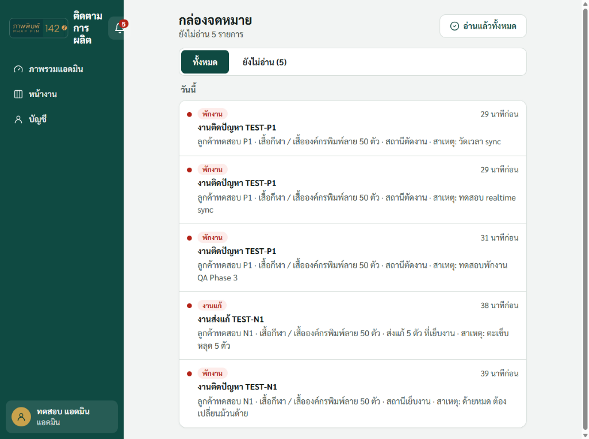
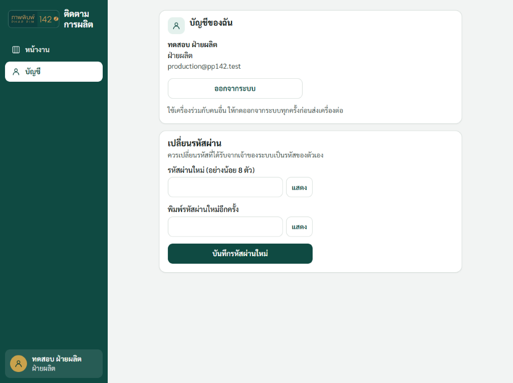
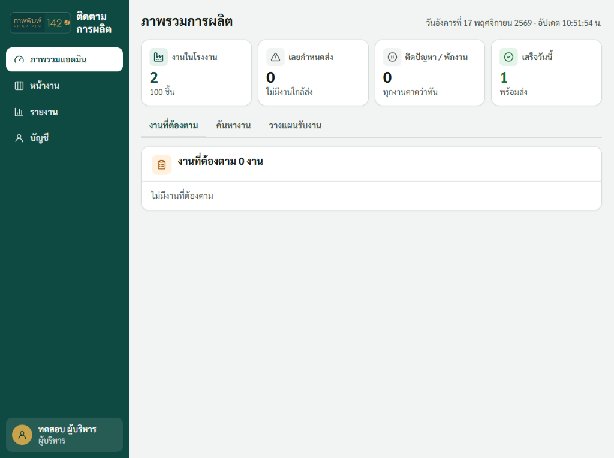
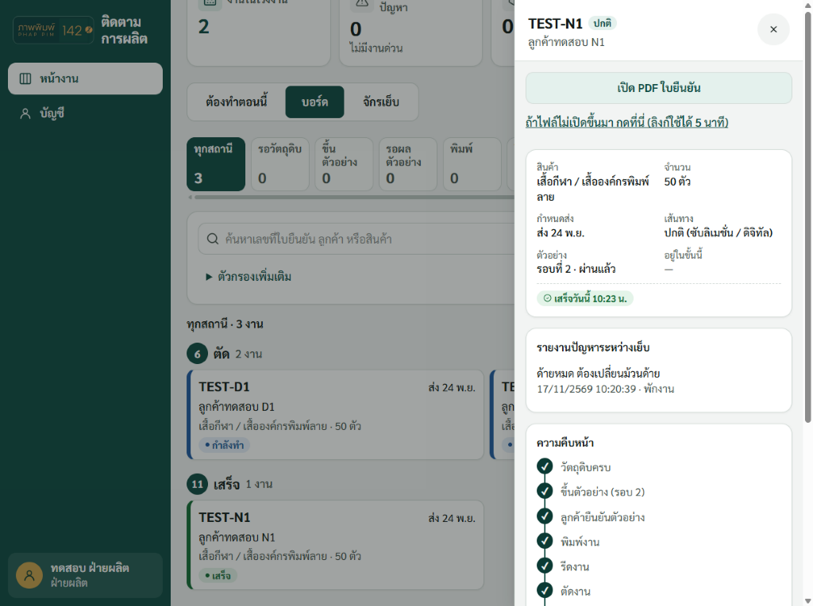
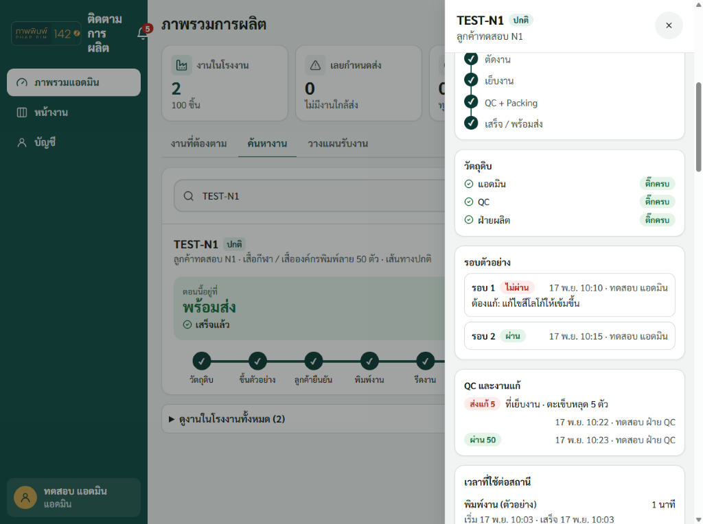
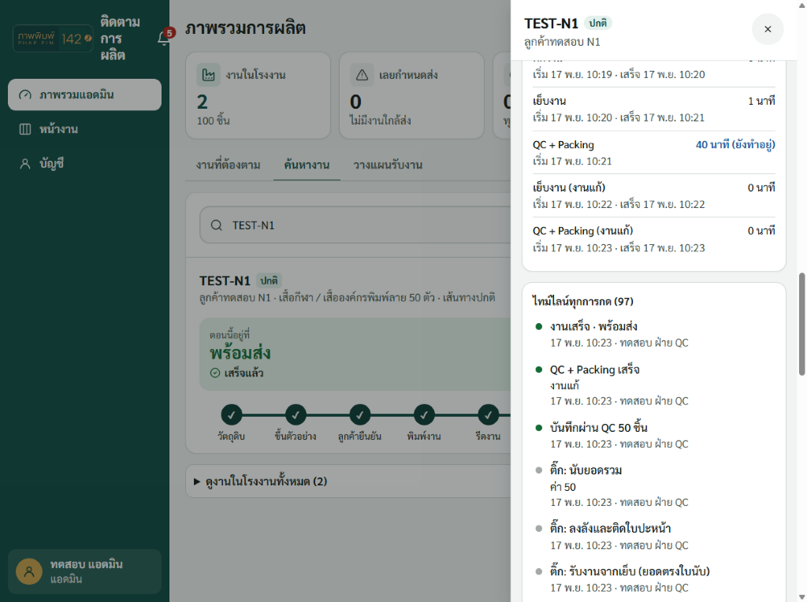
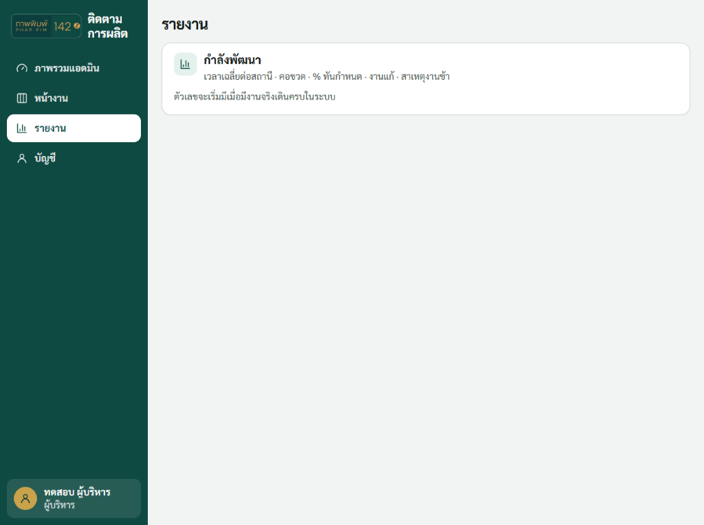

# คู่มือใช้งาน: ผู้บริหาร

> สำหรับผู้บริหาร · เว็บ: `https://pp142.pages.dev`
> สิทธิ์การใช้งาน: **ดูภาพรวม ค้นหางาน ดูบอร์ดสด และดูรายงาน** (ไม่สามารถกดเปลี่ยนแปลงสถานะงานหน้างานได้)

---

## 1. ล็อกอิน · กล่องจดหมาย · ออกจากระบบเมื่อส่งเครื่องต่อ

1. เปิดเว็บ `https://pp142.pages.dev` กรอกอีเมลและรหัสผ่าน แล้วกด **เข้าสู่ระบบ**

2. กดไอคอน **กระดิ่งมุมขวาบน** เพื่อเปิด **กล่องจดหมาย** ดูแจ้งเตือนสำคัญของโรงงาน

3. หากใช้งานบนอุปกรณ์ส่วนกลาง เมื่อเสร็จให้กดเมนู **บัญชี** → **ออกจากระบบ** ทุกครั้ง

---

## 2. ดูภาพรวมโรงงานแบบสด

1. หน้า **ภาพรวม** แสดงสรุปงานทั้งหมด งานที่ติดปัญหา งานเกินเวลามาตรฐาน และงานที่เสร็จแล้ว
2. ข้อมูลอัปเดตสดอัตโนมัติ ไม่ต้องกดรีเฟรช
3. ใช้แท็บ **งานที่ต้องตาม** เพื่อดูงานที่กำลังมีปัญหาหรือเกินเวลามาตรฐาน

---

## 3. ดูงานแต่ละสถานี ค้นหางาน และรายละเอียด

1. ไปที่ **หน้างาน** → **บอร์ด** เพื่อดูความหนาแน่นของงานในแต่ละ **สถานี** (พิมพ์, รีด, ตัด, รีดฟิล์ม, ส่งปัก, เย็บ, QC + Packing)
2. ไปที่ **จักรเย็บ** เพื่อดูคิว **งานเย็บ**, **ตารางจอง**, และ **สถานะจักร**
3. ใช้ **ค้นหางาน** เพื่อตรวจสถานะ **ใบยืนยัน** รายใบ ดู **รอบตัวอย่าง**, **เวลาที่ใช้ต่อสถานี**, **ไทม์ไลน์ทุกการกด**, **งานแก้**, **พักงาน**, **รายงานปัญหา**, และเปิดไฟล์ PDF **ใบยืนยัน** (ถ้าไฟล์ไม่เปิดขึ้นมา กดลิงก์สำรอง **ถ้าไฟล์ไม่เปิดขึ้นมา กดที่นี่**)

---

## 4. ดูหน้ารายงาน

กดเมนู **รายงาน** เพื่อดูสถิติการผลิต, เวลาเฉลี่ยต่อ **สถานี**, และสาเหตุปัญหาที่พบบ่อย

---

## 5. สิทธิ์ที่ไม่สามารถกดได้ (ดูได้อย่างเดียว)

ผู้บริหารไม่สามารถกด **รับงาน**, ติ๊ก **วัตถุดิบ**, เดิน **สถานี**, กดเย็บ/จองจักร, บันทึก **QC**, **พักงาน**, หรือ **รายงานปัญหา** แทนหน้างานได้ หน้าจอจะขึ้นข้อความว่า **บทบาทนี้ดูได้อย่างเดียว**

---

## 6. เน็ตหลุดทำอย่างไร

1. หากหน้าจอขึ้นแถบสีแดง **ขาดการเชื่อมต่อ** แปลว่าสัญญาณเน็ตขาดชั่วคราว ตัวเลขที่เห็นอาจยังไม่อัปเดตล่าสุด
2. รอจนเน็ตกลับมา แถบแดงจะหายไปและตัวเลขบนจอจะอัปเดตล่าสุดให้อัตโนมัติ
3. หากต้องการความมั่นใจ กดรีเฟรชหน้าเว็บ 1 ครั้งหลังเน็ตกลับมา
