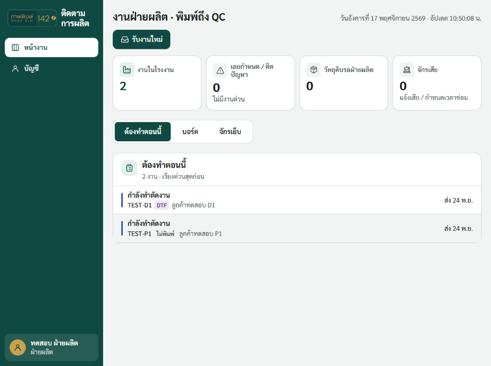
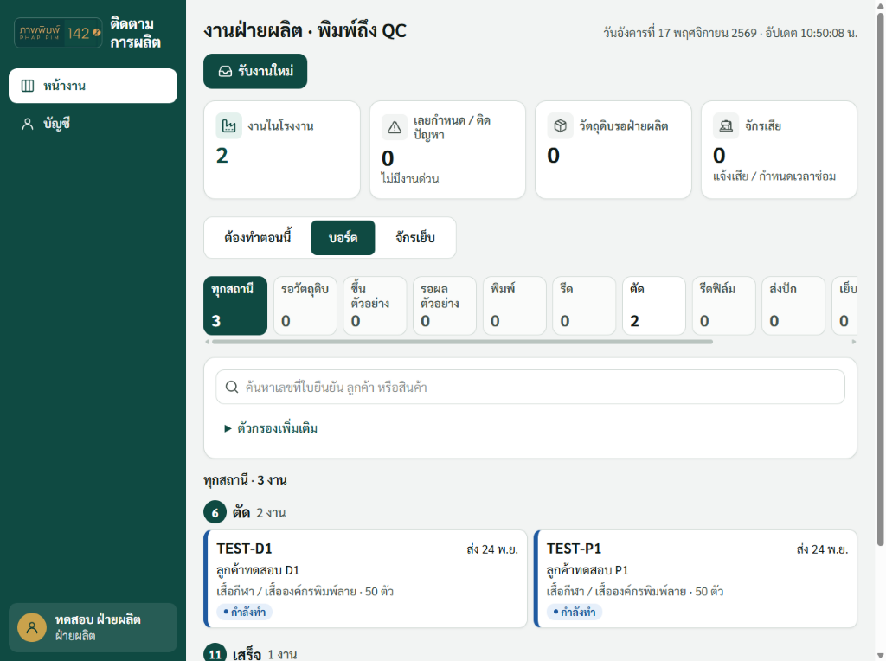
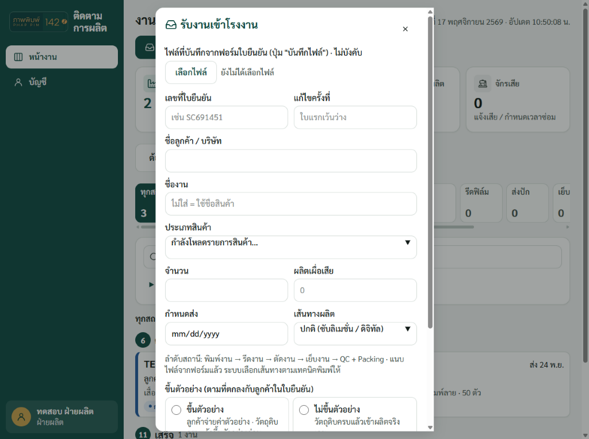

# คู่มือใช้งาน: ฝ่ายผลิต

> สำหรับทีมผลิตหน้างานบนแท็บเล็ต · เว็บ: `https://pp142.pages.dev`
> กฎจำง่าย: **ทำงานจริงแล้วกดในระบบทันที** · **ส่งเครื่องต่อให้เพื่อน ต้องออกจากระบบทุกครั้ง**

---

## 1. ล็อกอิน และออกจากระบบเมื่อส่งเครื่องต่อ

### ล็อกอินเข้าใช้งาน
1. เปิดเว็บ `https://pp142.pages.dev` บนแท็บเล็ต
2. กรอกอีเมลและรหัสผ่านของคุณ แล้วกด **เข้าสู่ระบบ**

### ออกจากระบบเมื่อส่งเครื่องต่อ (สำคัญมาก)
1. กดเมนู **บัญชี** ที่แถบด้านล่าง
2. กดปุ่ม **ออกจากระบบ**
3. รอจนหน้าจอกลับไปที่หน้าล็อกอิน ก่อนส่งแท็บเล็ตให้คนถัดไป

---

## 2. หน้าหลักของฝ่ายผลิต

ฝ่ายผลิตมี 3 แท็บในหน้า **หน้างาน**:
- **ต้องทำตอนนี้**: งานที่รอคิวหรือกำลังทำอยู่ในตอนนี้
- **บอร์ด**: ดูงานแยกตามแต่ละ **สถานี** ทั้งโรงงาน
- **จักรเย็บ**: จัดการคิวเย็บ จองจักร และแจ้งจักรเสีย

---

## 3. รับงานใหม่

1. ไปที่หน้า **หน้างาน** → กดปุ่ม **รับงานใหม่**
2. กรอกข้อมูลจาก **ใบยืนยัน** (เลขที่ใบยืนยัน, ลูกค้า, ประเภทสินค้า, จำนวน, กำหนดส่ง, เส้นทางผลิต)
3. แนบไฟล์ PDF ของ **ใบยืนยัน**
4. กดยืนยัน **รับงาน** → งานจะไปอยู่ที่ **รอวัตถุดิบ**

---

## 4. ติ๊กวัตถุดิบ

1. เปิดการ์ดงานที่อยู่สถานะ **รอวัตถุดิบ** → `[รอภาพ]` (หน้ารายละเอียดงาน)
2. ติ๊กเฉพาะรายการของฝ่ายผลิต (เช่น ด้ายสีตามสเปก, ป้าย / อุปกรณ์) โดยกด **ครบแล้ว**
3. เมื่อ **ฝ่ายผลิต**, **แอดมิน**, และ **QC** ติ๊กครบทุกฝ่าย ระบบจะส่งงานไป **ขึ้นตัวอย่าง** อัตโนมัติ

> ถ้ายังติ๊กไม่ครบทั้ง 3 ฝ่าย จะยังกดเริ่ม **ขึ้นตัวอย่าง** ไม่ได้

---

## 5. เดินสถานี และติ๊กขั้นย่อย (เฟส 1 และ เฟส 2)

1. กดเปิดงานที่ต้องการทำ → `[รอภาพ]` (หน้ารายละเอียดงาน)
2. กดปุ่ม **เริ่ม...** (เช่น เริ่มพิมพ์งาน, เริ่มรีดงาน, เริ่มตัดงาน)
3. ทำตาม **ขั้นย่อย** ของ **สถานี** นั้น แล้วกดติ๊กหรือกรอกค่า + **บันทึก** ให้ครบทุกข้อที่บังคับ
4. กดปุ่ม **...เสร็จ** แล้วกดยืนยัน

> **ข้อควรรู้:**
> - ถ้ายังทำ **ขั้นย่อย** บังคับไม่ครบ ปุ่มเสร็จจะกดไม่ได้ และจะมีข้อความบอกว่าขาดข้อไหน
> - งานเส้นทาง **DTF** ต้องรอแอดมินกด **ได้รับฟิล์มแล้ว** ก่อน จึงจะกดเริ่มรีด DTF ได้
> - งานรอบ **ขึ้นตัวอย่าง** ก็เดิน **สถานี** แบบเดียวกัน ก่อนส่งให้แอดมินบันทึกผลตัวอย่าง

---

## 6. เย็บ และจัดการจักรเย็บ

1. กดแท็บ **จักรเย็บ** → เลือกแท็บย่อย **งานเย็บ**

2. กดเริ่มเย็บงานที่รอคิว
3. ถ้าต้องการดูคิวจองล่วงหน้า กดแท็บ **ตารางจอง**

4. ถ้ามีจักรเสีย กดแท็บ **สถานะจักร** เพื่อดูสถานะหรือแจ้งซ่อม

5. เมื่อเย็บเสร็จ กด **เย็บเสร็จ** แล้วยืนยัน เพื่อส่งต่อไป **QC + Packing** (หน้าเย็บไม่ต้องติ๊ก **ขั้นย่อย** ทีละข้อ)
6. ถ้าพบงานมีป้าย **งานแก้** (สีส้ม/แดงจาก QC ส่งกลับมา) ให้รีบหยิบมาแก้ก่อน แล้วกดเย็บเสร็จส่งกลับ QC อีกครั้ง

---

## 7. พักงาน และรายงานปัญหา

### พักงาน (เมื่อต้องหยุดงานชั่วคราว)
1. เปิดรายละเอียดงานที่กำลังทำ → `[รอภาพ]`
2. กด **พักงาน / ติดปัญหา**
3. เลือกสาเหตุหรือพิมพ์อธิบายสั้นๆ แล้วกดยืนยัน
4. เวลาที่ **พักงาน** ระบบจะไม่นับเป็นเวลาทำงานจริง
5. เมื่อพร้อมกลับมาทำต่อ ให้กด **แก้แล้ว ทำต่อ**

### รายงานปัญหา (เมื่อมีอุปสรรคหรือเลยกำหนด)
1. กด **รายงานปัญหา** ในรายละเอียดงาน → `[รอภาพ]`
2. เลือกรหัสสาเหตุ อธิบายปัญหา และระบุวันที่คาดว่าเสร็จ
3. ถ้างงหรือแก้เองไม่ได้ ให้ติ๊กขอความช่วยเหลือ

> **สำคัญ:** ถ้างาานขึ้นแถบสีแดง (เลยกำหนด) ระบบจะไม่ให้กดจบ **สถานี** จนกว่าจะ **รายงานปัญหา** ก่อน

---

## 8. เน็ตหลุดทำอย่างไร

1. ถ้าเน็ตหลุด จะมีแถบสีแดงขึ้นเตือนด้านบนว่า **ขาดการเชื่อมต่อ**
2. **ห้ามกดปุ่มเดิมซ้ำๆ** เพราะคำสั่งอาจค้างหรือซ้ำเมื่อเน็ตกลับมา
3. รอจนสัญญาณ Wi-Fi กลับมา แถบแดงจะหายไปเองและข้อมูลบนจอจะอัปเดตล่าสุดให้อัตโนมัติ
4. ถ้ายังไม่อัปเดต ให้กดรีเฟรชหน้าเว็บ 1 ครั้ง แล้วตรวจสถานะงานก่อนกดต่อ
