# คู่มือใช้งาน: ฝ่ายผลิต

> สำหรับทีมผลิตหน้างาน ใช้**มือถือของตัวเอง** (หรือแท็บเล็ตส่วนกลาง) · เว็บ: `https://pp142.pages.dev`
> กฎจำง่าย: **ทำงานตามคิว** · **ทำงานจริงแล้วกดในระบบทันที** · **ใช้เครื่องร่วมกับเพื่อน ต้องออกจากระบบทุกครั้ง**
> อัปเดต 18 พ.ย.: เพิ่ม **หน้าคิวสถานี** (หัวข้อ 3) · **งานด่วนแทรกคิว** · **งานส่งออกบริษัทภายนอก** · หน้า **บัญชีของฉัน** ใหม่

---

## 1. ล็อกอิน · กล่องจดหมาย · ออกจากระบบเมื่อส่งเครื่องต่อ

### ล็อกอินเข้าใช้งาน
1. เปิดเว็บ `https://pp142.pages.dev` บนแท็บเล็ต
2. กรอกอีเมลและรหัสผ่านของคุณ แล้วกด **เข้าสู่ระบบ**

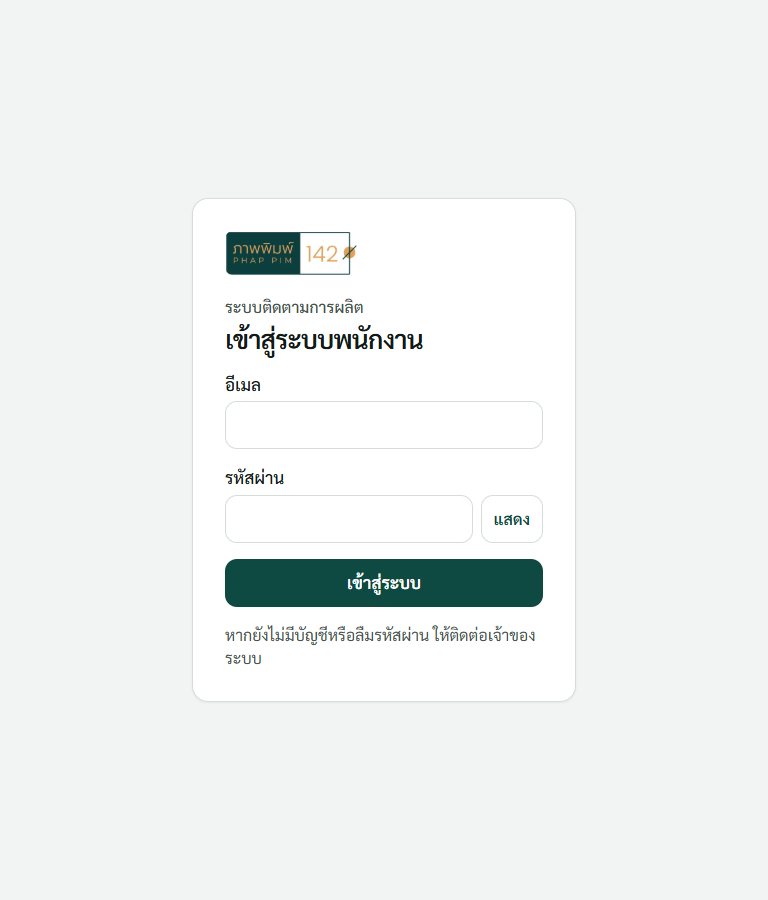

### กล่องจดหมาย (กระดิ่งมุมขวาบน)
กดไอคอน **กระดิ่งมุมขวาบน** (หรือเมนู **กล่องจดหมาย** บนจอใหญ่) เพื่อเปิด **กล่องจดหมาย** ดูแจ้งเตือนงานที่รอฝ่ายผลิตดำเนินการ

### หน้าบัญชีของฉัน · ออกจากระบบเมื่อส่งเครื่องต่อ (สำคัญมาก)
1. กดเมนู **บัญชี** ที่แถบด้านล่าง → ด้านบนแสดง **ชื่อคุณและบทบาท** · หัวข้อ **บัญชีนี้ทำอะไรได้** บอกสิทธิ์ของบัญชี
2. ถ้าชื่อด้านบน**ไม่ใช่คุณ** แปลว่าเพื่อนยังไม่ออกจากระบบ → กด **ออกจากระบบ** แล้วล็อกอินด้วยบัญชีตัวเอง (ทุกการกดบันทึกชื่อผู้กด)
3. ก่อนส่งเครื่องให้คนถัดไป กดปุ่มสีแดง **ออกจากระบบ** รอจนหน้าจอกลับไปที่หน้าล็อกอิน
4. **เปลี่ยนรหัสผ่าน** ได้ที่การ์ดด้านล่าง (อย่างน้อย 8 ตัว) · ลืมรหัสให้แจ้งเจ้าของระบบตั้งใหม่

---

## 2. หน้าหลักของฝ่ายผลิต (ปุ่มสถานีใหญ่ 3 กลุ่ม)

ฝ่ายผลิตมี 3 แท็บในหน้า **หน้างาน** (เปิดแอปมาเจอ **บอร์ด** ก่อน · เลือกสถานีไว้แล้วจะเข้าหน้าคิวสถานีเลย):
- **ต้องทำตอนนี้**: งานที่รอคิวหรือกำลังทำอยู่ในตอนนี้ · แถว **ส้ม** = ใกล้ครบเวลามาตรฐาน · **แดง** = เกินเวลา (ถ้าขึ้นว่า **ส่งรายงานปัญหาก่อนกดเสร็จ** ให้เปิดงานแล้วกรอกรายงาน)
- **บอร์ด**: แสดงปุ่ม **สถานี** ขนาดใหญ่แบ่งเป็น 3 กลุ่ม: **ก่อนผลิต** (`ขึ้นตัวอย่าง` · `รอผลตัวอย่าง`) · **เฟส 1** (`พิมพ์` · `รีด` · `ตัด` · `รีดฟิล์ม` · `ส่งปัก`) · **เฟส 2** (`เย็บ` · `QC + Packing` · `เสร็จ`) **และเครื่องจะจำสถานีที่เลือกไว้ให้** (ไม่ต้องกดหาสถานีเดิมซ้ำ)
- **จักรเย็บ**: จัดการคิวเย็บ จองจักร และแจ้งจักรเสีย

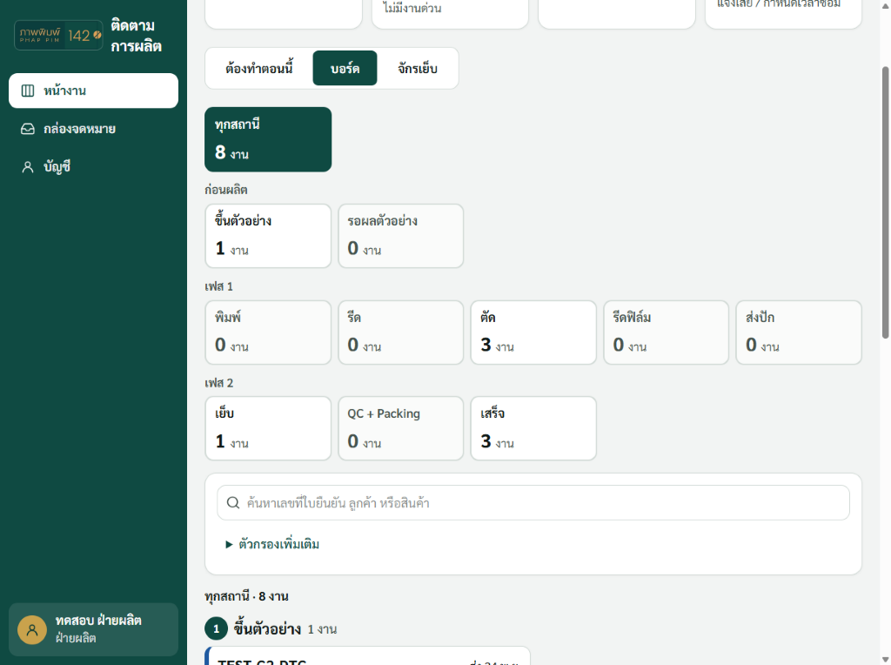

> **หมายเหตุ:** การส่งงานใหม่เข้าโรงงาน (**รับงาน**) ทำโดย **แอดมิน** เท่านั้น เมื่อแอดมินส่งงานเข้าแล้ว งานจะ**ต่อท้ายคิว**ของ **สถานี** แรกทันที (ไม่มีขั้นรอวัตถุดิบแล้ว)
> ปุ่มสถานีที่มีงานตัวอย่างรออยู่ จะมีคำว่า **+ ตัวอย่าง n** ใต้จำนวนงาน

---

## 3. หน้าคิวสถานี (ใช้ทุกวัน)

> **ทุกหน้าเรียงตามคิว (ลำดับที่แอดมินรับงานเข้า) ไม่ใช่ตามกำหนดส่ง** · ทำงาน **คิว 1** ก่อนเสมอ

1. ไปที่ **หน้างาน** → **บอร์ด** → กดปุ่มสถานีของตัวเอง (ครั้งแรกครั้งเดียว เครื่องจะจำไว้) · จะไปสถานีอื่นกด **เปลี่ยนสถานี** มุมขวา
2. หน้าคิวสถานีมี 3 ส่วน เรียงจากบนลงล่าง:
   - **กำลังทำ**: งานที่เริ่มแล้วหรือ **พักงาน** อยู่ · กด **…เสร็จ** (เช่น **ตัดเสร็จ**) → **ยืนยัน** ส่งต่อสถานีถัดไป · กด **พักงาน** → พิมพ์สาเหตุ → **บันทึกพักงาน** · งานที่พักอยู่กด **แก้แล้ว ทำต่อ** (เย็บ = **แก้แล้ว เย็บต่อ**)
   - **ส่งออกข้างนอก** (ถ้ามี): งานที่สถานีนี้ไปทำที่บริษัทภายนอก แสดงชื่อบริษัทและ **คาดว่าของถึง** · **ฝ่ายผลิตไม่ต้องกดอะไร** รอแอดมินรับของกลับ แล้วงานจะเข้าคิวเอง
   - **คิวรอเริ่ม**: เรียง **คิว 1, คิว 2, …** · คิว 1 มีกรอบเด่นและปุ่มใหญ่ **เริ่ม…** (เช่น **เริ่มตัด**) กดได้เลย
3. **อยากเริ่มงานที่ไม่ใช่คิว 1** (เช่น ผ้างานคิวแรกยังไม่มา): กด **เริ่มก่อนคิว** บนการ์ดงานนั้น → พิมพ์เหตุผล → **บันทึกและเริ่ม** (เหตุผลเก็บในประวัติงาน)
4. **งานด่วน (แทรกคิว)**: กด **แทรกเป็นคิวแรก (งานด่วน)** บนการ์ด → พิมพ์เหตุผล (เช่น ลูกค้าเลื่อนวันส่งเร็วขึ้น) → **แทรกเป็นคิวแรก** · ทำได้เฉพาะฝ่ายผลิต / ผู้บริหาร / เจ้าของระบบ · ตกลงกับหัวหน้าก่อนแทรกทุกครั้ง
5. กดแล้วจะมีข้อความลอยเหนือเมนูล่าง: **สีเขียว** = สำเร็จ (หายเองใน 4 วินาที) · **สีแดง** = ทำไม่ได้ อ่านเหตุผล แล้วกด **เปิดรายละเอียดงาน** หรือ **ปิด**
6. สถานี **รีดฟิล์ม**: ถ้าแอดมินยังไม่บันทึกได้รับฟิล์ม การ์ดจะขึ้น **เริ่มไม่ได้ · ยังไม่ได้รับ…** แทนปุ่มเริ่ม
7. สถานี **QC + Packing** ต้องบันทึกจำนวนผ่านในรายละเอียดงาน (ปุ่ม **บันทึกผล QC / Packing**) · ดูคู่มือ QC
8. กดที่ตัวการ์ด (เลขงาน/ชื่อลูกค้า) เพื่อเปิดรายละเอียดงาน

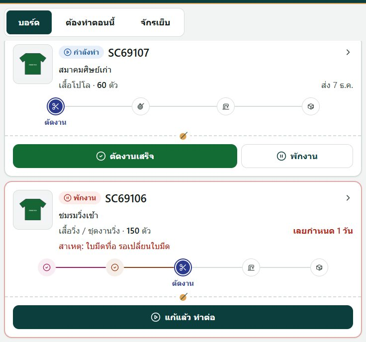

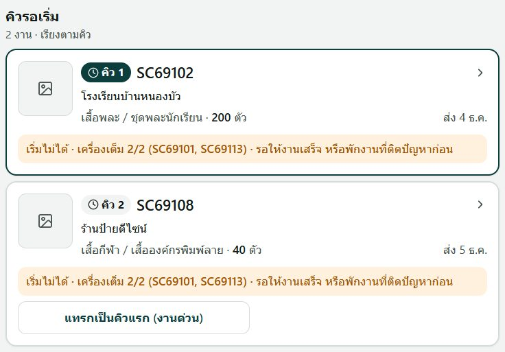

> หน้าคิวสถานีเป็นวิธีหลัก · หัวข้อ 4 ด้านล่าง (กดจากรายละเอียดงาน) ยังใช้ได้เหมือนเดิม

---

## 4. เดินสถานีจากรายละเอียดงาน (เฟส 1 และ เฟส 2)

1. กดเปิดงานที่ต้องการทำ เพื่อดูรายละเอียดงาน
   - สามารถกด **เปิด PDF ใบยืนยัน** เพื่อดูใบงาน (ถ้าไฟล์ไม่เปิดขึ้นมา ให้กดลิงก์สำรอง **ถ้าไฟล์ไม่เปิดขึ้นมา กดที่นี่**)
   - ในรายละเอียดงานสามารถดู **รอบตัวอย่าง**, **เวลาที่ใช้ต่อสถานี**, และ **ไทม์ไลน์ทุกการกด** ได้

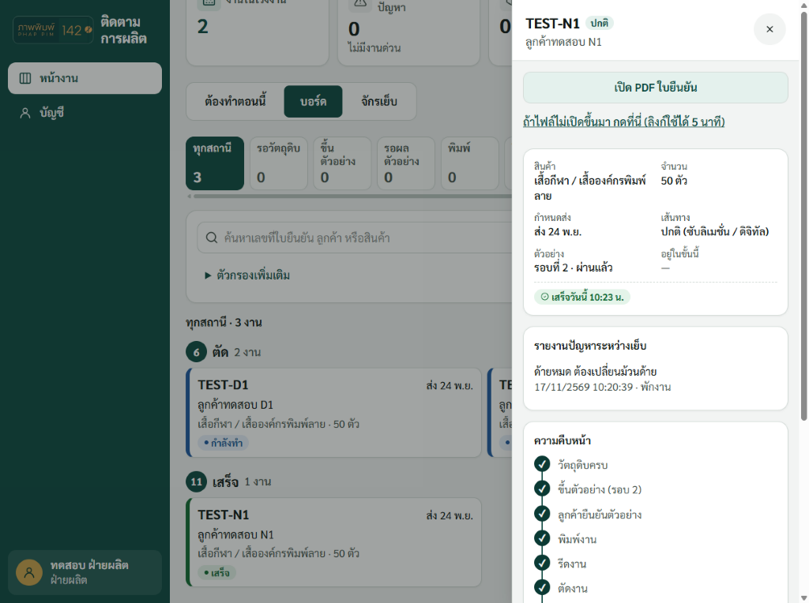

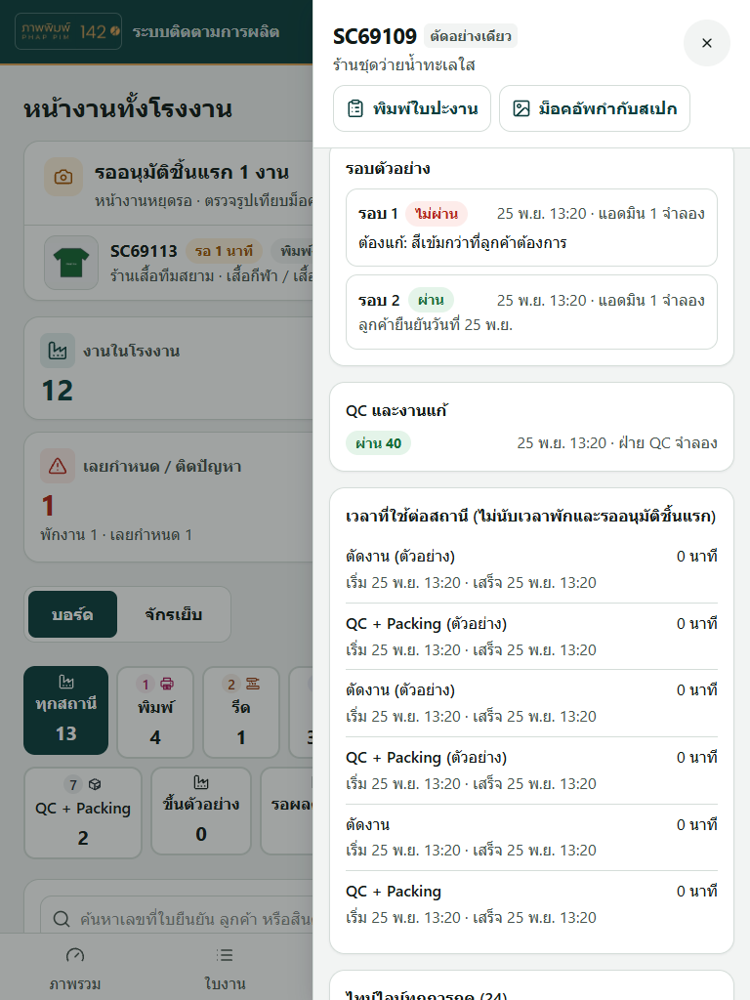

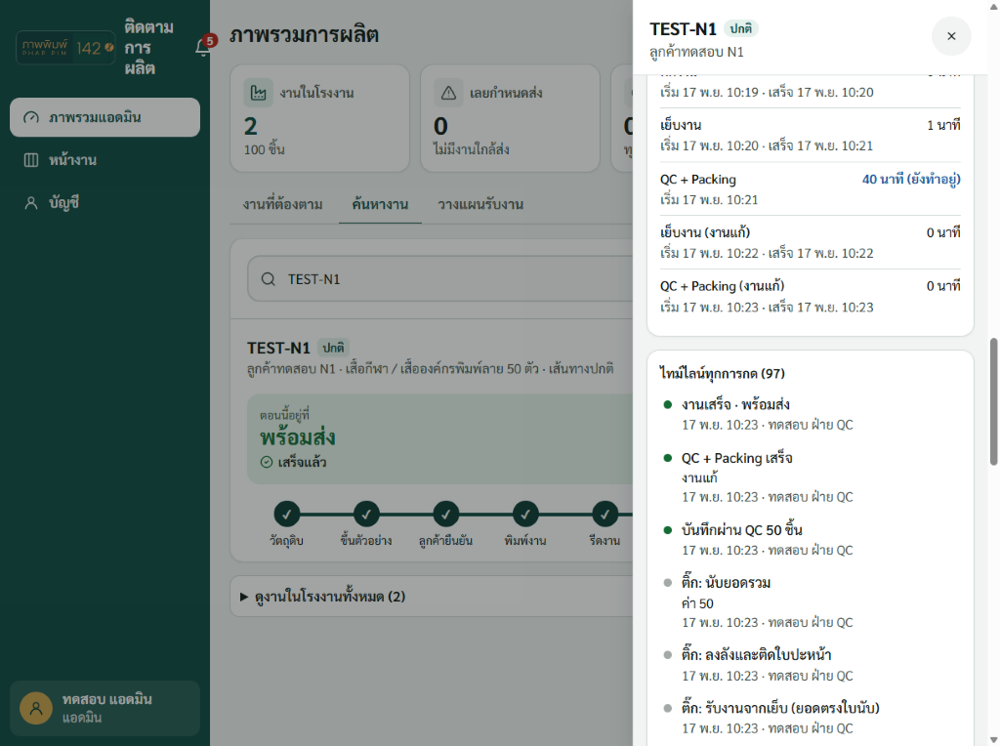

2. ทุก **สถานี** ใช้ปุ่มหลักแค่ **เริ่ม** → **เสร็จ** + **พักงาน / ติดปัญหา** (ไม่มีเช็คลิสต์ **ขั้นย่อย** ให้ต้องไล่ติ๊กแล้ว):
   - กด **เริ่ม...** (เช่น เริ่มพิมพ์งาน, เริ่มรีดงาน, เริ่มตัดงาน, เริ่มรีดฟิล์ม)
   - เมื่อทำจริงเสร็จแล้ว กด **...เสร็จ** แล้วกดยืนยัน

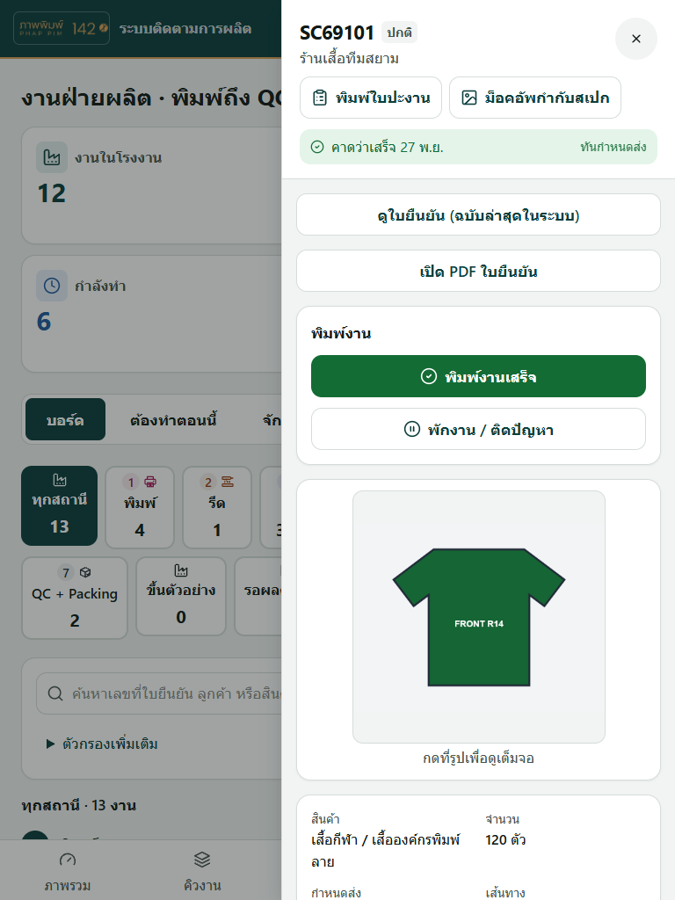

3. **เงื่อนไขพิเศษบางสถานี:**
   - **สถานีรีดฟิล์ม**: ใช้กับงาน **DTF / DTG / ซิลค์สกรีน** — ต้องรอแอดมินกดรับก่อน (**ได้รับฟิล์ม DTF แล้ว** / **ได้รับงาน DTG แล้ว** / **ได้รับงานสกรีนแล้ว**) จึงจะกดเริ่มรีดฟิล์มได้
   - **สถานีส่งปัก (ร้านนอก)**: กด **เริ่ม** ตอนส่งชิ้นผ้าไปร้านปัก → รับงานกลับและตรวจงานปัก (ตำแหน่ง สี ด้ายหลุด) → กด **เสร็จ** · จำนวนชิ้นที่ส่ง/รับกลับจดในใบปะงานกระดาษ (ระบบไม่มีช่องกรอกแล้ว)
   - **งานที่แอดมินส่งออกบริษัทภายนอก** (พิมพ์ / รีด / ตัด / เย็บ / ปัก): รายละเอียดงานขึ้นกล่อง **อยู่ที่บริษัทภายนอก** · ระหว่างนี้**กดเริ่มงานที่โรงงานไม่ได้** · แอดมินกด **รับเข้า** เมื่อของถึงโรงงาน แล้วงานจะไปรอที่สถานีถัดไป
4. หากพนักงานกดผิด **สถานี** หรือบันทึกผิด สามารถกดปุ่ม **แจ้งว่ากดผิด** ใน **ไทม์ไลน์ทุกการกด** ของหน้ารายละเอียดงานได้ (ปุ่มนี้แค่บันทึกว่ารายการนั้นผิดพร้อมเหตุผล **ไม่ได้ย้อนสถานะงาน** · ถ้างานต้องย้อนสถานะจริง ให้แจ้ง **เจ้าของระบบ**)

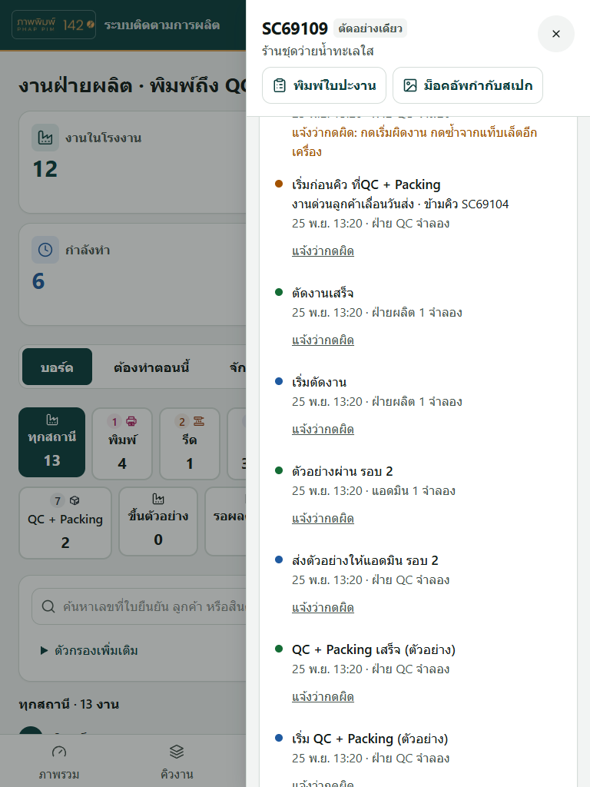

---

## 5. ใบปะงาน + QR (ใช้คู่กระดาษกับกองงาน)

1. เปิดรายละเอียดงาน → กด **พิมพ์ใบปะงาน**
2. พิมพ์เป็นขนาด **A5** แล้วติดไว้กับกองงานตลอดเส้นทาง
3. ช่อง **วันที่ / ผู้รับ / ลายเซ็น** บนกระดาษใช้เซ็นคู่กับระบบตอนส่งต่อระหว่าง **สถานี**
4. ใช้กล้องมือถือหรือแท็บเล็ตสแกน **QR** บนใบปะงาน → ล็อกอิน (ถ้ายังไม่ได้เข้าสู่ระบบ) → ระบบจะเปิดหน้างานนั้นให้ทันที ไม่ต้องพิมพ์ค้นหา

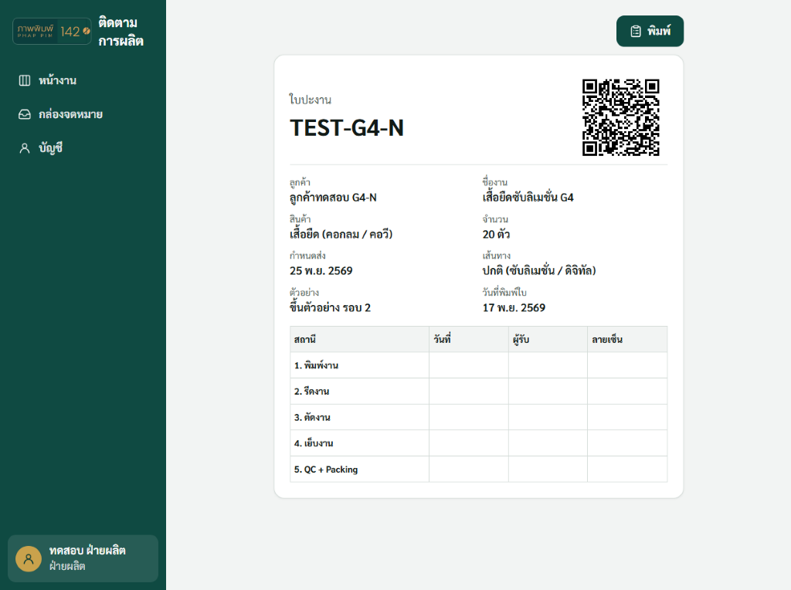

---

## 6. เย็บ และจัดการจักรเย็บ

1. กดแท็บ **จักรเย็บ** → เลือกแท็บย่อย **งานเย็บ**

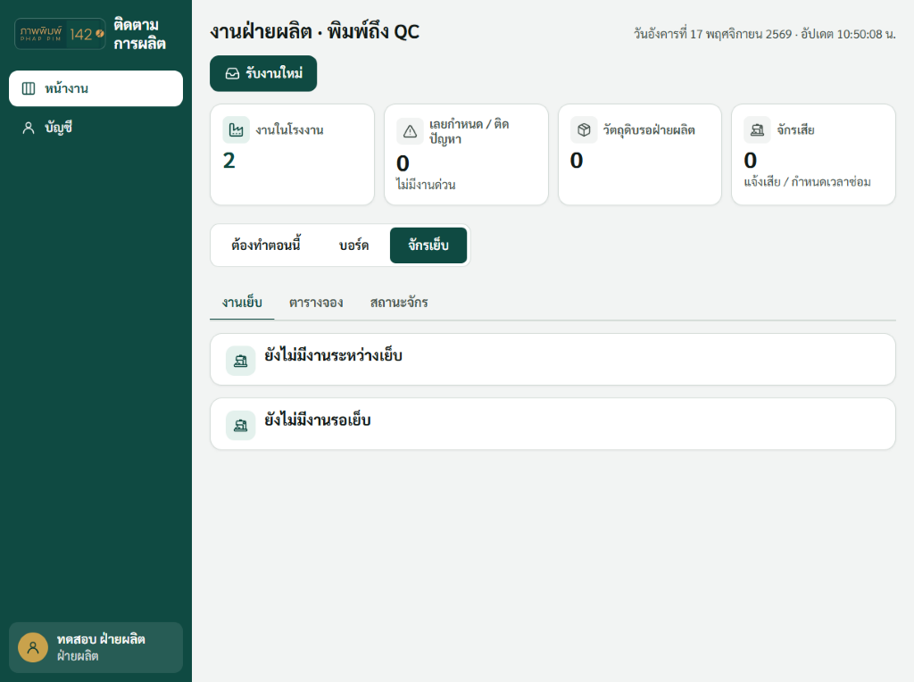

2. กดเริ่มเย็บงานที่รอคิว
3. ถ้าต้องการดูคิวจองล่วงหน้า กดแท็บ **ตารางจอง**

4. ถ้ามีจักรเสีย กดแท็บ **สถานะจักร** เพื่อดูสถานะหรือแจ้งซ่อม

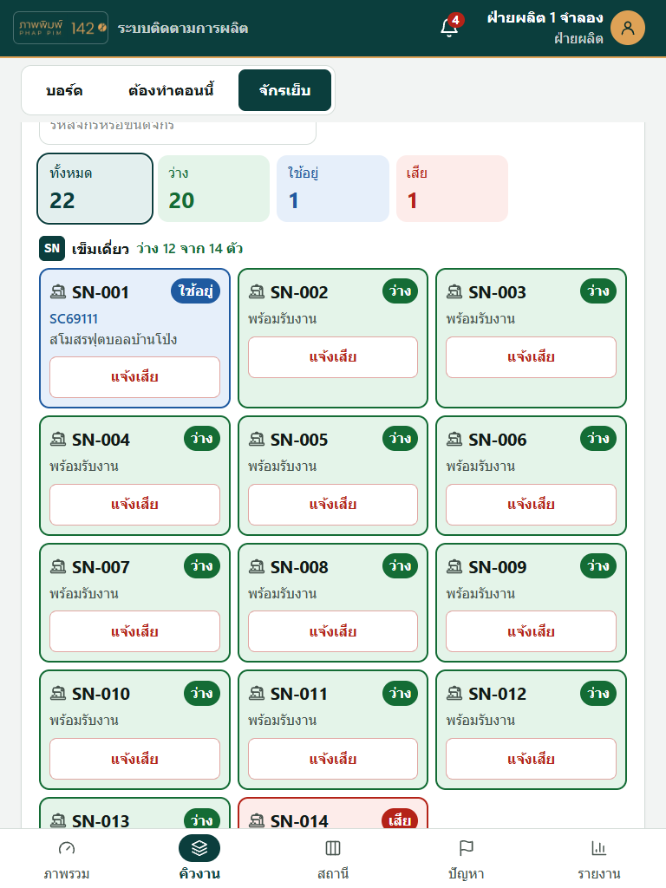

5. เมื่อเย็บเสร็จ กด **เย็บเสร็จ** แล้วยืนยัน เพื่อส่งต่อไป **QC + Packing** (ระบบคืนจักรให้โดยอัตโนมัติ)
6. ถ้าพบงานมีป้าย **งานแก้** (สีแดงจาก QC ส่งกลับมา) ให้รีบหยิบมาแก้ก่อน แล้วกดเย็บเสร็จส่งกลับ QC อีกครั้ง

---

## 7. พักงาน และรายงานปัญหา

### พักงาน (เมื่อต้องหยุดงานชั่วคราว)
1. เปิดรายละเอียดงานที่กำลังทำ
2. กด **พักงาน / ติดปัญหา**
3. **พิมพ์สาเหตุ** ลงในช่อง แล้วกดยืนยัน
4. เวลาที่ **พักงาน** ระบบจะไม่นับเป็นเวลาทำงานจริง
5. เมื่อพร้อมกลับมาทำต่อ ให้กด **แก้แล้ว ทำต่อ**

### รายงานปัญหา (เมื่อใกล้หรือเกินเวลามาตรฐาน)
- ฟอร์ม **รายงานปัญหา** จะขึ้นเองในรายละเอียดงานเมื่อใกล้หรือเกินเวลามาตรฐานเท่านั้น (ไม่ใช่ปุ่มที่กดได้ทุกเวลา · หากเป็นปัญหาทั่วไประหว่างทำ ให้ใช้ปุ่ม **พักงาน / ติดปัญหา**)
1. เลือกรหัสสาเหตุ อธิบายปัญหา และระบุวันที่คาดว่าเสร็จ
2. หากต้องการให้ใครช่วย ให้พิมพ์ในช่อง **ต้องการความช่วยเหลือจากใคร (ถ้ามี)**

> **สำคัญ:** ถ้างานขึ้นแถบสีแดง (**เกินเวลามาตรฐาน**) ระบบจะไม่ให้กดจบ **สถานี** จนกว่าจะ **รายงานปัญหา** ก่อน

---

## 8. เน็ตหลุด · มีระบบรุ่นใหม่ ทำอย่างไร

### เน็ตหลุด
1. ถ้าเน็ตหลุด จะมีแถบสีแดงขึ้นเตือนด้านบนว่า **ขาดการเชื่อมต่อ**
2. **ห้ามกดปุ่มเดิมซ้ำๆ** เพราะคำสั่งอาจค้างหรือซ้ำเมื่อเน็ตกลับมา
3. รอจนสัญญาณ Wi-Fi กลับมา แถบแดงจะหายไปเองและข้อมูลบนจอจะอัปเดตล่าสุดให้อัตโนมัติ
4. ถ้ายังไม่อัปเดต ให้กดรีเฟรชหน้าเว็บ 1 ครั้ง แล้วตรวจสถานะงานก่อนกดต่อ

### มีระบบรุ่นใหม่ / หน้าจอดูแปลก
- ถ้าหน้าจอดูแปลกหรือไม่ตรงกับคู่มือ ให้ปัดลงเพื่อรีเฟรช หรือปิดแล้วเปิดแอปใหม่
- ถ้าเห็นแถบแจ้งว่า **มีระบบรุ่นใหม่** ให้กดโหลดทันทีเพื่อให้ได้หน้าจอล่าสุด
- ถ้ายังเห็นหน้าจอเก่า (เช่น ไม่มีหน้าคิวสถานี) ให้**ปิดแท็บเว็บทั้งหมดแล้วเปิดใหม่** (รีเฟรชเฉยๆ อาจไม่พอ)
