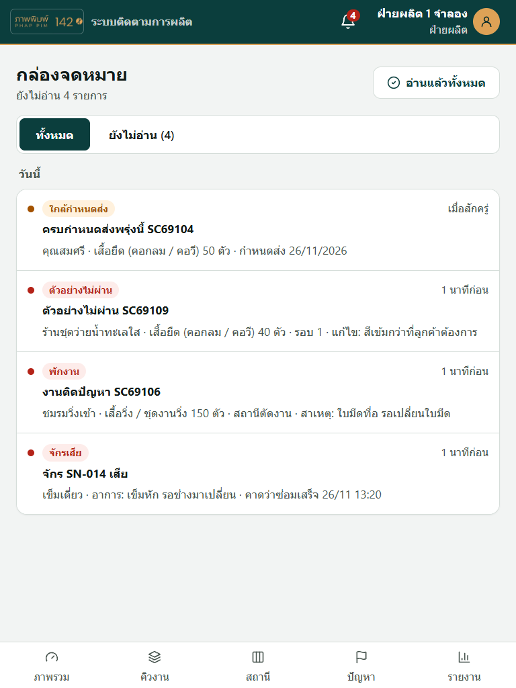
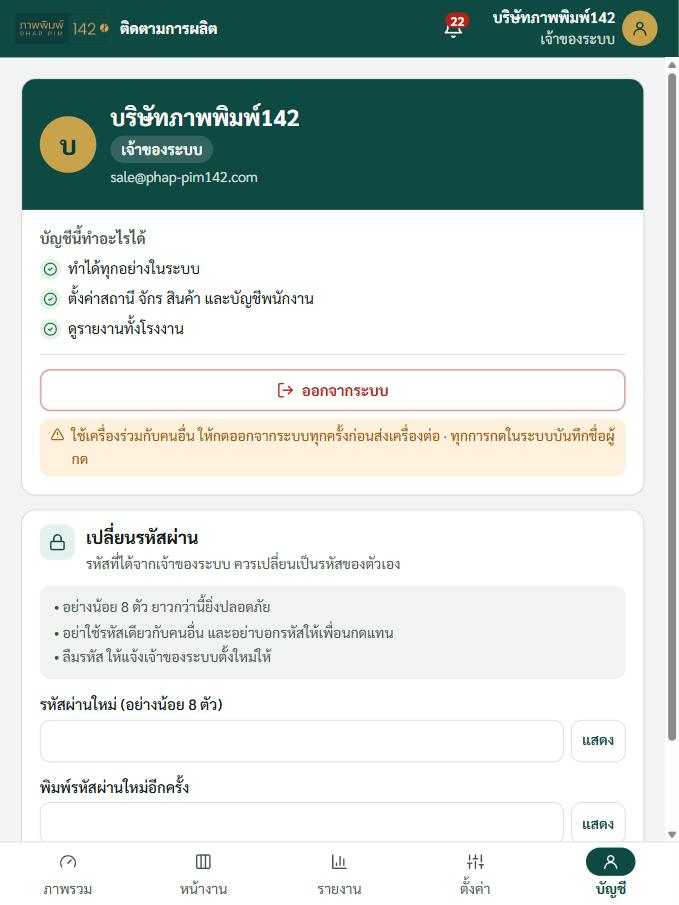
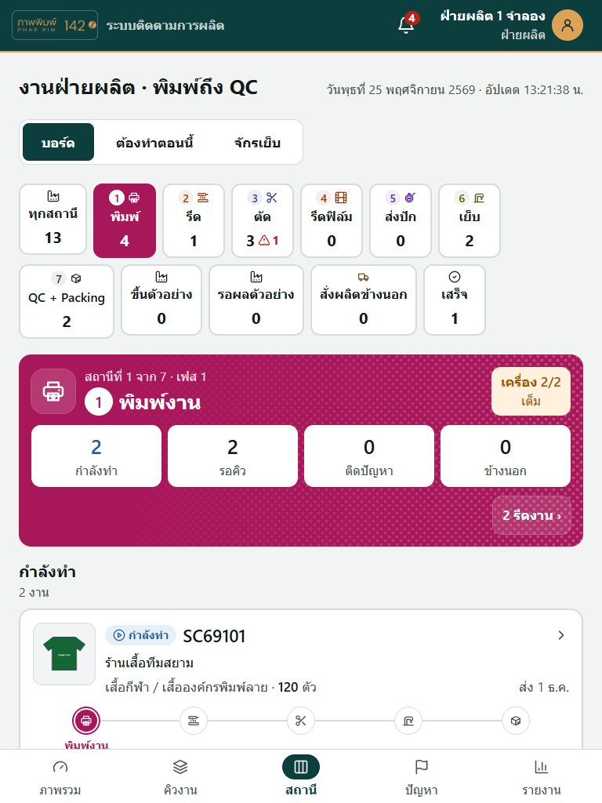
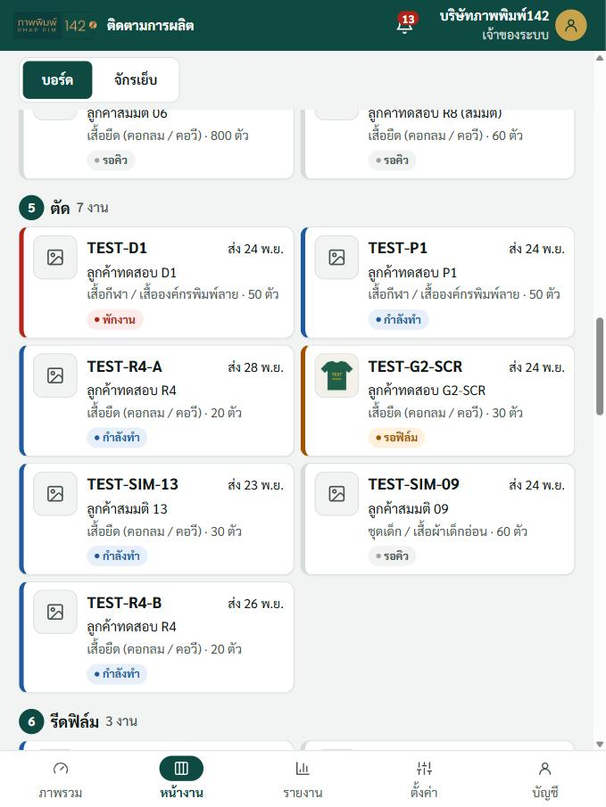
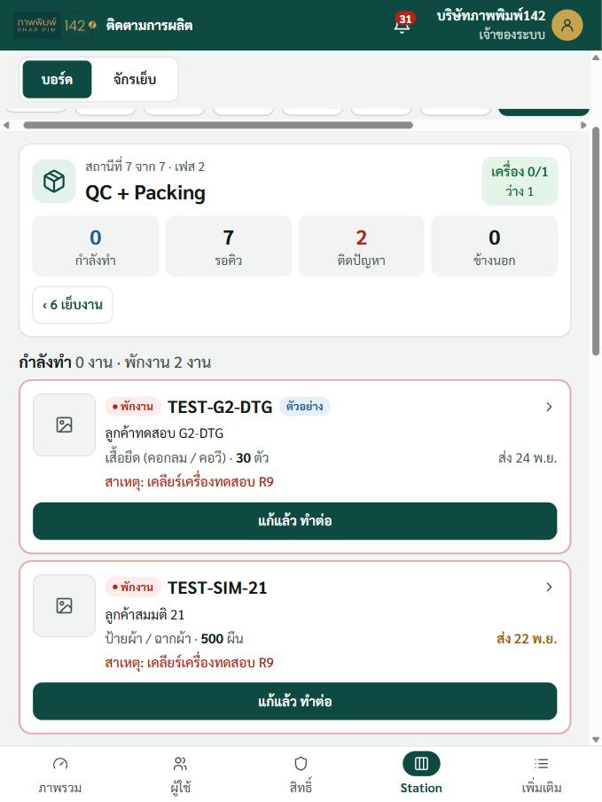
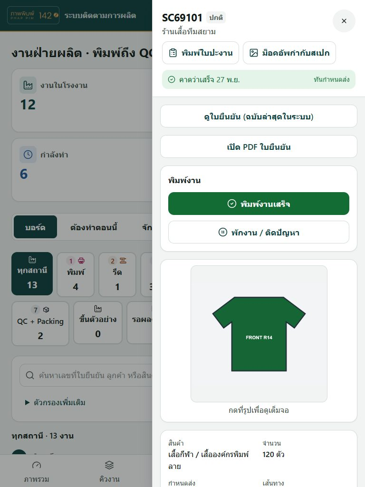
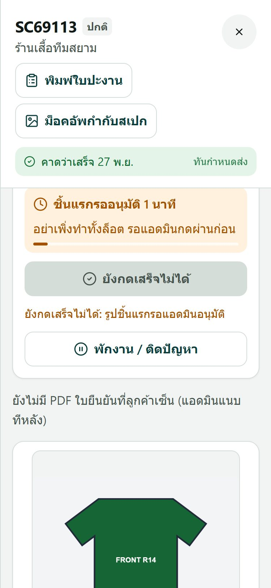
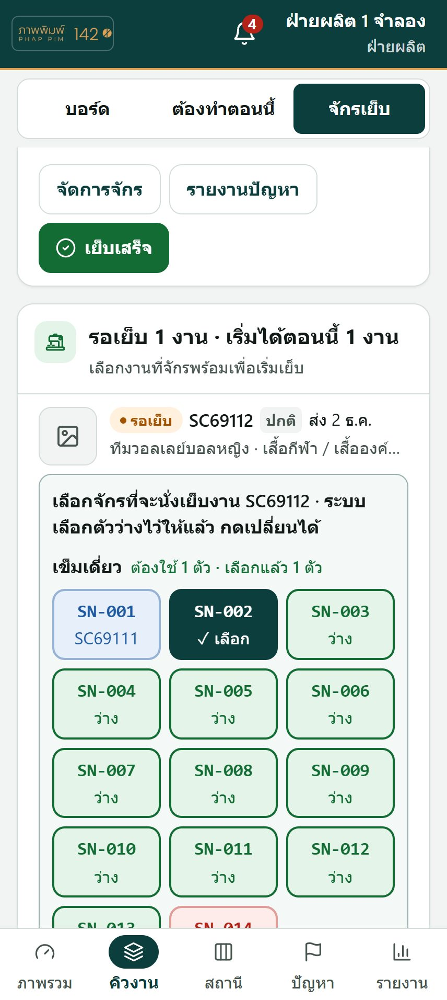
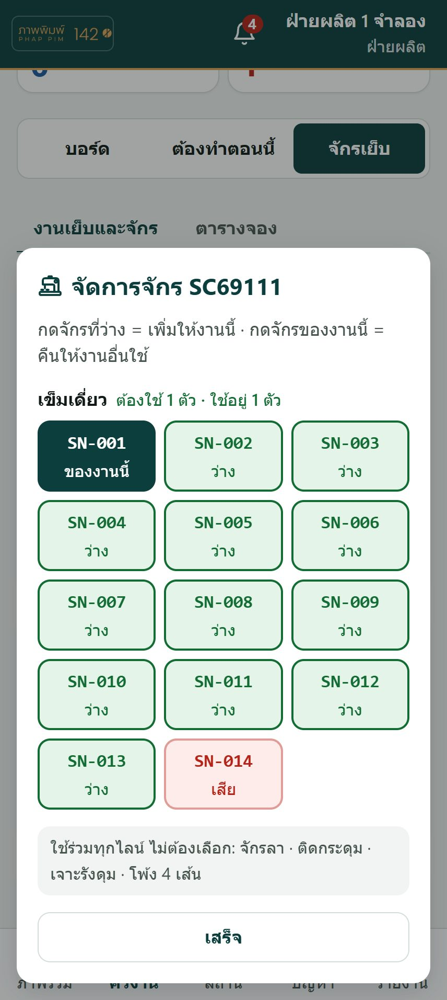
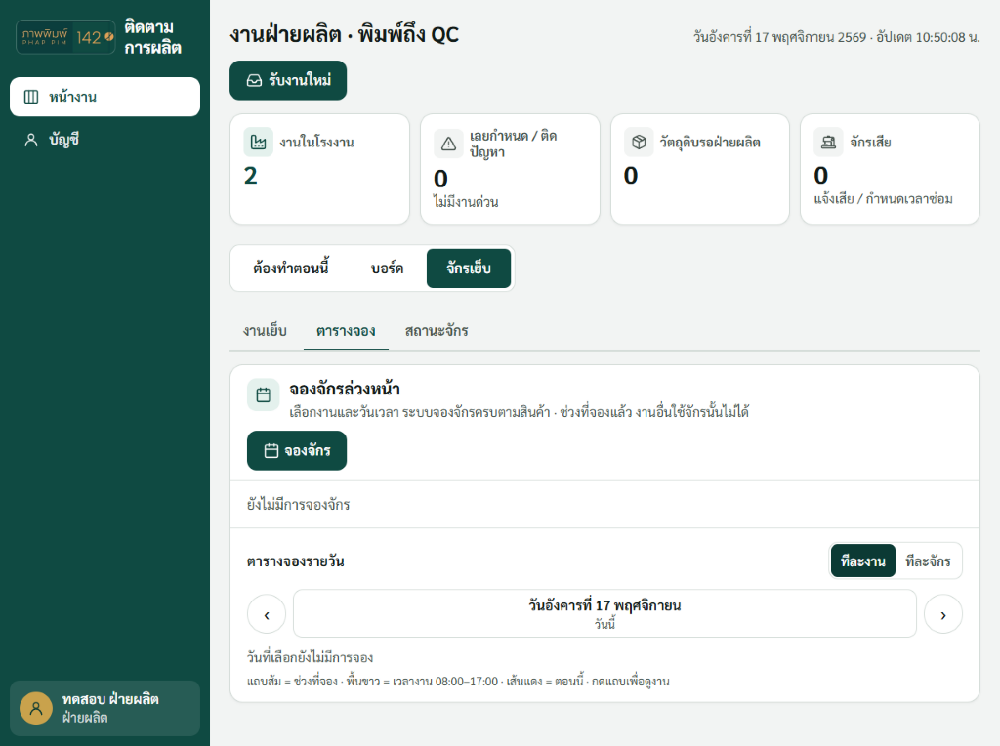

# คู่มือใช้งาน: ฝ่ายผลิต

> สำหรับทีมผลิตหน้างาน ใช้**มือถือของตัวเอง** (หรือแท็บเล็ตส่วนกลาง) · เว็บ: `https://pp142.pages.dev`
> กฎจำง่าย: **ทำงานตามคิว** · **ทำงานจริงแล้วกดในระบบทันที** · **ใช้เครื่องร่วมกับเพื่อน ต้องออกจากระบบทุกครั้ง**
> อัปเดต 18 พ.ย.: เพิ่ม **หน้าคิวสถานี** (หัวข้อ 3) · **งานด่วนแทรกคิว** · **งานส่งออกบริษัทภายนอก** · หน้า **บัญชีของฉัน** ใหม่
> อัปเดต 19 พ.ย.: **การ์ดงานทุกหน้ามีรูปม็อคอัพ** (กดเปิดงานแล้วกดรูปเพื่อดูเต็มจอ · กรอบเทา = แอดมินยังไม่ใส่รูป) · **เลือกจำนวนจักรตอนเริ่มเย็บ** และปุ่ม **จัดการจักร** (หัวข้อ 6) · จักรเสียแล้วงานพักเมื่อเหลือไม่ครบชุด · ข้อความ **ระบบตอบช้าเกินไป** (หัวข้อ 8)

---

## 1. ล็อกอิน · กล่องจดหมาย · ออกจากระบบเมื่อส่งเครื่องต่อ

### ล็อกอินเข้าใช้งาน
1. เปิดเว็บ `https://pp142.pages.dev` บนแท็บเล็ต
2. กรอกอีเมลและรหัสผ่านของคุณ แล้วกด **เข้าสู่ระบบ**

### กล่องจดหมาย (กระดิ่งมุมขวาบน)
กดไอคอน **กระดิ่งมุมขวาบน** (หรือเมนู **กล่องจดหมาย** บนจอใหญ่) เพื่อเปิด **กล่องจดหมาย** ดูแจ้งเตือนงานที่รอฝ่ายผลิตดำเนินการ

- ข้อความ **แก้ใบยืนยัน** = ลูกค้าขอแก้ใบหลังรับงาน แอดมินบันทึกแล้ว · ข้อความบอกจำนวน/กำหนดส่งที่เปลี่ยนและช่องที่แก้ · **เปิดรายละเอียดงานแล้วผลิตตามสเปกใหม่** (ใบปะงานที่พิมพ์ไปแล้วเป็นของเดิม ให้พิมพ์ใหม่)

### หน้าบัญชีของฉัน · ออกจากระบบเมื่อส่งเครื่องต่อ (สำคัญมาก)
1. กดชื่อ/รูปคนมุมขวาบน (หน้า **บัญชี**) → ด้านบนแสดง **ชื่อคุณและบทบาท** · หัวข้อ **บัญชีนี้ทำอะไรได้** บอกสิทธิ์ของบัญชี
2. ถ้าชื่อด้านบน**ไม่ใช่คุณ** แปลว่าเพื่อนยังไม่ออกจากระบบ → กด **ออกจากระบบ** แล้วล็อกอินด้วยบัญชีตัวเอง (ทุกการกดบันทึกชื่อผู้กด)
3. ก่อนส่งเครื่องให้คนถัดไป กดปุ่มสีแดง **ออกจากระบบ** รอจนหน้าจอกลับไปที่หน้าล็อกอิน
4. **เปลี่ยนรหัสผ่าน** ได้ที่การ์ดด้านล่าง (อย่างน้อย 8 ตัว) · ลืมรหัสให้แจ้งเจ้าของระบบตั้งใหม่

---

## เมนูของคุณ (ผู้จัดการแผนกผลิต (ฝ่ายผลิต / ผู้ควบคุมงาน))

เมนูแต่ละบทบาทไม่เหมือนกัน · จอใหญ่อยู่แถบซ้าย · มือถืออยู่แถบล่าง (เกิน 5 เมนูกด **เพิ่มเติม**) · **บัญชี** อยู่ที่ชื่อ/รูปคนมุมขวาบน · **กล่องจดหมาย** ที่กระดิ่ง

| เมนู | ใช้ทำอะไร |
|---|---|
| **ภาพรวมแผนก** | ตัวเลขสรุป + การ์ดสถานีที่ดูแล (ทำอยู่ / รอ / ติดปัญหา / เลยกำหนด) · กดสถานีเพื่อเปิดคิว |
| **คิวงาน** | สิ่งที่ต้องทำตอนนี้ เรียงตามคิว (เดิมคือแท็บ **ต้องทำตอนนี้**) |
| **กำหนดส่งลูกค้า** | งานที่ยังไม่ส่งเรียงตามวันส่ง · ดูว่างานไหนต้องเร่งให้ทันส่ง (แดง = เลยกำหนด / คาดว่าไม่ทัน) |
| **สถานีที่ดูแล** | บอร์ด + หน้าคิวสถานี + แท็บ **จักรเย็บ** (เดิมคือ **หน้างาน**) |
| **ปัญหา / งานแก้** | งานที่พักอยู่ (กด **แก้แล้ว ทำต่อ** / **แก้แล้ว เย็บต่อ** ได้ในหน้านี้) · งานแก้ที่ QC ส่งกลับ · งานเกินเวลามาตรฐาน |
| **รายงานแผนก** | รายงาน 7 / 30 / 90 วัน |

---

## 2. หน้าหลักของฝ่ายผลิต (แถบสถานี 1–7)

ฝ่ายผลิตมี 3 แท็บในเมนู **สถานีที่ดูแล** (เปิดแอปมาเจอ **บอร์ด** ก่อน · เลือกสถานีไว้แล้วจะเข้าหน้าคิวสถานีเลย):
- **ต้องทำตอนนี้**: งานที่รอคิวหรือกำลังทำอยู่ในตอนนี้ · แถว **ส้ม** = ใกล้ครบเวลามาตรฐาน · **แดง** = เกินเวลา (ถ้าขึ้นว่า **ส่งรายงานปัญหาก่อนกดเสร็จ** ให้เปิดงานแล้วกรอกรายงาน)
- **บอร์ด**: ด้านบนเป็น **แถบสถานี** ปุ่มเรียงเลข **1 พิมพ์ · 2 รีด · 3 ตัด · 4 รีดฟิล์ม · 5 ส่งปัก · 6 เย็บ · 7 QC + Packing** (ปุ่มแรกคือ **ทุกสถานี** · มือถือเลื่อนแถบไปทางขวาได้) · แต่ละปุ่มมีไอคอน + จำนวนงาน · ไอคอน **!** สีแดงกับตัวเลข = มีงาน **เลยกำหนด / ติดปัญหา** กี่งาน · **เครื่องจะจำสถานีที่เลือกไว้ให้** (ไม่ต้องกดหาสถานีเดิมซ้ำ)
- **จักรเย็บ**: งานเย็บ + ผังจักร (เลือกจักร · จัดการจักร · แจ้งจักรเสีย) และตารางจอง

> **หมายเหตุ:** การส่งงานใหม่เข้าโรงงาน (**รับงาน**) ทำโดย **แอดมิน** เท่านั้น งานที่รับเข้ารออยู่คอลัมน์ **รอผลิต** จนแอดมินเช็ควัตถุดิบครบ + ถ่ายรูป แล้วกด **ปล่อยเข้าไลน์การผลิต** งานจึง**ต่อท้ายคิว**ของ **สถานี** แรก (ฝ่ายผลิตเปิดดูรายการวัตถุดิบและรูปได้ แต่ติ๊ก/ปล่อยไม่ได้)
> ปุ่มสถานีที่มีงานตัวอย่างรออยู่ จะมีคำว่า **+ ตัวอย่าง n** ใต้จำนวนงาน

---

## 3. หน้าคิวสถานี (ใช้ทุกวัน)

> **ทุกหน้าเรียงตามคิว (ลำดับที่แอดมินรับงานเข้า) ไม่ใช่ตามกำหนดส่ง** · ทำงาน **คิว 1** ก่อนเสมอ

1. ไปที่เมนู **สถานีที่ดูแล** → **บอร์ด** → กดสถานีของตัวเองในแถบสถานี (ครั้งแรกครั้งเดียว เครื่องจะจำไว้) · จะไปสถานีอื่นกดปุ่มอื่นในแถบสถานี หรือปุ่ม **‹ ก่อนหน้า / ถัดไป ›** ใต้หัวสถานี
2. **หัวสถานี** บอก **สถานีที่ n จาก 7 · เฟส 1/2** + ตัวเลข **กำลังทำ / รอคิว / ติดปัญหา / ข้างนอก** · มุมขวามีป้าย **เครื่อง x/y** (เช่น **เครื่อง 1/2 · ว่าง 1**)
   - ป้ายเขียว = ยังมีเครื่องว่าง · ป้ายส้ม **เต็ม** = เครื่องถูกใช้ครบแล้ว **เริ่มงานใหม่ไม่ได้** การ์ดคิวจะบอกว่างานไหนใช้เครื่องอยู่
   - **งานที่พักงาน / อยู่ข้างนอก ไม่นับว่าใช้เครื่อง** → งานติดปัญหาให้ **พักงาน** (ยกลง) แล้วเครื่องว่าง เริ่มงานอื่นได้ · พอกด **แก้แล้ว ทำต่อ** ตอนเครื่องเต็ม งานนั้นจะ **กลับเข้าคิวรอเริ่ม**
   - จำนวนเครื่องตอนนี้: พิมพ์ 2 · รีด 1 · ตัด 2 · รีดฟิล์ม 2 · ส่งปัก / เย็บ / QC + Packing ไม่จำกัด (เย็บใช้ผังจักรแทน · QC + Packing เป็นไลน์ผลิต เริ่มหลายงานพร้อมกันได้)
3. หน้าคิวสถานีมี 3 ส่วน เรียงจากบนลงล่าง:
   - **กำลังทำ**: หัวข้อบอก **กำลังทำ n งาน · พักงาน n งาน** · กด **…เสร็จ** (เช่น **ตัดเสร็จ**) → **ยืนยัน** ส่งต่อสถานีถัดไป · กด **พักงาน** → พิมพ์สาเหตุ → **บันทึกพักงาน** · งานที่พักอยู่กด **แก้แล้ว ทำต่อ** (เย็บ = **แก้แล้ว เย็บต่อ**)
   - งานเกินเวลามาตรฐาน ปุ่มเสร็จจะเปลี่ยนเป็นปุ่มแดง **เกินเวลา · ส่งรายงานปัญหาก่อนกดเสร็จ** → กดแล้วเปิดงานและเลื่อนไปที่ฟอร์มรายงานให้เลย · ส่งรายงานแล้วค่อยกดเสร็จ
   - **ส่งออกข้างนอก** (ถ้ามี): งานที่สถานีนี้ไปทำที่บริษัทภายนอก แสดงชื่อบริษัทและ **คาดว่าของถึง** · **ฝ่ายผลิตไม่ต้องกดอะไร** รอแอดมินรับของกลับ แล้วงานจะเข้าคิวเอง
   - **คิวรอเริ่ม**: เรียง **คิว 1, คิว 2, …** · คิว 1 มีกรอบเด่นและปุ่มใหญ่ **เริ่ม…** (เช่น **เริ่มตัด**) กดได้เลย
   - สถานี **เย็บ**: ปุ่มคิว 1 คือ **เลือกจักรแล้วเริ่มเย็บ** → พาไปแท็บ **จักรเย็บ** เปิดผังจักรของงานนั้นให้เลือกจักร (หัวข้อ 6)
4. **อยากเริ่มงานที่ไม่ใช่คิว 1** (เช่น ผ้างานคิวแรกยังไม่มา): กด **เริ่มก่อนคิว** บนการ์ดงานนั้น → พิมพ์เหตุผล → **บันทึกและเริ่ม** (เหตุผลเก็บในประวัติงาน) · สถานีเย็บปุ่มเป็น **บันทึกแล้วเลือกจักร** แล้วไปเลือกจักรต่อ
5. **งานด่วน (แทรกคิว)**: กด **แทรกเป็นคิวแรก (งานด่วน)** บนการ์ด → พิมพ์เหตุผล (เช่น ลูกค้าเลื่อนวันส่งเร็วขึ้น) → **แทรกเป็นคิวแรก** · ทำได้เฉพาะฝ่ายผลิต / ผู้บริหาร / เจ้าของระบบ · ตกลงกับหัวหน้าก่อนแทรกทุกครั้ง
6. กดแล้วจะมีข้อความลอยเหนือเมนูล่าง: **สีเขียว** = สำเร็จ (หายเองใน 4 วินาที) · **สีแดง** = ทำไม่ได้ อ่านเหตุผล แล้วกด **เปิดรายละเอียดงาน** หรือ **ปิด**
7. สถานี **รีดฟิล์ม**: ถ้าแอดมินยังไม่บันทึกได้รับฟิล์ม การ์ดจะขึ้น **เริ่มไม่ได้ · ยังไม่ได้รับ…** แทนปุ่มเริ่ม
8. สถานี **QC + Packing** ต้องบันทึกจำนวนผ่านในรายละเอียดงาน (ปุ่ม **บันทึกผล QC / Packing**) · ดูคู่มือ QC
9. กดที่ตัวการ์ด (เลขงาน/ชื่อลูกค้า) เพื่อเปิดรายละเอียดงาน

> หน้าคิวสถานีเป็นวิธีหลัก · หัวข้อ 4 ด้านล่าง (กดจากรายละเอียดงาน) ยังใช้ได้เหมือนเดิม

---

## 3.5 รูปชิ้นแรก + รูปงานเสร็จ (เมื่อเจ้าของระบบเปิดใช้)

> ใช้กับงานที่ **กดเริ่มสถานีหลังเปิดใช้** เท่านั้น · งานที่ทำค้างอยู่ก่อนเปิดใช้กดเสร็จได้ตามเดิม

**สถานีที่ต้องรออนุมัติชิ้นแรก:** พิมพ์ · รีด · ตัด · รีดฟิล์ม · ส่งปัก (เจ้าของระบบเปลี่ยนได้ในหน้าตั้งค่า)

1. กด **เริ่ม…** ตามปกติ → การ์ดขึ้นกรอบฟ้า **ทำชิ้นแรก 1 ชิ้น แล้วถ่ายรูปส่งให้แอดมินตรวจ · อย่าเพิ่งทำทั้งล็อต**
2. ทำชิ้นแรก 1 ชิ้น → กด **ถ่ายรูปชิ้นแรก** (มือถือเปิดกล้องหลังทันที) · ถ่ายได้หลายรูป กด **ถ่ายเพิ่ม** (สูงสุด 6 รูป · เลือกเกิน ระบบบอกว่าไม่ได้ใส่กี่รูป) · กดกากบาทที่มุมรูปเพื่อลบ
3. พิมพ์บอกแอดมินได้ (ไม่ต้องกรอกก็ได้) → กด **ส่งรูปชิ้นแรก**
4. การ์ดขึ้นกรอบส้ม **ชิ้นแรกรออนุมัติ n นาที · อย่าเพิ่งทำทั้งล็อต** · **ระหว่างรอไม่นับเวลามาตรฐาน** · รอนานเกิน 15 นาที ระบบเตือนผู้บริหาร + ฝ่ายผลิตให้เอง
5. ผลอนุมัติ:
   - **ไม่ผ่าน** → กรอบแดงบอกเหตุผล (เช่น สีเพี้ยน · ตำแหน่งผิด) + กระดิ่งแจ้งเตือน → แก้ แล้วทำชิ้นแรกใหม่ ถ่ายรูปส่งอีกครั้ง
   - **ผ่าน** → **ทำทั้งล็อตได้**
6. ทำเสร็จทั้งล็อต → กด **ถ่ายรูปงานเสร็จ** → **ส่งรูปงานเสร็จ** → ขึ้นกรอบเขียว **ส่งรูปงานเสร็จแล้ว n รูป · กดเสร็จได้** → กด **…เสร็จ** ตามปกติ

**สถานีอื่น (เย็บ · QC + Packing):** ไม่ต้องรออนุมัติ แต่ **ต้องถ่ายรูปงานเสร็จอย่างน้อย 1 รูป** ก่อนกดเสร็จ

- ปุ่มเสร็จที่ยังกดไม่ได้จะบอกเหตุผล เช่น **ยังกดเสร็จไม่ได้: รูปชิ้นแรกรอแอดมินอนุมัติ**
- งานส่งแก้ (QC ส่งกลับ) ต้องผ่านชิ้นแรกใหม่ทุกรอบ รูปรอบก่อนใช้แทนไม่ได้
- **รูปที่ส่งไปแล้วใช้ซ้ำไม่ได้** (รูปชิ้นแรกที่ไม่ผ่าน · รูปชิ้นแรกเอามาเป็นรูปงานเสร็จ) ระบบขึ้น **มีรูปที่เคยส่งไปแล้ว ให้ถ่ายรูปใหม่** → ถ่ายรูปใหม่จากงานจริง
- พนักงานส่งรูปได้เฉพาะงานที่ **กดเริ่มแล้ว** ใน **สถานีของตัวเอง** · บัญชีที่ยังไม่ได้จับคู่สถานีส่งรูปและเปิดดูรูปไม่ได้ (ให้เจ้าของระบบจับคู่ก่อน)
- งานที่ส่งออกข้างนอก หรือเจ้าของระบบปิดระบบรูปแล้ว ไม่ต้องรอผลชิ้นแรก
- รูปทุกรูปดูย้อนหลังได้ในรายละเอียดงาน หัวข้อ **รูปจากสถานี**

---

## 4. เดินสถานีจากรายละเอียดงาน (เฟส 1 และ เฟส 2)

1. กดเปิดงานที่ต้องการทำ เพื่อดูรายละเอียดงาน
   - สามารถกด **เปิด PDF ใบยืนยัน** เพื่อดูใบงาน (ถ้าไฟล์ไม่เปิดขึ้นมา ให้กดลิงก์สำรอง **ถ้าไฟล์ไม่เปิดขึ้นมา กดที่นี่**)
   - ในรายละเอียดงานสามารถดู **รอบตัวอย่าง**, **เวลาที่ใช้ต่อสถานี**, และ **ไทม์ไลน์ทุกการกด** ได้

2. ทุก **สถานี** ใช้ปุ่มหลักแค่ **เริ่ม** → **เสร็จ** + **พักงาน / ติดปัญหา** (ไม่มีเช็คลิสต์ **ขั้นย่อย** ให้ต้องไล่ติ๊กแล้ว):
   - กด **เริ่ม...** (เช่น เริ่มพิมพ์งาน, เริ่มรีดงาน, เริ่มตัดงาน, เริ่มรีดฟิล์ม)
   - เมื่อทำจริงเสร็จแล้ว กด **...เสร็จ** แล้วกดยืนยัน

3. **เงื่อนไขพิเศษบางสถานี:**
   - **สถานีรีดฟิล์ม**: ใช้กับงาน **DTF / DTG / ซิลค์สกรีน** — ต้องรอแอดมินกดรับก่อน (**ได้รับฟิล์ม DTF แล้ว** / **ได้รับงาน DTG แล้ว** / **ได้รับงานสกรีนแล้ว**) จึงจะกดเริ่มรีดฟิล์มได้
   - **สถานีส่งปัก (ร้านนอก)**: กด **เริ่ม** ตอนส่งชิ้นผ้าไปร้านปัก → รับงานกลับและตรวจงานปัก (ตำแหน่ง สี ด้ายหลุด) → กด **เสร็จ** · จำนวนชิ้นที่ส่ง/รับกลับจดในใบปะงานกระดาษ (ระบบไม่มีช่องกรอกแล้ว)
   - **งานที่แอดมินส่งออกบริษัทภายนอก** (พิมพ์ / รีด / ตัด / เย็บ / ปัก): รายละเอียดงานขึ้นกล่อง **อยู่ที่บริษัทภายนอก** · ระหว่างนี้**กดเริ่มงานที่โรงงานไม่ได้** · แอดมินกด **รับเข้า** เมื่อของถึงโรงงาน แล้วงานจะไปรอที่สถานีถัดไป
4. หากพนักงานกดผิด **สถานี** หรือบันทึกผิด สามารถกดปุ่ม **แจ้งว่ากดผิด** ใน **ไทม์ไลน์ทุกการกด** ของหน้ารายละเอียดงานได้ (ปุ่มนี้แค่บันทึกว่ารายการนั้นผิดพร้อมเหตุผล **ไม่ได้ย้อนสถานะงาน** · ถ้างานต้องย้อนสถานะจริง ให้แจ้ง **เจ้าของระบบ**)

---

## 5. ใบปะงาน + QR (ใช้คู่กระดาษกับกองงาน)

1. เปิดรายละเอียดงาน → กด **พิมพ์ใบปะงาน**
2. พิมพ์เป็นขนาด **A5** แล้วติดไว้กับกองงานตลอดเส้นทาง
3. ช่อง **วันที่ / ผู้รับ / ลายเซ็น** บนกระดาษใช้เซ็นคู่กับระบบตอนส่งต่อระหว่าง **สถานี**
4. ใช้กล้องมือถือหรือแท็บเล็ตสแกน **QR** บนใบปะงาน → ล็อกอิน (ถ้ายังไม่ได้เข้าสู่ระบบ) → ระบบจะเปิดหน้างานนั้นให้ทันที ไม่ต้องพิมพ์ค้นหา

---

## 6. เย็บ และจัดการจักรเย็บ

> **กดเลือกจักรตัวที่นั่งเย็บจริง** ตามรหัสที่ติดบนจักร (SN-001, OL4-002 …) · ระบบเลือกตัวว่างไว้ให้ก่อน กดเปลี่ยนได้
> จักรใช้ร่วม (**โพ้ง · ลา · กระดุม · รังดุม**) ไม่ผูกกับงาน ทุกไลน์สลับใช้ได้ **ไม่ต้องเลือก**

แท็บ **จักรเย็บ** มีหน้าเดียวคือ **งานเย็บและจักร**: ด้านบน = งานกำลังเย็บ + รอเย็บ · ด้านล่าง = **ผังจักรทุกตัว** ตามรหัส
- **เขียว** = ว่าง · **ฟ้า** = ใช้อยู่ (บอกเลขงาน) · **แดง** = เสีย · **ส้ม** = จองให้งานอื่น

### เริ่มเย็บ (เลือกจักรที่นั่งเย็บ)
1. ส่วน **รอเย็บ** (เรียงตามคิว) → กด **เริ่มเย็บ** ที่งาน (หรือกด **เลือกจักรแล้วเริ่มเย็บ** จากหน้าคิวสถานีเย็บ ก็มาที่ผังนี้)
   - งานที่ **ไม่ใช่คิวแรก** ต้องพิมพ์ **เหตุผลที่เริ่มก่อนคิว** ในช่องเหนือปุ่มก่อน (เหมือนสถานีอื่น · เก็บในประวัติงาน)
2. ผังจักรของงานนั้นเปิดขึ้น · ตัวที่ระบบเลือกไว้ขึ้น **✓ เลือก** (สีเขียวเข้ม)
   - นั่งเย็บตัวอื่น: กดตัวที่เลือกไว้เพื่อเอาออก แล้วกดตัวที่นั่งจริง (เฉพาะตัว **ว่าง** กดได้)
   - งานใหญ่เปิดหลายตัวพร้อมกัน: กดเลือกเพิ่มได้เลย
3. ปุ่มใหญ่บอกรหัสที่เลือก เช่น **เริ่มเย็บด้วย SN-012 · SN-013** → กด
   - เลือกไม่ครบตามที่สินค้าต้องใช้ ปุ่มจะบอกว่าขาดอะไร เช่น **เลือกเข็มเดี่ยว 0/1 ตัว**
   - อีกเครื่องกดใช้จักรตัวนั้นไปก่อน ระบบจะบอกว่า **จักร SN-012 ใช้กับงาน … อยู่ เลือกตัวอื่น**
4. งานที่ยังเริ่มไม่ได้ ปุ่มจะขึ้น **จักรไม่ว่าง** พร้อมเหตุผล · ถ้าขึ้นว่า **สินค้านี้ยังไม่มีข้อมูลจักรเย็บ** ให้แจ้ง **เจ้าของระบบ**

### ระหว่างเย็บ: ปุ่ม "จัดการจักร" (เพิ่ม / คืนจักร)
1. ในส่วน **กำลังเย็บ** กด **จัดการจักร** บนการ์ดงาน
2. ผังจักรขึ้นมา · ตัวที่งานนี้ใช้อยู่ขึ้น **ของงานนี้**
3. กดจักร **ว่าง** = เพิ่มให้งานนี้ · กดจักร **ของงานนี้** = คืนให้งานอื่นใช้ · **กดแล้วบันทึกทันที**
4. คืนจนเหลือไม่ครบที่สินค้าต้องใช้ไม่ได้ ระบบบอกเหตุผล (ถ้าจะหยุดเย็บจริง ให้กด **รายงานปัญหา** แล้วติ๊ก **พักงานไว้ก่อน**)
5. จัดเสร็จกด **เสร็จ**

### จักรเสีย
1. ในผังจักร (ล่างหน้า **งานเย็บและจักร**) กด **แจ้งเสีย** ที่จักรตัวที่เสีย → แจ้งเสียพร้อมอาการ (ใส่เวลาคาดว่าซ่อมเสร็จได้)
2. **จักรเสีย 1 ตัวจากหลายตัว งานไม่หยุด** ระบบแค่เอาตัวที่เสียออก · งานจะ**พักอัตโนมัติเฉพาะเมื่อจักรที่เหลือไม่ครบชุด**ของสินค้า (ก่อนกดแจ้งเสีย หน้าจอเตือนให้รู้ก่อน)
3. งานที่ถูกพัก: หาจักรมาแทน (กดจักรว่างใน **จัดการจักร**) หรือรอซ่อม แล้ว**ฝ่ายผลิต**กด **เย็บต่อ** · ไทม์ไลน์งานจะบันทึกว่า **จักรเสีย (อาการ)**
4. ซ่อมเสร็จแล้ว กลับมาที่จักรตัวนั้นกด **ซ่อมเสร็จ** (จักรกลับเป็นว่าง)

### ตารางจอง · เย็บเสร็จ · งานแก้
- ดูหรือจองจักรล่วงหน้า กดแท็บย่อย **ตารางจอง**

- เมื่อเย็บครบ กด **เย็บเสร็จ** → **ยืนยันเย็บเสร็จ** งานไป **QC + Packing** และระบบคืนจักรทุกตัวให้เอง
- งานที่มีป้าย **งานแก้** (สีแดง QC ส่งกลับมา) ให้รีบหยิบมาแก้ก่อน แล้วกดเย็บเสร็จส่งกลับ QC อีกครั้ง
- งานที่ส่งไปเย็บข้างนอก**ไม่ขึ้นใน รอเย็บ** แต่อยู่ในส่วน **ส่งออกข้างนอก** ของหน้าคิวเย็บ · ไม่ต้องขึ้นจักร

---

## 6.5 ม็อคอัพกำกับสเปก

> แอดมินชี้จุดบนภาพเสื้อพร้อมสเปก แล้ว**อนุมัติใช้ผลิตเอง** · ฝ่ายผลิตไม่ต้องอนุมัติ มีหน้าที่**ดูสเปกแล้วกดรับทราบ** · เจอสเปกผิดให้แจ้งแอดมินสร้างฉบับแก้ไข

### ฉบับที่ค้างรออนุมัติ (ถ้ามี)
1. ฉบับ **รออนุมัติ** ที่ส่งมาก่อนเปลี่ยนวิธี (มีข้อความใน **กล่องจดหมาย** "ม็อคอัพรออนุมัติ"): เปิดรายละเอียดงาน → **ม็อคอัพกำกับสเปก** → แท็บ **ตรวจ ฉบับ n**
2. ตรวจทุกจุดกับใบยืนยัน → **อนุมัติฉบับ n ใช้ผลิต** (ใส่หมายเหตุได้) หรือพิมพ์เหตุผลแล้ว **ส่งกลับให้แอดมินแก้**
3. อนุมัติแล้วระบบเก็บสำเนาไว้แก้ไม่ได้ · ใบยืนยันถูกแก้ทีหลังก็ไม่เปลี่ยนสเปกในฉบับที่อนุมัติ (หน้าจอเตือนให้แจ้งแอดมิน)

### ดูสเปกที่หน้างาน + รับทราบ
1. เปิดรายละเอียดงาน → กด **ม็อคอัพกำกับสเปก** → หน้า **ดูสเปก (ฉบับ n ใช้ผลิต)**
2. **ดูเฉพาะสถานี** = เห็นเฉพาะจุดของสถานีนั้น + จุดที่ไม่ระบุสถานี · กดเลข/กล่องบนภาพเพื่ออ่านสเปกเต็มด้านขวา
3. อ่านแล้วกด **รับทราบสเปกฉบับ n · สถานี…** (บันทึกชื่อ สถานี ฉบับ เวลา) · กดแล้วขึ้นเขียว **รับทราบแล้ว**
4. การ์ดงานในหน้าคิวสถานีขึ้นป้าย **มีสเปกกำกับ · ยังไม่รับทราบ** (ส้ม) หรือ **สเปกเปลี่ยน ฉบับ n · ยังไม่รับทราบ** (แดง) จนกว่าสถานีนั้นจะกดรับทราบ
5. แถบส้ม **มีฉบับแก้ไข n รออนุมัติ · ยังผลิตตามฉบับ n** = ยังใช้ฉบับเดิมจนกว่าจะอนุมัติ · ฉบับใหม่อนุมัติแล้วต้องกดรับทราบใหม่
6. หน้านี้**แก้สเปกไม่ได้** · เจอสเปกผิดให้แจ้งแอดมิน

## 7. พักงาน และรายงานปัญหา

### พักงาน (เมื่อต้องหยุดงานชั่วคราว)
1. เปิดรายละเอียดงานที่กำลังทำ
2. กด **พักงาน / ติดปัญหา**
3. **พิมพ์สาเหตุ** ลงในช่อง แล้วกดยืนยัน
4. เวลาที่ **พักงาน** ไม่นับเป็นเวลาทำงานของสถานี แต่ **เวลาผลิตทั้งงาน (10/15/20 วันทำงาน) ยังนับต่อ** · แก้แล้วรีบกดทำต่อ
5. เมื่อแก้ปัญหาแล้ว **ฝ่ายผลิต** (หรือผู้บริหาร) กด **แก้แล้ว ทำต่อ** · งานเย็บที่พัก = ฝ่ายผลิตกด **เย็บต่อ** ในแท็บจักรเย็บ
   - ใครก็พักงานได้ แต่ **QC และแอดมินกดทำต่อเองไม่ได้** → ถ้า QC พักงานที่ QC + Packing จะเรียกฝ่ายผลิตมากดให้

### รายงานปัญหา (เมื่อใกล้หรือเกินเวลามาตรฐาน)
- ฟอร์ม **รายงานปัญหา** จะขึ้นเองในรายละเอียดงานเมื่อใกล้หรือเกินเวลามาตรฐานเท่านั้น (ไม่ใช่ปุ่มที่กดได้ทุกเวลา · หากเป็นปัญหาทั่วไประหว่างทำ ให้ใช้ปุ่ม **พักงาน / ติดปัญหา**)
1. เลือกรหัสสาเหตุ อธิบายปัญหา และระบุวันที่คาดว่าเสร็จ
2. หากต้องการให้ใครช่วย ให้พิมพ์ในช่อง **ต้องการความช่วยเหลือจากใคร (ถ้ามี)**

> **สำคัญ:** ถ้างานขึ้นแถบสีแดง (**เกินเวลามาตรฐาน**) ระบบจะไม่ให้กดจบ **สถานี** จนกว่าจะ **รายงานปัญหา** ก่อน

---

## 8. เน็ตหลุด · มีระบบรุ่นใหม่ ทำอย่างไร

### เน็ตหลุด
1. ถ้าเน็ตหลุด จะมีแถบสีแดงขึ้นเตือนด้านบนว่า **ขาดการเชื่อมต่อ**
2. **ห้ามกดปุ่มเดิมซ้ำๆ** เพราะคำสั่งอาจค้างหรือซ้ำเมื่อเน็ตกลับมา
3. รอจนสัญญาณ Wi-Fi กลับมา แถบแดงจะหายไปเองและข้อมูลบนจอจะอัปเดตล่าสุดให้อัตโนมัติ
4. ถ้ายังไม่อัปเดต ให้กดรีเฟรชหน้าเว็บ 1 ครั้ง แล้วตรวจสถานะงานก่อนกดต่อ

### ขึ้นข้อความ "ระบบตอบช้าเกินไป…"
- แปลว่ากดไปแล้วรอเกิน 30 วินาที **ระบบยังไม่แน่ใจว่าบันทึกหรือยัง**
- **ดูสถานะงานบนจอก่อน** (เช่น งานย้ายไปส่วนกำลังทำแล้วหรือยัง) · ถ้าเปลี่ยนแล้ว = บันทึกแล้ว ไม่ต้องกดซ้ำ · ถ้ายังไม่เปลี่ยนค่อยกดอีกครั้ง
- กดซ้ำโดยไม่ตั้งใจ ระบบกันบันทึกซ้ำไว้แล้ว แต่ให้ดูจอก่อนทุกครั้ง

### หน้าจอขึ้นว่าเกิดข้อผิดพลาด
- ระบบจะไม่ขึ้นจอขาว แต่ขึ้นกล่องแจ้งข้อผิดพลาดแทน · กด **โหลดใหม่** (ไม่หายให้แจ้งเจ้าของระบบ) แล้วตรวจสถานะงานก่อนกดต่อ

### มีระบบรุ่นใหม่ / หน้าจอดูแปลก
- ถ้าหน้าจอดูแปลกหรือไม่ตรงกับคู่มือ ให้ปัดลงเพื่อรีเฟรช หรือปิดแล้วเปิดแอปใหม่
- ถ้าเห็นแถบแจ้งว่า **มีระบบรุ่นใหม่** ให้กดโหลดทันทีเพื่อให้ได้หน้าจอล่าสุด
- ถ้ายังเห็นหน้าจอเก่า (เช่น ไม่มีหน้าคิวสถานี) ให้**ปิดแท็บเว็บทั้งหมดแล้วเปิดใหม่** (รีเฟรชเฉยๆ อาจไม่พอ)
