# คู่มือใช้งาน: เจ้าของระบบ

> สำหรับเจ้าของระบบ (Owner) · เว็บ: `https://pp142.pages.dev`
> หน้าที่หลัก: ดูแลบัญชีผู้ใช้ · ตั้งค่า **สถานี** เวลามาตรฐาน จักรเย็บ · ตรวจความเรียบร้อยของระบบทั้งหมด

---

## 1. ล็อกอิน · กล่องจดหมาย · ออกจากระบบเมื่อส่งเครื่องต่อ

1. เปิดเว็บ `https://pp142.pages.dev` กรอกอีเมลและรหัสผ่าน แล้วกด **เข้าสู่ระบบ**

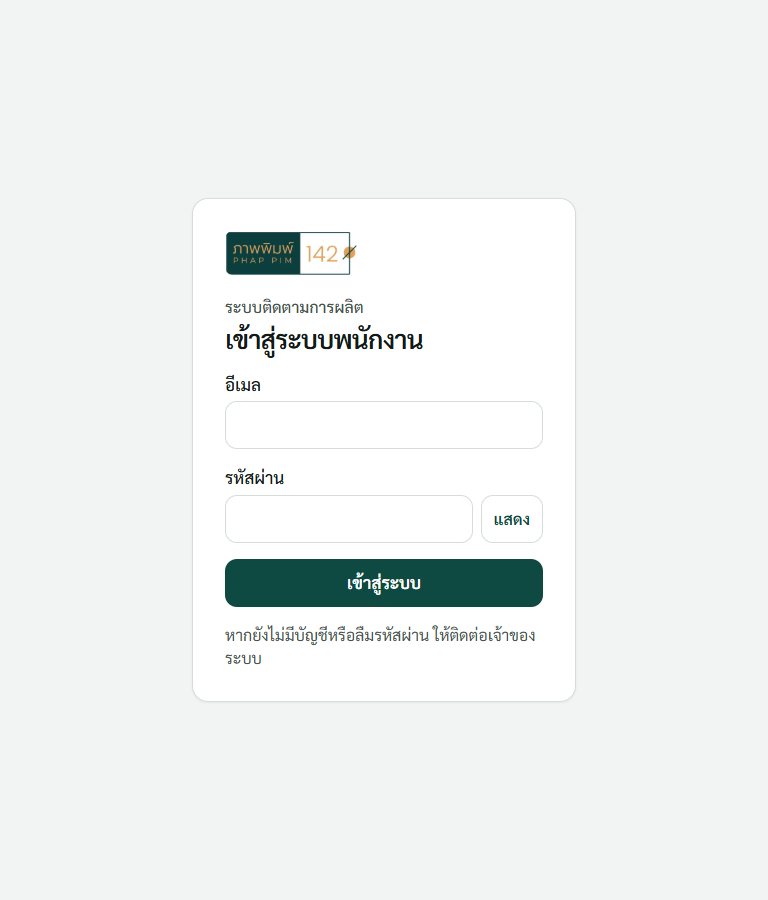

2. กดไอคอน **กระดิ่งมุมขวาบน** (หรือเมนู **กล่องจดหมาย** บนจอใหญ่) เพื่อเปิด **กล่องจดหมาย** ดูแจ้งเตือนงานค้างหรือปัญหาที่ต้องการความช่วยเหลือ

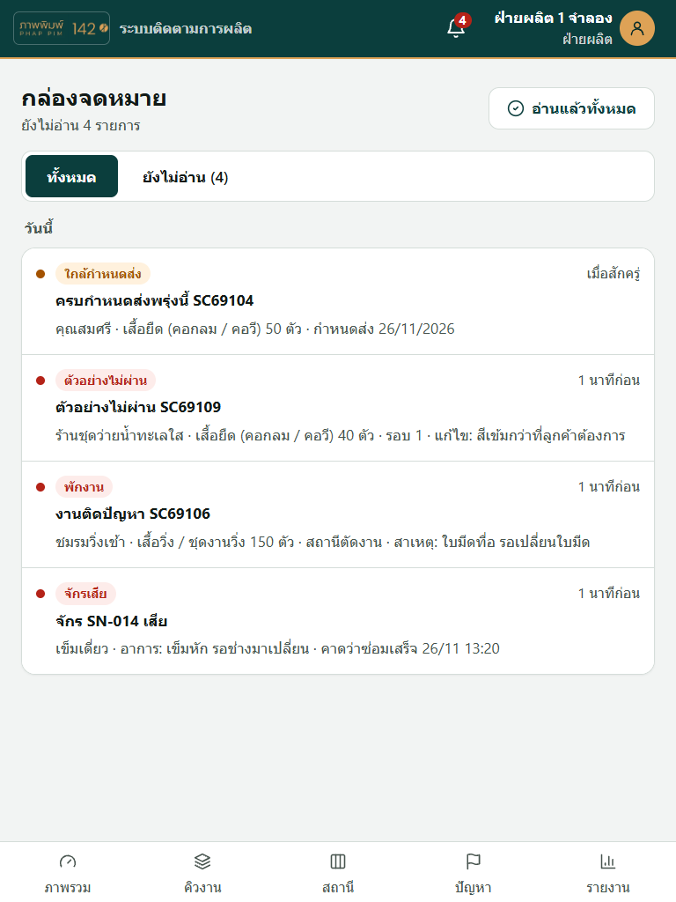

3. เพื่อความปลอดภัยของสิทธิ์เจ้าของระบบ **ห้ามเปิดค้างไว้บนแท็บเล็ตส่วนกลางหน้างาน** เมื่อใช้งานเสร็จให้กดชื่อมุมขวาบน → **ออกจากระบบ** ทันที · หน้า **บัญชี** เปลี่ยนรหัสผ่านของตัวเองได้

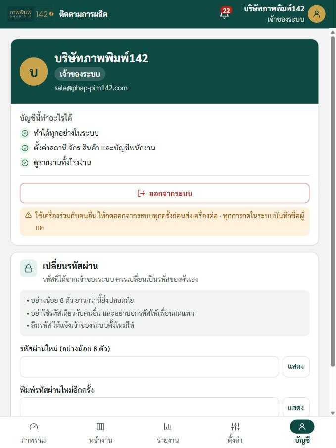

---

## เมนูของคุณ (ผู้ดูแลระบบ (เจ้าของ))

เมนูแต่ละบทบาทไม่เหมือนกัน · จอใหญ่อยู่แถบซ้าย · มือถืออยู่แถบล่าง (เกิน 5 เมนูกด **เพิ่มเติม**) · **บัญชี** อยู่ที่ชื่อ/รูปคนมุมขวาบน · **กล่องจดหมาย** ที่กระดิ่ง

| เมนู | ใช้ทำอะไร |
|---|---|
| **ภาพรวมระบบ** | หน้าแรกของเจ้าของ: ผู้ใช้ตามบทบาท · พนักงานที่ยังไม่จับคู่สถานี · จักรเสีย · สินค้าที่ยังไม่มีสูตรจักร · การแก้ตั้งค่าล่าสุด |
| **ผู้ใช้งาน** | เพิ่ม/ปิดบัญชี · เปลี่ยนบทบาท (บทบาทใหม่ **พนักงานสถานี** สำหรับคนหน้างานรายคน) |
| **Roles & Permissions** | ตารางว่าแต่ละบทบาททำอะไรได้ (ดูอย่างเดียว · ฐานข้อมูลบังคับจริง) |
| **Station Assignment** | ติ๊กสถานีให้พนักงานสถานีแต่ละคน · ยังไม่จับคู่ = กดงานไม่ได้ |
| **Audit Log** | ใครแก้ตั้งค่า/ผู้ใช้/จับคู่สถานี เมื่อไร ค่าเดิม → ค่าใหม่ · และทุกการกดงาน · กรองตามคน/7–30 วัน · แก้หรือลบไม่ได้ |
| **ตั้งค่าระบบ** | สถานี · เวลามาตรฐาน · วัตถุดิบ · รหัสสาเหตุ · จักรเย็บ · การแจ้งเตือน |
| **กลุ่ม งานผลิต** | ภาพรวมการผลิต · ทุก Station · รายงาน |

---

## 2. สิ่งที่เจ้าของระบบจัดการได้

### ดูภาพรวม · รายละเอียดงาน · รายงาน
- ดูสถานะงานทั้งหมด **บอร์ด** **จักรเย็บ** **ค้นหางาน** **รับงานใหม่** และดู **รอบตัวอย่าง**, **เวลาที่ใช้ต่อสถานี**, **ไทม์ไลน์ทุกการกด**, รวมถึงเปิด PDF **ใบยืนยัน** (ถ้าไฟล์ไม่เปิดขึ้นมา กดลิงก์สำรอง **ถ้าไฟล์ไม่เปิดขึ้นมา กดที่นี่**)

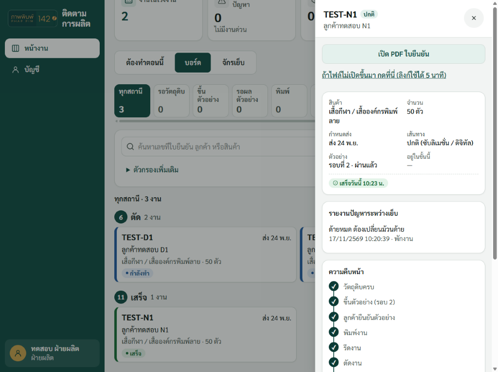

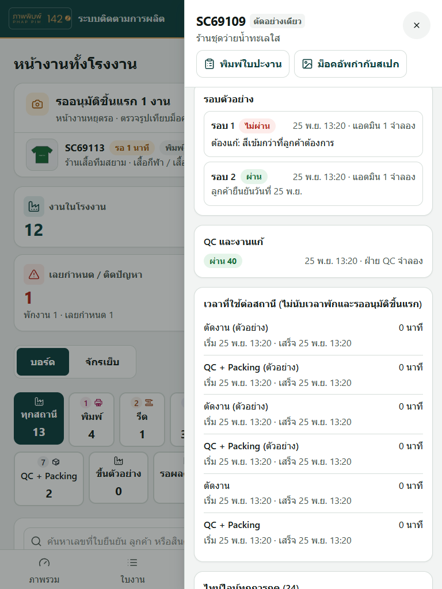

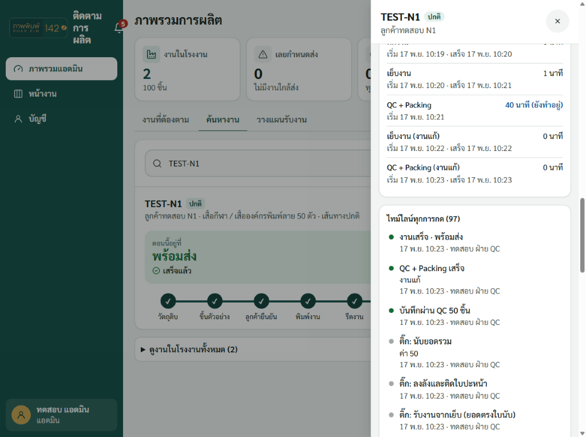

- **หน้ารายงาน**: ดูเวลาเฉลี่ยต่อ **สถานี** (หักเวลา **พักงาน** แล้ว), จุดคอขวด, % ทันกำหนด, สถิติ **งานแก้**, และสรุป **รายงานปัญหา** (**คลิกที่งานเกินกำหนดในหน้ารายงานเพื่อเปิดรายละเอียดงานได้ทันที**)

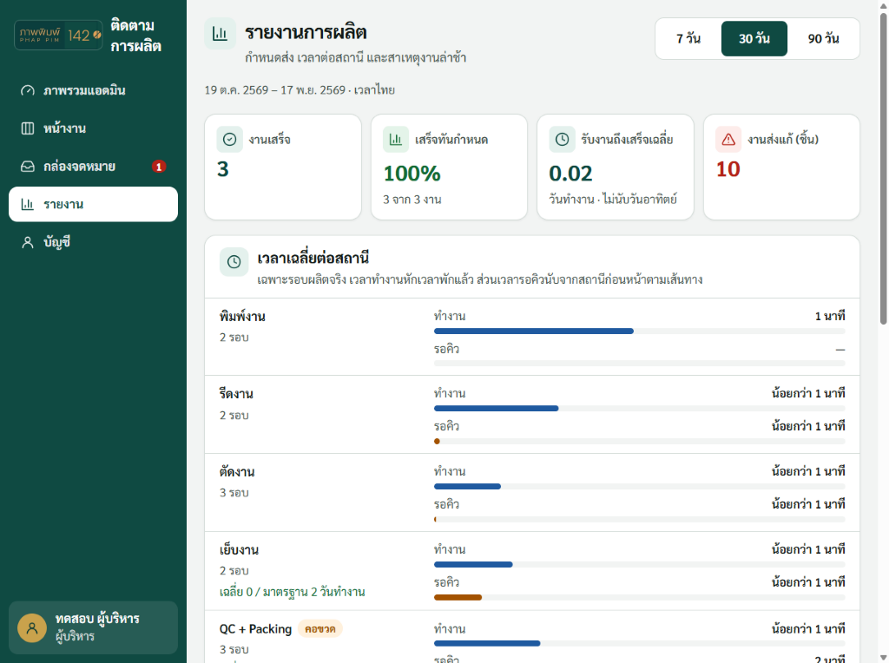

### ผู้ใช้งาน และ Station Assignment (เมนูด้านซ้าย)
แยกออกจากหน้าตั้งค่าแล้ว · กดเมนู **ผู้ใช้งาน** หรือ **Station Assignment** ด้านซ้าย

- **ผู้ใช้งาน**: แก้ชื่อ กำหนดบทบาท (`เจ้าของระบบ`, `แอดมิน`, `QC`, `ฝ่ายผลิต`, `ผู้บริหาร`) และเปิด/ปิดการใช้งานบัญชี *(การ **สร้างบัญชีใหม่** ทำใน **Supabase → Authentication → Add user** แล้วกลับมากำหนดบทบาทที่หน้านี้)*

   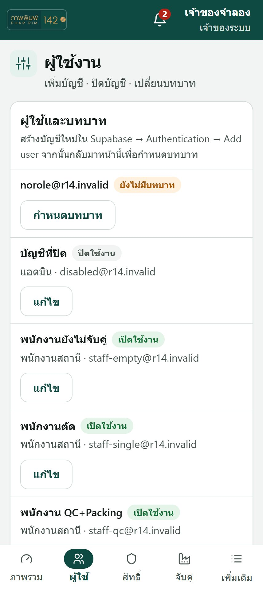

- **Station Assignment**: จับคู่พนักงานสถานีกับสถานีที่ทำงาน (บัญชีที่ยังไม่จับคู่เปิดหน้าสถานีไม่ได้)

### หน้าตั้งค่า (6 หมวด)
ใช้ปรับค่าต่างๆ ของโรงงานบนหน้าเว็บโดยไม่ต้องแก้โค้ด · เลือกแท็บจากช่อง **หมวดตั้งค่า** ด้านบน (ภาพจากมือถือบัญชีเจ้าของระบบ 17 พ.ย.)

1. **สถานีและขั้นย่อย**: ตั้งเฟสและเวลามาตรฐานรายสถานี (เกณฑ์งานใหญ่) · **ขั้นย่อยเก็บไว้อ้างอิงเท่านั้น** หน้างานกดแค่ **เริ่ม → เสร็จ** (ยกเว้นขั้น "ได้รับฟิล์ม" ที่แอดมินต้องบันทึกก่อนเริ่มรีดฟิล์ม)

   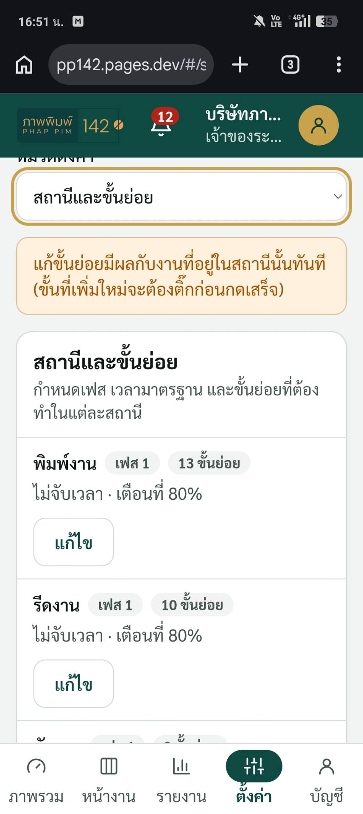

2. **เวลามาตรฐานของช่วง**: เวลารวมของสถานีที่ต่อกัน (เช่น พิมพ์ → ตัด 3 วันทำงาน · ตั้งแต่ 700 ชิ้น 5 วัน) · เกินแล้วต้องส่ง **รายงานปัญหา** ก่อนกดเสร็จ

   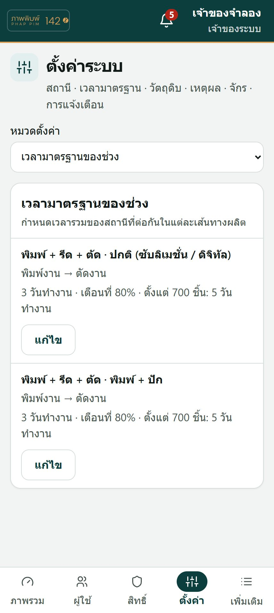

3. **แม่แบบวัตถุดิบ**: **ระบบไม่ใช้แล้ว** ตั้งแต่ 17 พ.ย. (แอดมินเตรียมวัตถุดิบครบก่อนส่งงานเข้า) · เก็บไว้เผื่อกลับมาใช้

   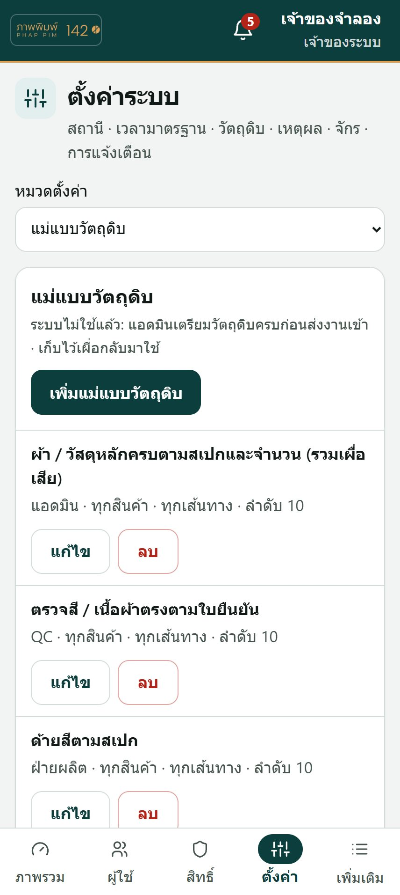

4. **รหัสสาเหตุ**: เพิ่ม/แก้ไข และเปิด-ปิดรหัสสาเหตุที่ใช้ในฟอร์ม **รายงานปัญหา** (รหัสที่เลิกใช้ให้ปิด ไม่ลบ เพื่อรายงานย้อนหลัง)

   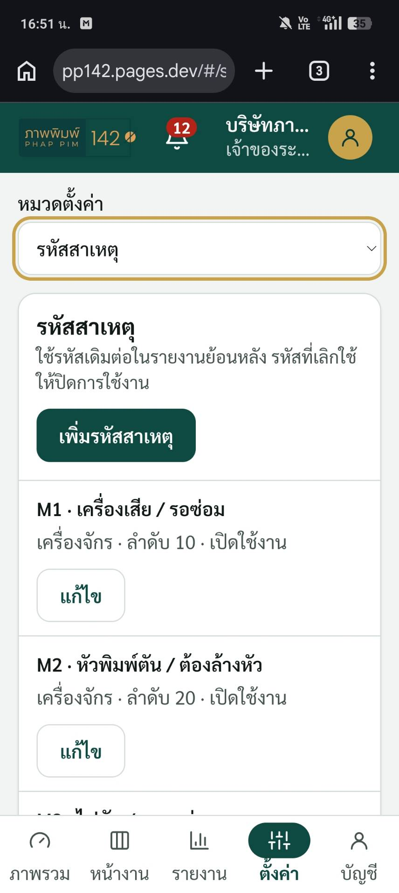

5. **จักรเย็บ**: แท็บ **รายการจักร** เพิ่ม/แก้/ปิดใช้งานจักร (แจ้งเสีย/ซ่อมเสร็จทำที่หน้างาน) · แท็บ **จำนวนจักรตามสินค้า** ตั้งว่าสินค้าแต่ละแบบใช้จักรชนิดใดกี่ตัว · **จักรลา · ติดกระดุม · เจาะรังดุม เป็นจักรใช้ร่วม** ทุกไลน์สลับใช้ได้ ไม่ผูกกับงาน (เปลี่ยนชนิดจักรเป็น **ใช้ร่วม / ประจำไลน์** ได้เองในแท็บ **จักรเย็บ** → ชนิดจักร)

   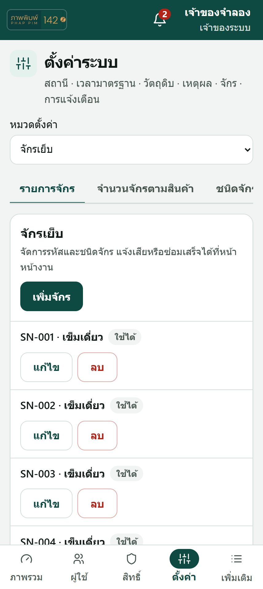

6. **การแจ้งเตือน**: เปิด/ปิดการสร้างข้อความแต่ละเรื่องเข้า **กล่องจดหมาย** (ปิดแล้วข้อความเดิมยังอยู่ · เจ้าของระบบเห็นทุกข้อความ)

   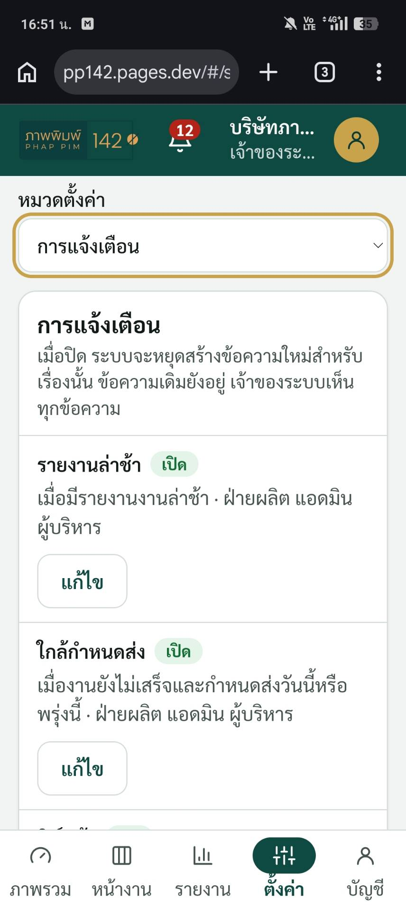

---

## 3. การดูแลงานหน้างาน และแก้ไขเมื่อกดผิด

- **คิวงาน (18 พ.ย.)**: ทุกหน้าเรียงตามลำดับที่รับงานเข้า · หน้างานใช้ **หน้าคิวสถานี** (ทุก Station → บอร์ด → เลือกสถานี) · เริ่มงานที่ไม่ใช่คิวแรกต้องใส่เหตุผล · **แทรกเป็นคิวแรก (งานด่วน)** ทำได้โดยฝ่ายผลิต / ผู้บริหาร / เจ้าของระบบ (ต้องใส่เหตุผล) · เหตุผลทุกครั้งอยู่ใน **ไทม์ไลน์ทุกการกด**
- **ส่งออกบริษัทภายนอก**: แอดมินบันทึกส่งออก / ส่งต่อ / รับของกลับ / แบ่งงาน (`เลขเดิม-2`) ในรายละเอียดงาน · ระหว่างงานอยู่ข้างนอก ระบบกันไม่ให้กดเริ่มงานที่โรงงาน และ**ยกเลิกงานไม่ได้จนกว่าจะรับของกลับ** · ข้อมูลบริษัท (โทร แผนที่ ประเภทงาน) ตอนนี้เพิ่มได้จากฟอร์มส่งออกเท่านั้น

- ในการปฏิบัติงานปกติ เจ้าของระบบใช้หน้าจอเพื่อ **ติดตามและตรวจสอบ** เป็นหลัก ให้ทีมงานแต่ละฝ่ายกดตามบทบาทของตนเอง (เพื่อเก็บประวัติผู้กดจริงในระบบ)
- กรณีพนักงานกดผิด **สถานี** หรือบันทึกผิด ให้กดปุ่ม **แจ้งว่ากดผิด** ใน **ไทม์ไลน์ทุกการกด** ของหน้ารายละเอียดงาน (ปุ่มนี้แค่บันทึกว่ารายการนั้นผิดพร้อมเหตุผล **ไม่ได้ย้อนสถานะงาน** · ถ้างานต้องย้อนสถานะจริง ให้เจ้าของระบบเป็นผู้ดำเนินการ) (ห้ามแก้ตรงในตารางฐานข้อมูล)

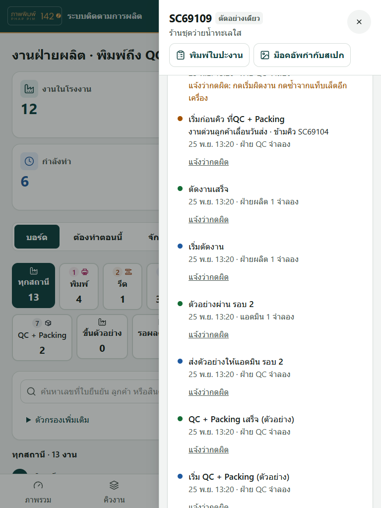

---

## 4. สิ่งที่ต้องตรวจเป็นประจำ

1. ตรวจงานค้างหรือแถบแดง (**เกินเวลามาตรฐาน**) ใน **งานที่ต้องตาม** และ **รายงานปัญหา** ทุกเช้า
2. เมื่อเปลี่ยนสเปกเครื่องจักรหรือเวลามาตรฐานในโรงงาน ให้ปรับค่าผ่านหน้า **ตั้งค่า** (หัวข้อ 2)
3. เมื่อมีพนักงานเข้าใหม่หรือลาออก ให้สร้างบัญชีใน **Supabase → Authentication → Add user** แล้วกำหนดบทบาทในหน้าเว็บ พร้อมเตือนเรื่อง **ออกจากระบบ** ทุกครั้งเมื่อส่งแท็บเล็ตต่อ

---

## 5. เน็ตหลุด · มีระบบรุ่นใหม่ ทำอย่างไร

- **เน็ตหลุด:** หากขึ้นแถบสีแดง **ขาดการเชื่อมต่อ** ด้านบน ให้รอจนสัญญาณเน็ตกลับมา ห้ามกดปุ่มแก้ไขหรือบันทึกซ้ำระหว่างที่แถบแดงยังอยู่ เมื่อเน็ตกลับมาแถบแดงจะหายไปเอง
- **มีระบบรุ่นใหม่:** ถ้าหน้าจอดูแปลกหรือไม่ตรงคู่มือ ให้ปัดรีเฟรชหรือปิดเปิดแอปใหม่ และถ้าเห็นแถบ **มีระบบรุ่นใหม่** ให้กดโหลดทันที
