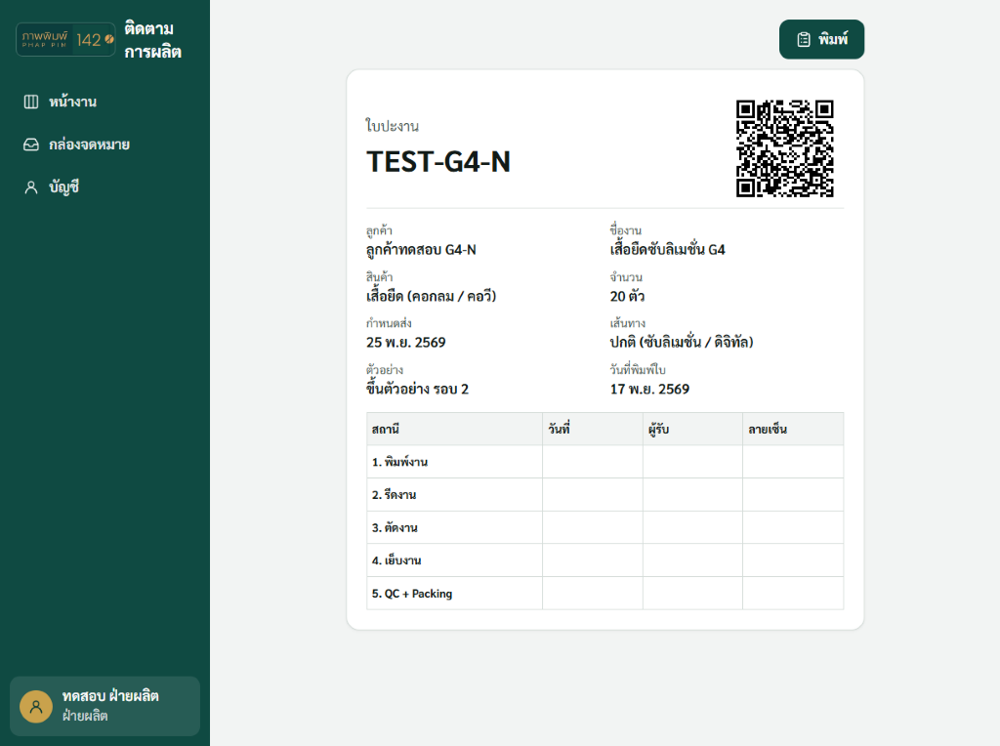

# คู่มือใช้งาน: แอดมิน

> สำหรับทีมแอดมิน · เว็บ: `https://pp142.pages.dev`
> หน้าที่หลัก: **รับงาน** (ส่งงานเข้าโรงงานด้วยไฟล์ `.json` และ PDF) · พิมพ์ **ใบปะงาน** · สั่ง/รับฟิล์ม (DTF / DTG / สกรีน) · บันทึกผล **ขึ้นตัวอย่าง** · ค้นหางานให้ลูกค้า

---

## 1. ล็อกอิน · กล่องจดหมาย · ออกจากระบบเมื่อส่งเครื่องต่อ

1. เปิดเว็บ `https://pp142.pages.dev` กรอกอีเมลและรหัสผ่าน แล้วกด **เข้าสู่ระบบ**

2. กดไอคอน **กระดิ่งมุมขวาบน** (หรือเมนู **กล่องจดหมาย** บนจอใหญ่) เพื่อเปิด **กล่องจดหมาย** ดูรายการแจ้งเตือนงานที่รอฝั่งแอดมิน

3. เมื่อใช้งานเสร็จหรือส่งเครื่องต่อให้คนอื่น ให้กดเมนู **บัญชี** → **ออกจากระบบ** ทุกครั้ง

---

## 2. หน้าหลักของแอดมิน

หน้า **ภาพรวม** ของแอดมินมี 3 แท็บ:
- **งานที่ต้องตาม**: รวมงานที่รอดำเนินการฝั่งแอดมิน เช่น รอรับฟิล์ม, รอผล **ขึ้นตัวอย่าง**, งานติดปัญหา
- **ค้นหางาน**: ค้นหาตามเลขที่ **ใบยืนยัน** (SC) หรือชื่อลูกค้า เพื่อดูสถานะล่าสุด
- **วางแผนรับงาน**: ดูคิวงานและกำลังผลิตเพื่อประเมินวันส่งงานใหม่

---

## 3. รับงานใหม่ (ส่งงานเข้าโรงงานด้วยไฟล์ `.json` และ PDF)

> มีเฉพาะ **แอดมิน** (และเจ้าของระบบ) เท่านั้นที่กดส่งงานเข้าโรงงานได้ · ระบบไม่มีขั้นรอวัตถุดิบแล้ว ส่งงานเข้าแล้วงานจะขึ้น **สถานี** แรกทันที

1. ในฟอร์ม **ใบยืนยัน** (`production-confirmation.html`) เมื่อกรอกข้อมูลครบแล้ว ให้กดปุ่ม **บันทึกไฟล์** (ได้ไฟล์ `.json`) และส่งออกไฟล์ **PDF** ที่ลูกค้าเซ็นครบ
2. บนเว็บ กดปุ่ม **รับงานใหม่** (อยู่ทั้งในหน้า **ภาพรวม** และ **หน้างาน**)
3. แนบไฟล์ **`.json`** จากฟอร์มใบยืนยัน → ระบบจะเติมเลขที่ใบ, ลูกค้า, สินค้า, **เส้นทางผลิต**, **จำนวน**, **ผลิตเผื่อเสีย**, **กำหนดส่ง**, และ **ขึ้นตัวอย่าง / ไม่ขึ้นตัวอย่าง** ให้อัตโนมัติ
   - **ต้องใช้ฟอร์มรุ่นใหม่** ในการสร้างไฟล์ `.json` (หากจำเป็นต้องเปิดไฟล์จากรุ่นเก่า ให้ตรวจช่อง **จำนวน** และ **เส้นทางผลิต** ด้วยตัวเองทุกครั้งก่อนกดรับ)
4. ตรวจเส้นทางผลิต 8 แบบ (`ปกติ`, `DTF`, `DTG`, `ซิลค์สกรีน`, `ปัก`, `พิมพ์ + ปัก`, `ตัดงานลูกค้า`, `ไม่มีงานพิมพ์`) และช่อง **ขึ้นตัวอย่าง / ไม่ขึ้นตัวอย่าง** ให้ตรงกับ **ใบยืนยัน**
5. แนบไฟล์ **PDF** ของ **ใบยืนยัน** แล้วกด **รับงาน**:
   - งานที่เลือก **ขึ้นตัวอย่าง** → ไปที่ **ขึ้นตัวอย่าง** ทันที
   - งานที่เลือก **ไม่ขึ้นตัวอย่าง** → เข้า **สถานีแรกของการผลิตจริงทันที**

---

## 4. พิมพ์ใบปะงาน + QR

1. หลังส่งงานเข้าแล้ว เปิดรายละเอียดงาน → กด **พิมพ์ใบปะงาน**
2. พิมพ์ขนาด **A5** ส่งคู่กับกองงานหน้างาน (มีช่องวันที่/ผู้รับ/ลายเซ็นใช้คู่กระดาษ)
3. เมื่อสแกน **QR** ด้วยมือถือและล็อกอิน ระบบจะเปิดหน้างานนั้นให้ทันที

---

## 5. สั่ง/รับงาน DTF / DTG / ซิลค์สกรีน

1. ในรายละเอียดงาน กดปุ่มสั่งตามประเภทงาน พร้อมระบุวันคาดว่าได้รับ:
   - งาน **DTF**: กด **บันทึกสั่งฟิล์ม DTF** → เมื่อของมาถึงกด **ได้รับฟิล์ม DTF แล้ว**
   - งาน **DTG**: กด **บันทึกสั่งงาน DTG** → เมื่อของมาถึงกด **ได้รับงาน DTG แล้ว**
   - งาน **ซิลค์สกรีน**: กด **บันทึกสั่งงานสกรีน** → เมื่อของมาถึงกด **ได้รับงานสกรีนแล้ว**
2. หากแอดมินยังไม่กดรับ ฝ่ายผลิตจะกดเริ่ม **สถานี** **รีดฟิล์ม** ไม่ได้

---

## 6. บันทึกผลขึ้นตัวอย่าง

1. เมื่อฝ่ายผลิตทำ **ขึ้นตัวอย่าง** ครบทุก **สถานี** แล้ว งานจะมารอผลตัวอย่างที่แอดมิน
2. เปิดรายละเอียดงาน:
   - ถ้าตัวอย่าง **ผ่าน**: กด **ตัวอย่างผ่าน** → งานจะเข้าสู่คิวผลิตจริงทันที
   - ถ้าตัวอย่าง **ไม่ผ่าน**: พิมพ์สิ่งที่ต้องแก้ไขให้ชัดเจน แล้วกด **ไม่ผ่าน · ขึ้นตัวอย่างใหม่** → ยืนยัน เพื่อส่งกลับไป **ขึ้นตัวอย่าง** รอบถัดไป

---

## 7. ค้นหางาน · ดูรายละเอียด · เปิดใบยืนยัน

1. กดแท็บ **ค้นหางาน** แล้วพิมพ์เลขที่ **ใบยืนยัน** หรือชื่อลูกค้า

2. คลิกงานเพื่อดูว่าตอนนี้อยู่ **สถานี** ไหน และกด **รายละเอียดเต็ม** เพื่อดู **รอบตัวอย่าง**, **เวลาที่ใช้ต่อสถานี**, **ไทม์ไลน์ทุกการกด**, และเปิดไฟล์ PDF **ใบยืนยัน** (ถ้าไฟล์ไม่เปิดขึ้นมา กดลิงก์สำรอง **ถ้าไฟล์ไม่เปิดขึ้นมา กดที่นี่**)

---

## 8. วางแผนรับงาน

ใช้แท็บ **วางแผนรับงาน** เพื่อดูว่างานในโรงงานตอนนี้แน่นแค่ไหน ก่อนรับปากวันส่งกับลูกค้า

---

## 9. เย็บ / จักร / พักงาน / รายงานปัญหา

- **การเดินสถานี / เย็บ / จักร / QC / พักงาน**: แอดมินมีสิทธิ์ **ดูได้อย่างเดียว** เพื่อใช้ตอบลูกค้า ไม่สามารถกดเริ่มหรือจบ **สถานี** แทนฝ่ายผลิตได้
- หากพบงานติดปัญหาหรือขึ้นแถบแดง (**เกินเวลามาตรฐาน**) ใน **บอร์ด** สามารถเปิดดูรายละเอียด **รายงานปัญหา** เพื่อแจ้งลูกค้าได้ทันที

---

## 10. เน็ตหลุด · มีระบบรุ่นใหม่ ทำอย่างไร

- **เน็ตหลุด:** หากขึ้นแถบสีแดง **ขาดการเชื่อมต่อ** ด้านบน ให้หยุดกดปุ่มชั่วคราว รอจนเน็ตกลับมา แถบแดงจะหายไปและข้อมูลจะอัปเดตอัตโนมัติ (ถ้าไม่มั่นใจให้รีเฟรชหน้าเว็บ 1 ครั้งก่อนทำรายการใหม่)
- **มีระบบรุ่นใหม่:** ถ้าหน้าจอดูแปลกหรือไม่ตรงคู่มือ ให้ปัดรีเฟรชหรือปิดเปิดแอปใหม่ และถ้าเห็นแถบ **มีระบบรุ่นใหม่** ให้กดโหลดทันที
