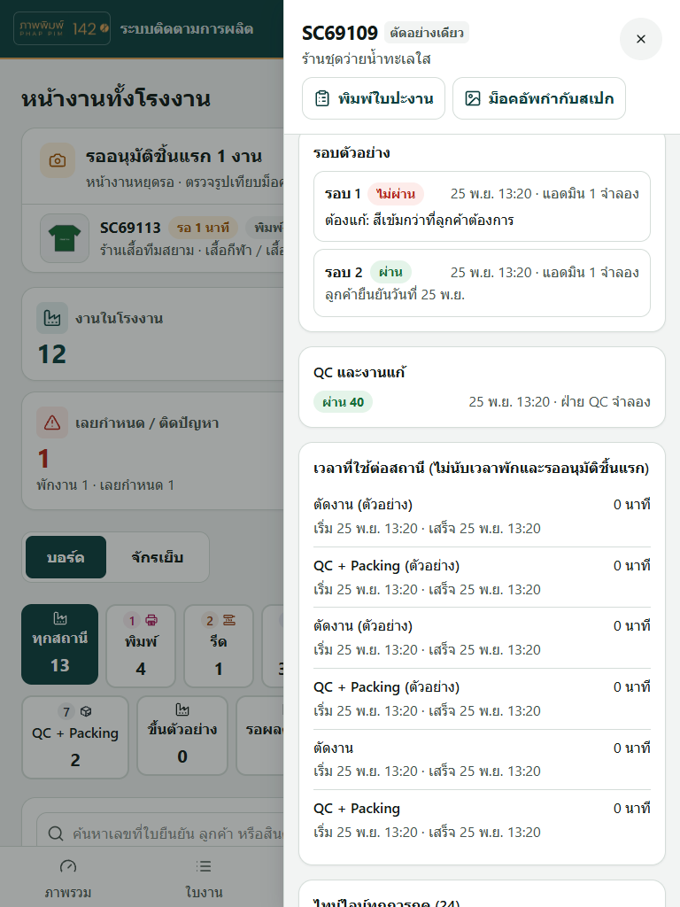
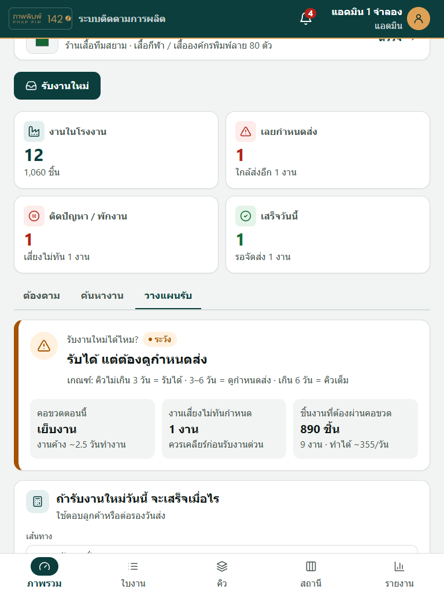
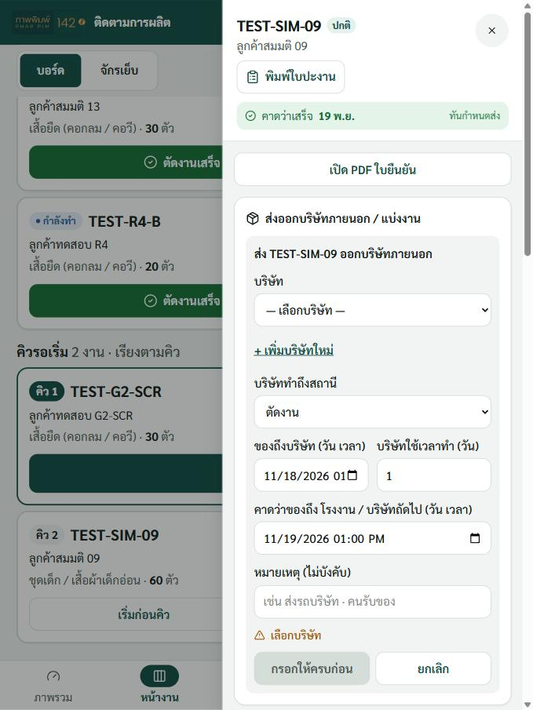

# คู่มือใช้งาน: แอดมิน

> สำหรับทีมแอดมิน · เว็บ: `https://pp142.pages.dev`
> หน้าที่หลัก: **รับงาน** (บันทึกใบยืนยันเข้าระบบ แล้วส่งงานเข้าโรงงาน) · พิมพ์ **ใบปะงาน** · สั่ง/รับฟิล์ม (DTF / DTG / สกรีน) · บันทึกผล **ขึ้นตัวอย่าง** · **ส่งงานออกบริษัทภายนอก / รับของกลับ** · ค้นหางานให้ลูกค้า
> อัปเดต 18 พ.ย.: งานเรียง**ตามคิว** (ลำดับที่รับงานเข้า) · การ์ด **สถานีตอนนี้** · **ส่งออกบริษัทภายนอก** และ **แบ่งงาน** (หัวข้อ 9) · หน้า **บัญชีของฉัน** ใหม่

---

## 1. ล็อกอิน · กล่องจดหมาย · ออกจากระบบเมื่อส่งเครื่องต่อ

1. เปิดเว็บ `https://pp142.pages.dev` กรอกอีเมลและรหัสผ่าน แล้วกด **เข้าสู่ระบบ**

2. กดไอคอน **กระดิ่งมุมขวาบน** (หรือเมนู **กล่องจดหมาย** บนจอใหญ่) เพื่อเปิด **กล่องจดหมาย** ดูรายการแจ้งเตือนงานที่รอฝั่งแอดมิน

3. หน้า **บัญชี** (กดชื่อมุมขวาบน) แสดงชื่อ บทบาท และ **บัญชีนี้ทำอะไรได้** · เปลี่ยนรหัสผ่านได้ที่หน้านี้ · เมื่อใช้งานเสร็จหรือส่งเครื่องต่อให้คนอื่น กด **ออกจากระบบ** ทุกครั้ง

---

## เมนูของคุณ (แอดมิน)

เมนูแต่ละบทบาทไม่เหมือนกัน · จอใหญ่อยู่แถบซ้าย · มือถืออยู่แถบล่าง (เกิน 5 เมนูกด **เพิ่มเติม**) · **บัญชี** อยู่ที่ชื่อ/รูปคนมุมขวาบน · **กล่องจดหมาย** ที่กระดิ่ง

| เมนู | ใช้ทำอะไร |
|---|---|
| **ภาพรวมใบงาน** | ต้องตาม · สถานีตอนนี้ · งานส่งออกข้างนอก (เดิมคือ **ภาพรวม**) · ปุ่ม **รับงานใหม่** อยู่ที่นี่ |
| **จัดการใบงาน** | ค้นหางาน + ตารางงานทุกงาน · รับงานใหม่ / ใบยืนยันที่บันทึกไว้ |
| **คิวการผลิต** | คิวของทุกสถานีเรียงตามลำดับ (ดูอย่างเดียว · แทรกคิวเป็นของฝ่ายผลิต/ผู้บริหาร) |
| **ติดตาม Station** | บอร์ดทั้งโรงงาน (เดิมคือ **หน้างาน**) |
| **รายงาน** | รายงาน 7 / 30 / 90 วัน (แอดมินเปิดได้แล้ว) |

---

## 2. หน้าหลักของแอดมิน

หน้า **ภาพรวม** ของแอดมินมี 3 แท็บ:
- **งานที่ต้องตาม**: รวมงานที่รอดำเนินการฝั่งแอดมิน เช่น รอรับฟิล์ม, รอผล **ขึ้นตัวอย่าง**, งานติดปัญหา, **ของข้างนอกเลยกำหนด** และ **คาดไม่ทัน X วัน** (ยังไม่เลยกำหนดส่งแต่คาดว่าเสร็จไม่ทัน → แจ้งลูกค้าล่วงหน้า หรือขอหัวหน้าแทรกคิว)
  - การ์ด **สถานีตอนนี้**: จำนวนงานแต่ละสถานี (ทำอยู่ / รอ / ติดปัญหา / ข้างนอก / เลยกำหนด) · กรอบแดง = มีงานติดปัญหาหรือเลยกำหนด · กดสถานีเพื่อดูคิวของสถานีนั้น
  - การ์ด **งานที่ส่งออกข้างนอก**: งานที่อยู่บริษัทภายนอก เรียงตามวันที่ของจะถึง · เลยกำหนดเป็นสีแดงพร้อมปุ่ม **โทร** / **เปิดแผนที่**
- **ค้นหางาน**: ค้นหาตามเลขที่ **ใบยืนยัน** (SC) หรือชื่อลูกค้า เพื่อดูสถานะล่าสุด
- **วางแผนรับงาน**: ดูคิวงานและกำลังผลิตเพื่อประเมินวันส่งงานใหม่

---

## 3. รับงานใหม่ (บันทึกใบยืนยันเข้าระบบ → ส่งงานเข้าโรงงาน)

> มีเฉพาะ **แอดมิน** (และเจ้าของระบบ) เท่านั้นที่กดส่งงานเข้าโรงงานได้ · ระบบไม่มีขั้นรอวัตถุดิบแล้ว ส่งงานเข้าแล้วงานจะขึ้น **สถานี** แรกทันที
> **เปลี่ยน 17 พ.ย.:** ไม่ต้องใช้ไฟล์ `.json` แล้ว · PDF ที่ลูกค้าเซ็น **ไม่บังคับ** ตอนส่งงานเข้า (แนบทีหลังได้)

1. กด **รับงานใหม่** → **เปิดฟอร์มใบยืนยัน (ใบใหม่)** (หรือเปิด `pp142.pages.dev/confirmation`) → กรอกข้อมูล
2. ในฟอร์มกด **บันทึกเข้าระบบ** → หน้าระบบเปิดขึ้นและแจ้ง **บันทึกใบยืนยัน … เข้าระบบแล้ว** (บันทึกซ้ำเลขเดิม = แก้ใบเดิม)
3. กด **ส่งออก PDF** ในฟอร์มเพื่อส่งให้ลูกค้าเซ็นตามเดิม
   - **ภาพแรก** ในช่อง **ภาพม็อคอัพ / ลายที่ลูกค้ายืนยัน** = รูปบนการ์ดงานทุกหน้าและบนใบปะงาน (คนหน้างานจำงานจากรูป) · ให้ใส่ภาพที่ดูง่ายที่สุดเป็นภาพแรก
4. พร้อมผลิตแล้ว: กด **ส่งงานเข้าโรงงานเลย** ในแถบแจ้ง หรือกด **รับงานใหม่** → เลือกใบในช่อง **ใบยืนยันที่บันทึกเข้าระบบแล้ว** → ระบบเติมเลขที่ใบ ลูกค้า สินค้า **จำนวน** **กำหนดส่ง** **ขึ้นตัวอย่าง** ให้
   - **เส้นทางผลิตแอดมินเลือกเองทุกงาน** ในช่อง **เส้นทางผลิต** (ระบบไม่เลือกให้ตามเทคนิคพิมพ์ เพราะงานแต่ละงานเดินไม่เหมือนกัน) · เลือกแล้วจะเห็นลำดับสถานีใต้ช่อง · ยังไม่เลือก = กดรับงานไม่ได้
   - ต้องแก้ใบ: เลือกใบแล้วกด **แก้ใบนี้ในฟอร์ม** → แก้ → **บันทึกเข้าระบบ** อีกครั้ง
5. งานที่รับเข้า**ต่อท้ายคิว**เสมอ (ทุกหน้าเรียงตามคิว ไม่ใช่ตามกำหนดส่ง) · งานด่วนให้แจ้งฝ่ายผลิต/ผู้บริหารกด **แทรกเป็นคิวแรก** ที่หน้าคิวสถานี
6. เลือกเส้นทางผลิตให้ตรงกับงานจริง และตรวจ **ขึ้นตัวอย่าง / ไม่ขึ้นตัวอย่าง** ให้ตรงใบยืนยัน · ดูกล่อง **คาดว่าเสร็จ** (แดง = ไม่ทันกำหนดส่ง แจ้งลูกค้าก่อน แต่ยังส่งงานเข้าได้)
7. มี PDF ที่ลูกค้าเซ็นแล้วแนบได้เลย · ยังไม่มีก็กด **รับงาน** ได้ แล้วแนบทีหลังที่ **รายละเอียดงาน → แนบ PDF ใบยืนยัน**
8. งานที่ยังไม่มีรูป (กรอบเทาบนการ์ด) หรืออยากเปลี่ยนรูป: **รายละเอียดงาน → เลือกรูปม็อคอัพ → บันทึกรูปม็อคอัพ** (ถ่ายจากมือถือได้ ระบบย่อรูปให้เอง)
   - งานที่เลือก **ขึ้นตัวอย่าง** → ไปที่ **ขึ้นตัวอย่าง** ทันที · **ไม่ขึ้นตัวอย่าง** → เข้า **สถานีแรก** ทันที
   - ยังใช้ไฟล์ `.json` แบบเดิมได้ (ช่อง **หรือแนบไฟล์ .json**)

---

## 4. พิมพ์ใบปะงาน + QR

1. หลังส่งงานเข้าแล้ว เปิดรายละเอียดงาน → กด **พิมพ์ใบปะงาน**
2. พิมพ์ขนาด **A5** ส่งคู่กับกองงานหน้างาน (มีช่องวันที่/ผู้รับ/ลายเซ็นใช้คู่กระดาษ)
3. เมื่อสแกน **QR** ด้วยมือถือและล็อกอิน ระบบจะเปิดหน้างานนั้นให้ทันที

---

## 5. สั่ง/รับงาน DTF / DTG / ซิลค์สกรีน

1. ในรายละเอียดงาน กดปุ่มสั่งตามประเภทงาน พร้อมระบุวันคาดว่าได้รับ:
   - งาน **DTF**: กด **บันทึกสั่งฟิล์ม DTF** → เมื่อของมาถึงกด **ได้รับฟิล์ม DTF แล้ว**
   - งาน **DTG**: กด **บันทึกสั่งงาน DTG** → เมื่อของมาถึงกด **ได้รับงาน DTG แล้ว**
   - งาน **ซิลค์สกรีน**: กด **บันทึกสั่งงานสกรีน** → เมื่อของมาถึงกด **ได้รับงานสกรีนแล้ว**
2. หากแอดมินยังไม่กดรับ ฝ่ายผลิตจะกดเริ่ม **สถานี** **รีดฟิล์ม** ไม่ได้

---

## 6. บันทึกผลขึ้นตัวอย่าง

1. เมื่อฝ่ายผลิตทำ **ขึ้นตัวอย่าง** ครบทุก **สถานี** แล้ว งานจะมารอผลตัวอย่างที่แอดมิน
2. เปิดรายละเอียดงาน:
   - ถ้าตัวอย่าง **ผ่าน**: กด **ตัวอย่างผ่าน** → งานจะเข้าสู่คิวผลิตจริงทันที
   - ถ้าตัวอย่าง **ไม่ผ่าน**: พิมพ์สิ่งที่ต้องแก้ไขให้ชัดเจน แล้วกด **ไม่ผ่าน · ขึ้นตัวอย่างใหม่** → ยืนยัน เพื่อส่งกลับไป **ขึ้นตัวอย่าง** รอบถัดไป

---

## 7. ค้นหางาน · ดูรายละเอียด · เปิดใบยืนยัน

1. กดแท็บ **ค้นหางาน** แล้วพิมพ์เลขที่ **ใบยืนยัน** หรือชื่อลูกค้า

2. คลิกงานเพื่อดูว่าตอนนี้อยู่ **สถานี** ไหน และกด **รายละเอียดเต็ม** เพื่อดู **รอบตัวอย่าง**, **เวลาที่ใช้ต่อสถานี**, **ไทม์ไลน์ทุกการกด**, และเปิดไฟล์ PDF **ใบยืนยัน** (ถ้าไฟล์ไม่เปิดขึ้นมา กดลิงก์สำรอง **ถ้าไฟล์ไม่เปิดขึ้นมา กดที่นี่**)

---

## 8. วางแผนรับงาน

ใช้แท็บ **วางแผนรับงาน** เพื่อดูว่างานในโรงงานตอนนี้แน่นแค่ไหน ก่อนรับปากวันส่งกับลูกค้า

---

## 9. ส่งงานออกบริษัทภายนอก · รับของกลับ · แบ่งงาน

> แอดมินเป็นคนบันทึก · ส่งออกได้ที่สถานี **พิมพ์ / รีด / ตัด / เย็บ / ปัก** ตอนที่งาน**ยังไม่เริ่ม**สถานีนั้น · ทำในรายละเอียดงาน กล่อง **ส่งออกบริษัทภายนอก / แบ่งงาน**

### ส่งออก
1. เปิดรายละเอียดงาน → กด **ส่งออกบริษัทภายนอก**
2. เลือก **บริษัท** (กลุ่มบนคือบริษัทที่รับงานสถานีนี้) · เลือกแล้วจะเห็นประเภทงาน ที่อยู่ ปุ่ม **โทร** / **เปิดแผนที่** · ไม่มีในรายการกด **+ เพิ่มบริษัทใหม่**
3. **บริษัททำถึงสถานี**: ถ้าบริษัททำหลายสถานีต่อกัน (เช่น พิมพ์ → รีด) เลือกสถานีสุดท้ายที่บริษัททำ
4. กรอก **ของถึงบริษัท (วัน เวลา)** · **บริษัทใช้เวลาทำ (วัน)** · **คาดว่าของถึง โรงงาน / บริษัทถัดไป** (ระบบเติมให้ แก้ได้) · **หมายเหตุ** (ไม่บังคับ)
5. กด **บันทึกส่งออก** → ระหว่างงานอยู่ข้างนอก ฝ่ายผลิต**กดเริ่มงานที่โรงงานไม่ได้** · งานขึ้นในการ์ด **งานที่ส่งออกข้างนอก**

### ระหว่างอยู่ข้างนอก (กล่อง **อยู่ที่บริษัทภายนอก**)
- **แก้กำหนด**: บริษัทเลื่อน หรือของถึงไม่ตรงที่คาด → แก้วันเวลา → **บันทึกกำหนดใหม่**
- **ส่งต่อบริษัทอื่น (…)**: บริษัทแรกส่งของไปบริษัทถัดไปเลยโดยไม่ผ่านโรงงาน → เลือกบริษัทและวันเวลา → **บันทึกส่งต่อ**
- เลยวันที่คาดว่าของถึง = กล่องเป็นสีแดง **เลยกำหนดแล้ว ตามบริษัท** · กด **โทร** ได้เลย

### รับของกลับ
1. ของถึงโรงงานแล้ว → กด **ของถึงโรงงานแล้ว · รับเข้า**
2. ใส่หมายเหตุ (เช่น ได้ครบ / ขาด 2 ตัว · ไม่บังคับ) → **ยืนยันรับของ** → งานไปรอที่สถานีถัดไป (งานแก้ → ไป **QC + Packing**)

### แบ่งงาน (ส่งออกบางส่วน)
1. ต้องการส่งออกแค่บางส่วน → กด **แบ่งจำนวน (ส่งออกบางส่วน)** → ใส่ **จำนวนที่แยกเป็นงานใหม่** → **บันทึกแบ่งงาน**
2. ระบบสร้างงานใหม่เลข **`เลขเดิม-2`** อยู่สถานีเดียวกัน คิวถัดจากงานเดิม · เปิดงานใหม่แล้วกด **ส่งออกบริษัทภายนอก**
3. แบ่งได้เฉพาะงานผลิตที่ยังไม่เริ่มสถานี ไม่ใช่งานแก้ และยังไม่ถึง QC + Packing

---

## 10. เย็บ / จักร / พักงาน / รายงานปัญหา

- **การเดินสถานี / เย็บ / จักร / QC / พักงาน**: แอดมินมีสิทธิ์ **ดูได้อย่างเดียว** เพื่อใช้ตอบลูกค้า ไม่สามารถกดเริ่มหรือจบ **สถานี** แทนฝ่ายผลิตได้
- **แอดมินไม่มีหน้าที่แก้ปัญหาของสถานี** · งานติดปัญหาขึ้นใน **งานที่ต้องตาม** ป้าย **ติดปัญหา · รอผู้บริหารแก้** ให้ดูไว้เพื่อแจ้งลูกค้า · ผู้บริหารหรือฝ่ายผลิตเป็นคนกด **แก้แล้ว ทำต่อ** (แอดมินกดไม่ได้)
- หากพบงานขึ้นแถบแดง (**เกินเวลามาตรฐาน**) ใน **บอร์ด** สามารถเปิดดูรายละเอียด **รายงานปัญหา** เพื่อแจ้งลูกค้าได้ทันที

---

## 10.5 ม็อคอัพกำกับสเปก (ชี้จุดบนภาพเสื้อ + สเปก)

> แอดมินทำร่างและส่งอนุมัติ · **แอดมินอนุมัติเองไม่ได้** (ฝ่ายผลิต / ผู้บริหาร / เจ้าของอนุมัติ) · แอดมินทุกคนแก้ร่างเดียวกันได้ · ต้องใช้จอกว้าง 768 px ขึ้นไป (แท็บเล็ตแนวนอน / คอม)

1. เปิดรายละเอียดงาน → **ม็อคอัพกำกับสเปก** → **เริ่มทำม็อคอัพกำกับสเปก**
2. **ภาพ**: เลือกมุม (ด้านหน้า / ด้านหลัง / ซ้าย / ขวา / รายละเอียด) → **เลือกไฟล์** (PNG / JPG / WEBP ไม่เกิน 5 MB · เก็บไฟล์ต้นฉบับไม่ย่อ) → ดูตัวอย่าง → **ใช้เป็นภาพ…**
3. **กดบนภาพ = เพิ่มจุด** เลขเรียงเอง · ลากจุดหรือกล่องข้อความเพื่อย้าย · ปุ่ม **− 100% +** ซูม · **↶ ย้อน / ↷ ทำซ้ำ** (Ctrl+Z / Ctrl+Y) · ▲▼ ในรายการด้านซ้ายเปลี่ยนลำดับ
4. แผงขวาของจุดที่เลือก:
   - **ชื่อจุด** เช่น คอเสื้อ อกซ้าย
   - **อ้างข้อมูลจากใบยืนยัน**: เลือกตำแหน่ง/ช่องที่กรอกไว้ในใบยืนยันแล้ว (เทคนิค · ขนาด · หมายเหตุ) **ไม่ต้องพิมพ์ซ้ำ**
   - **สเปกเพิ่มเติม**: สิ่งที่ใบยืนยันไม่มี (เช่น ขอบคอกว้าง 2 ซม. · รหัสสี) → **+ สร้างสเปกใหม่จากจุดนี้** หรือเลือกสเปกเดิม (ใช้ซ้ำหลายจุดได้ แก้ที่เดียว)
   - **สถานีที่เกี่ยวข้อง**: เลือกแล้วพนักงานสถานีจะเห็นเฉพาะจุดของสถานีตัวเอง (ไม่เลือก = ทุกสถานีเห็น)
5. **บันทึกร่าง** ระหว่างทำ (มีคนบันทึกไปก่อน = ระบบบอกให้ **โหลดใหม่** ไม่ทับกัน) · เผลอเปลี่ยนหน้า/ปิดแท็บก่อนบันทึก = เปิดกลับมาเครื่องเดิมจะขึ้นแถบ **มีงานที่ยังไม่ได้บันทึก** กด **กู้คืน** ได้ → ครบแล้ว **ส่งอนุมัติ** (ต้องมีภาพหน้า และทุกจุดมีชื่อ + สเปกหรือข้อความ)
6. ถูก **ส่งกลับให้แก้** = แถบแดงบอกเหตุผล (และมีข้อความใน **กล่องจดหมาย**) แก้แล้วส่งใหม่
7. **อนุมัติแล้วแก้ไม่ได้** · ต้องการแก้ = **สร้างฉบับแก้ไข** (ใส่เหตุผล) · ฉบับเดิมยังใช้ผลิตจนฉบับใหม่อนุมัติ · งานที่เริ่มผลิตแล้วต้องให้ผู้บริหาร/เจ้าของอนุมัติ
8. **พิมพ์ / PDF**: หน้าดูสเปก → **พิมพ์ / PDF** → เลือก A4 หรือ A3 แนวนอน → **พิมพ์ / บันทึก PDF** (ในหน้าพิมพ์เลือก "บันทึกเป็น PDF")

## 11. เน็ตหลุด · มีระบบรุ่นใหม่ ทำอย่างไร

- **เน็ตหลุด:** หากขึ้นแถบสีแดง **ขาดการเชื่อมต่อ** ด้านบน ให้หยุดกดปุ่มชั่วคราว รอจนเน็ตกลับมา แถบแดงจะหายไปและข้อมูลจะอัปเดตอัตโนมัติ (ถ้าไม่มั่นใจให้รีเฟรชหน้าเว็บ 1 ครั้งก่อนทำรายการใหม่)
- **มีระบบรุ่นใหม่:** ถ้าหน้าจอดูแปลกหรือไม่ตรงคู่มือ ให้**ปิดแท็บเว็บทั้งหมดแล้วเปิดใหม่** (รีเฟรชเฉยๆ อาจไม่พอ) และถ้าเห็นแถบ **มีระบบรุ่นใหม่** ให้กดโหลดทันที
