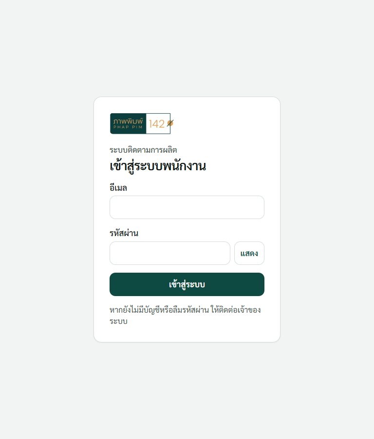
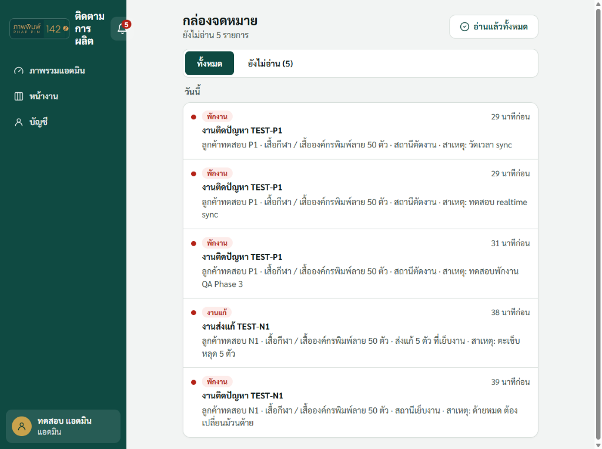
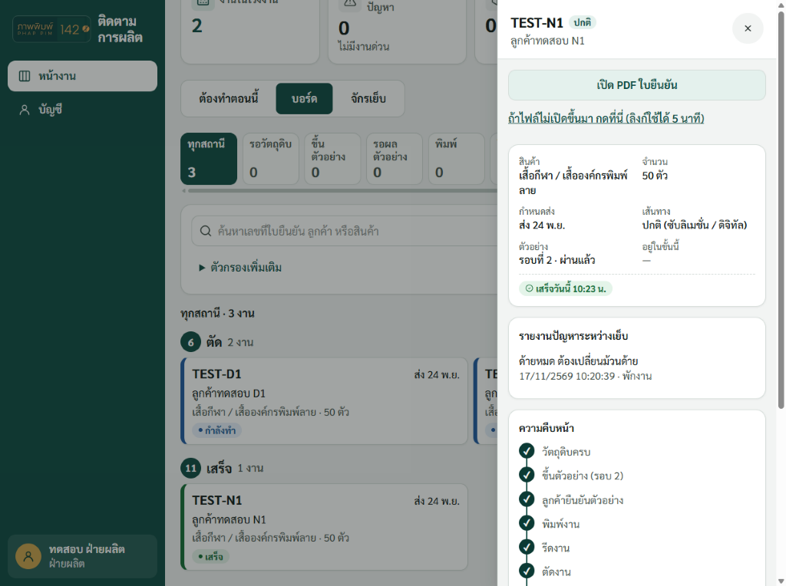
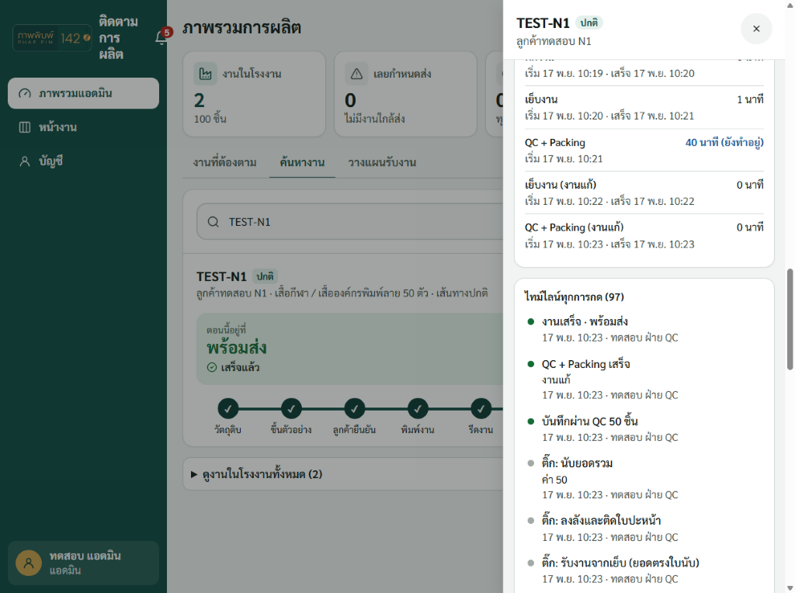

# คู่มือใช้งาน: แอดมิน

> สำหรับทีมแอดมิน · เว็บ: `https://pp142.pages.dev`
> หน้าที่หลัก: ติดตามงาน · ติ๊ก **วัตถุดิบ** ฝั่งแอดมิน · สั่ง/รับฟิล์ม (DTF / DTG / สกรีน) · บันทึกผล **ขึ้นตัวอย่าง** · ค้นหางานให้ลูกค้า

---

## 1. ล็อกอิน · กล่องจดหมาย · ออกจากระบบเมื่อส่งเครื่องต่อ

1. เปิดเว็บ `https://pp142.pages.dev` กรอกอีเมลและรหัสผ่าน แล้วกด **เข้าสู่ระบบ**

2. กดไอคอน **กระดิ่งมุมขวาบน** เพื่อเปิด **กล่องจดหมาย** ดูรายการแจ้งเตือนงานที่รอฝั่งแอดมิน

3. เมื่อใช้งานเสร็จหรือส่งเครื่องต่อให้คนอื่น ให้กดเมนู **บัญชี** → **ออกจากระบบ** ทุกครั้ง

---

## 2. หน้าหลักของแอดมิน

หน้า **ภาพรวม** ของแอดมินมี 3 แท็บ:
- **งานที่ต้องตาม**: รวมงานที่รอดำเนินการฝั่งแอดมิน เช่น รอติ๊ก **วัตถุดิบ**, รอรับฟิล์ม, รอผล **ขึ้นตัวอย่าง**
- **ค้นหางาน**: ค้นหาตามเลขที่ **ใบยืนยัน** (SC) หรือชื่อลูกค้า เพื่อดูสถานะล่าสุด
- **วางแผนรับงาน**: ดูคิวงานและกำลังผลิตเพื่อประเมินวันส่งงานใหม่

---

## 3. ติ๊กวัตถุดิบ และสั่ง/รับฟิล์ม (DTF / DTG / ซิลค์สกรีน)

### ติ๊กวัตถุดิบฝั่งแอดมิน
1. เปิดงานจากแท็บ **งานที่ต้องตาม** หรือ **ค้นหางาน**
2. ติ๊ก **ครบแล้ว** ในรายการฝั่งแอดมิน (ผ้า / วัสดุหลัก, ไฟล์งานล่าสุดตรงกับ **ใบยืนยัน**)
3. เมื่อครบทั้ง 3 ฝ่าย:
   - งานที่เลือก **ขึ้นตัวอย่าง** → จะไป **ขึ้นตัวอย่าง**
   - งานที่เลือก **ไม่ขึ้นตัวอย่าง** → จะเข้า **ผลิตจริงทันที**

### งาน DTF / DTG / ซิลค์สกรีน (สั่งและรับฟิล์ม)
1. ในรายละเอียดงาน กด **บันทึกสั่งฟิล์ม** พร้อมระบุวันคาดว่าได้รับ (รองรับทั้งงาน DTF, DTG และซิลค์สกรีน)
2. เมื่อฟิล์มมาส่งถึงโรงงานแล้ว กด **ได้รับฟิล์มแล้ว**
3. หากยังไม่กด **ได้รับฟิล์มแล้ว** ฝ่ายผลิตจะกดเริ่ม **สถานี** **รีดฟิล์ม** ไม่ได้

---

## 4. บันทึกผลขึ้นตัวอย่าง

1. เมื่อฝ่ายผลิตทำ **ขึ้นตัวอย่าง** ครบทุก **สถานี** แล้ว งานจะมารอผลตัวอย่างที่แอดมิน
2. เปิดรายละเอียดงาน:
   - ถ้าตัวอย่าง **ผ่าน**: กด **ตัวอย่างผ่าน** → งานจะเข้าสู่คิวผลิตจริงทันที
   - ถ้าตัวอย่าง **ไม่ผ่าน**: พิมพ์สิ่งที่ต้องแก้ไขให้ชัดเจน แล้วกด **ไม่ผ่าน · ขึ้นตัวอย่างใหม่** → ยืนยัน เพื่อส่งกลับไป **ขึ้นตัวอย่าง** รอบถัดไป

---

## 5. ค้นหางาน · ดูรายละเอียด · เปิดใบยืนยัน

1. กดแท็บ **ค้นหางาน** แล้วพิมพ์เลขที่ **ใบยืนยัน** หรือชื่อลูกค้า

2. คลิกงานเพื่อดูว่าตอนนี้อยู่ **สถานี** ไหน และกด **รายละเอียดเต็ม** เพื่อดู **รอบตัวอย่าง**, **เวลาที่ใช้ต่อสถานี**, **ไทม์ไลน์ทุกการกด**, และเปิดไฟล์ PDF **ใบยืนยัน** (ถ้าไฟล์ไม่เปิดขึ้นมา กดลิงก์สำรอง **ถ้าไฟล์ไม่เปิดขึ้นมา กดที่นี่**)

---

## 6. วางแผนรับงาน

ใช้แท็บ **วางแผนรับงาน** เพื่อดูว่างานในโรงงานตอนนี้แน่นแค่ไหน ก่อนรับปากวันส่งกับลูกค้า

---

## 7. เย็บ / จักร / พักงาน / รายงานปัญหา

- **การเดินสถานี / เย็บ / จักร / QC / พักงาน**: แอดมินมีสิทธิ์ **ดูได้อย่างเดียว** เพื่อใช้ตอบลูกค้า ไม่สามารถกดเริ่มหรือจบ **สถานี** แทนฝ่ายผลิตได้
- หากพบงานติดปัญหาหรือขึ้นแถบแดง (**เกินเวลามาตรฐาน**) ใน **บอร์ด** สามารถเปิดดูรายละเอียด **รายงานปัญหา** เพื่อแจ้งลูกค้าได้ทันที

---

## 8. เน็ตหลุดทำอย่างไร

1. หากขึ้นแถบสีแดง **ขาดการเชื่อมต่อ** ด้านบน ให้หยุดกดปุ่มชั่วคราว
2. รอจนเน็ตกลับมา แถบแดงจะหายไปและข้อมูลจะอัปเดตอัตโนมัติ
3. หากไม่มั่นใจว่าคำสั่งที่กดไปล่าสุดเข้าหรือยัง ให้รีเฟรชหน้าเว็บ 1 ครั้งแล้วตรวจสถานะงานก่อนทำรายการใหม่
