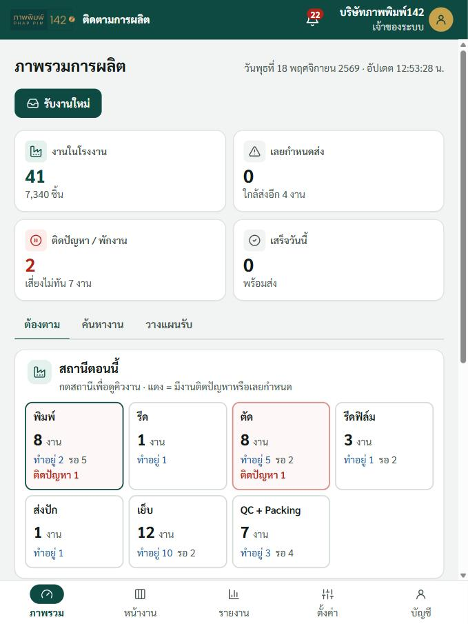
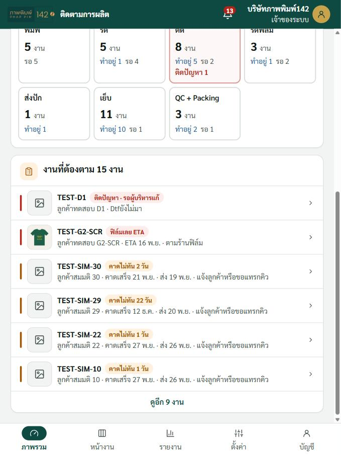
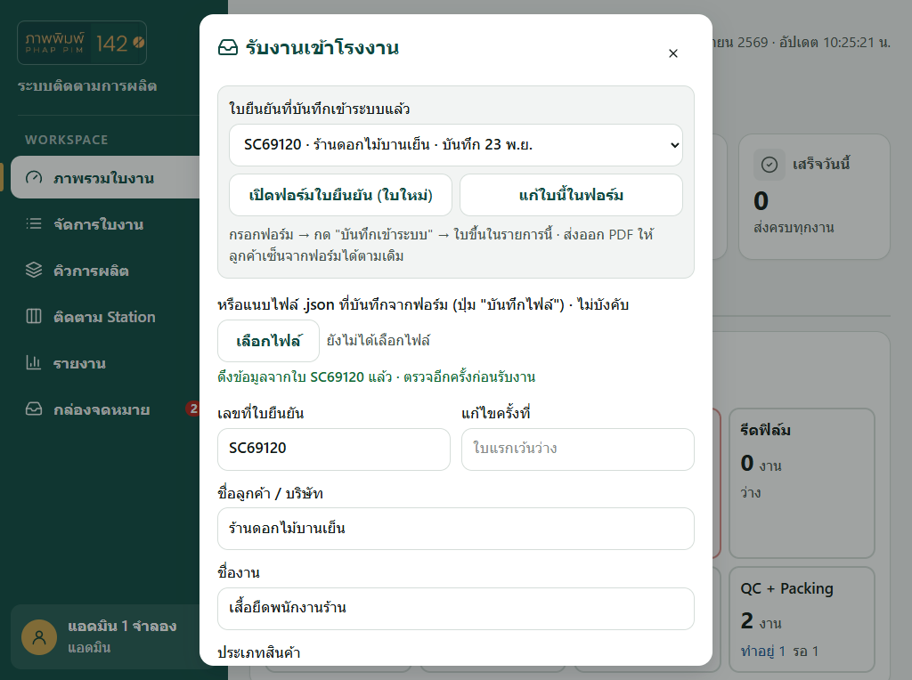
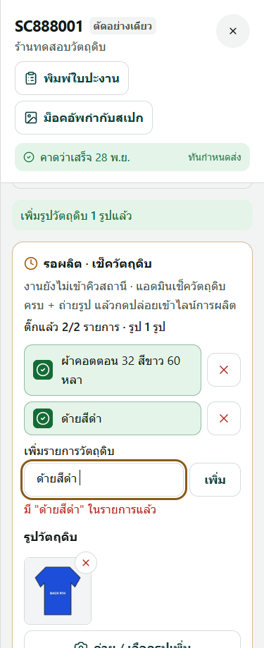
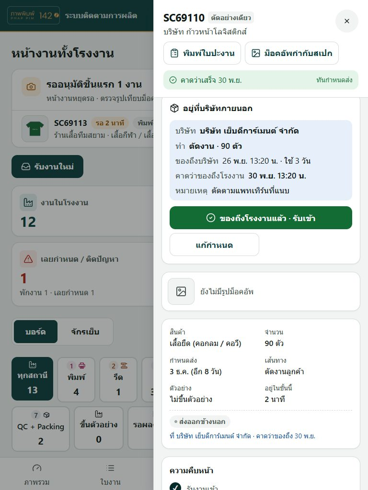
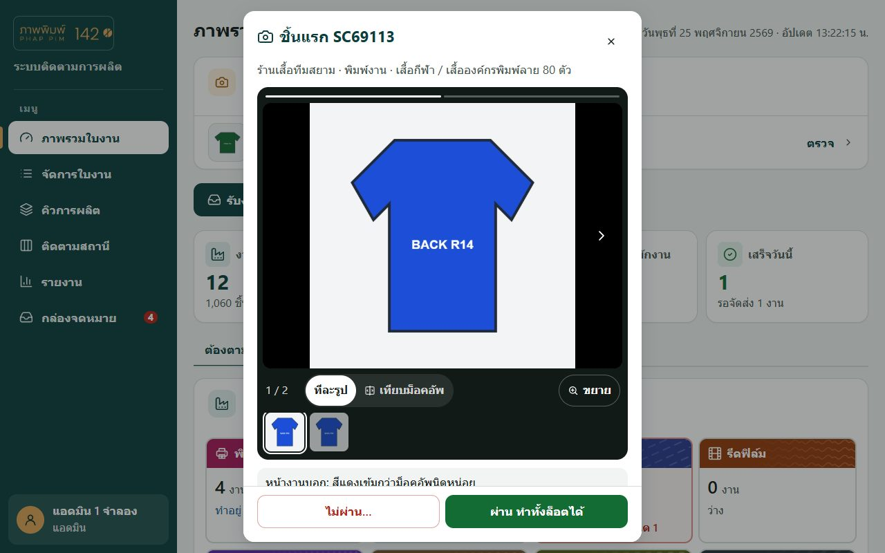

# คู่มือใช้งาน: แอดมิน

> สำหรับทีมแอดมิน · เว็บ: `https://pp142.pages.dev`
> หน้าที่หลัก: **รับงาน** (บันทึกใบยืนยันเข้าระบบ แล้วส่งงานเข้าโรงงาน) · พิมพ์ **ใบปะงาน** · สั่ง/รับฟิล์ม (DTF / DTG / สกรีน) · บันทึกผล **ขึ้นตัวอย่าง** · **ส่งงานออกบริษัทภายนอก / รับของกลับ** · ค้นหางานให้ลูกค้า
> อัปเดต 18 พ.ย.: งานเรียง**ตามคิว** (ลำดับที่รับงานเข้า) · การ์ด **สถานีตอนนี้** · **ส่งออกบริษัทภายนอก** และ **แบ่งงาน** (หัวข้อ 9) · หน้า **บัญชีของฉัน** ใหม่

---

## 1. ล็อกอิน · กล่องจดหมาย · ออกจากระบบเมื่อส่งเครื่องต่อ

1. เปิดเว็บ `https://pp142.pages.dev` กรอกอีเมลและรหัสผ่าน แล้วกด **เข้าสู่ระบบ**

2. กดไอคอน **กระดิ่งมุมขวาบน** (หรือเมนู **กล่องจดหมาย** บนจอใหญ่) เพื่อเปิด **กล่องจดหมาย** ดูรายการแจ้งเตือนงานที่รอฝั่งแอดมิน

3. หน้า **บัญชี** (กดชื่อมุมขวาบน) แสดงชื่อ บทบาท และ **บัญชีนี้ทำอะไรได้** · เปลี่ยนรหัสผ่านได้ที่หน้านี้ · เมื่อใช้งานเสร็จหรือส่งเครื่องต่อให้คนอื่น กด **ออกจากระบบ** ทุกครั้ง

---

## เมนูของคุณ (แอดมิน)

เมนูแต่ละบทบาทไม่เหมือนกัน · จอใหญ่อยู่แถบซ้าย · มือถืออยู่แถบล่าง (เกิน 5 เมนูกด **เพิ่มเติม**) · **บัญชี** อยู่ที่ชื่อ/รูปคนมุมขวาบน · **กล่องจดหมาย** ที่กระดิ่ง

| เมนู | ใช้ทำอะไร |
|---|---|
| **ภาพรวมใบงาน** | ต้องตาม · สถานีตอนนี้ · งานส่งออกข้างนอก (เดิมคือ **ภาพรวม**) · ปุ่ม **รับงานใหม่** อยู่ที่นี่ |
| **กำหนดส่งลูกค้า** | งานที่ยังไม่ส่งเรียงตามกำหนดส่งลูกค้า: เลยกำหนด → วันนี้ → พรุ่งนี้ → รายวัน 14 วัน · บอกว่าแต่ละงานเสร็จแล้วรอส่ง / อยู่สถานีไหน / คาดว่าเสร็จไม่ทัน · วิธีรับสินค้า + ที่อยู่ · ปุ่ม **พิมพ์รายการ** |
| **จัดการใบงาน** | ค้นหางาน + ตารางงานทุกงาน · รับงานใหม่ / ใบยืนยันที่บันทึกไว้ |
| **คิวการผลิต** | คิวของทุกสถานีเรียงตามลำดับ (ดูอย่างเดียว · แทรกคิวเป็นของฝ่ายผลิต/ผู้บริหาร) |
| **ติดตามสถานี** | บอร์ดทั้งโรงงาน (เดิมคือ **หน้างาน**) |
| **รายงาน** | รายงาน 7 / 30 / 90 วัน (แอดมินเปิดได้แล้ว) |

---

## 2. หน้าหลักของแอดมิน

หน้า **ภาพรวม** ของแอดมินมี 3 แท็บ:
- **งานที่ต้องตาม**: รวมงานที่รอดำเนินการฝั่งแอดมิน เช่น รอรับฟิล์ม, รอผล **ขึ้นตัวอย่าง**, งานติดปัญหา, **ของข้างนอกเลยกำหนด** และ **คาดไม่ทัน X วัน** (ยังไม่เลยกำหนดส่งแต่คาดว่าเสร็จไม่ทัน → แจ้งลูกค้าล่วงหน้า หรือขอหัวหน้าแทรกคิว)
  - การ์ด **สถานีตอนนี้**: จำนวนงานแต่ละสถานี (ทำอยู่ / รอ / ติดปัญหา / ข้างนอก / เลยกำหนด) · กรอบแดง = มีงานติดปัญหาหรือเลยกำหนด · กดสถานีเพื่อดูคิวของสถานีนั้น
  - การ์ด **งานที่ส่งออกข้างนอก**: งานที่อยู่บริษัทภายนอก เรียงตามวันที่ของจะถึง · เลยกำหนดเป็นสีแดงพร้อมปุ่ม **โทร** / **เปิดแผนที่**
- **ค้นหางาน**: ค้นหาตามเลขที่ **ใบยืนยัน** (SC) หรือชื่อลูกค้า เพื่อดูสถานะล่าสุด
- **วางแผนรับงาน**: ดูคิวงานและกำลังผลิตเพื่อประเมินวันส่งงานใหม่

---

## 3. รับงานใหม่ (บันทึกใบยืนยันเข้าระบบ → ส่งงานเข้าโรงงาน)

> มีเฉพาะ **แอดมิน** (และเจ้าของระบบ) เท่านั้นที่กดส่งงานเข้าโรงงานได้ · ระบบไม่มีขั้นรอวัตถุดิบแล้ว ส่งงานเข้าแล้วงานจะขึ้น **สถานี** แรกทันที
> **เปลี่ยน 17 พ.ย.:** ไม่ต้องใช้ไฟล์ `.json` แล้ว · PDF ที่ลูกค้าเซ็น **ไม่บังคับ** ตอนส่งงานเข้า (แนบทีหลังได้)

1. กด **รับงานใหม่** → **เปิดฟอร์มใบยืนยัน (ใบใหม่)** (หรือเปิด `pp142.pages.dev/confirmation`) → กรอกข้อมูล
   - ปุ่ม **ใบใหม่** เปิดฟอร์มว่างเสมอ · ถ้าใบเดิมในเครื่องยังไม่ได้กด **บันทึกเข้าระบบ** ฟอร์มจะถามก่อนล้าง (กด **ยกเลิก** = เปิดใบเดิมไว้ทำต่อ) · เปิดลิงก์ `pp142.pages.dev/confirmation` ตรง ๆ = เปิดใบล่าสุดที่ทำค้างไว้
2. ในฟอร์มกด **บันทึกเข้าระบบ** → หน้าระบบเปิดขึ้นและแจ้ง **บันทึกใบยืนยัน … เข้าระบบแล้ว** (บันทึกซ้ำเลขเดิม = แก้ใบเดิม)
3. กด **ส่งออก PDF** ในฟอร์มเพื่อส่งให้ลูกค้าเซ็นตามเดิม
   - **หลายแบบในงานเดียว** (เช่น กระเป๋าผ้าร่ม 3 ลาย): ใส่ในตาราง **แบบและจำนวน** แถวละ 1 แบบ (แบบ / ลาย · สี · รูป · จำนวน) ยอดงาน = ผลรวม · เสื้อผ้าใช้แถว "แบบ / สี" ในตารางไซซ์ · ถ้าทรงหรือขนาดต่างกัน ให้แยกใบ (`-0001` `-0002`)
   - **รูปม็อคอัพหลายรูป:** ใส่ได้หลายรูป มีเลข **รูป 1, 2, 3…** · เลือกรูปของแต่ละแบบในคอลัมน์ **รูป** · ทุกรูปเข้าระบบ หน้างานเห็นแบบพร้อมรูปในรายละเอียดงาน · **รูป 1** = รูปบนการ์ดงานและใบปะงาน
   - **หน่วยของขนาด:** ทุกช่องขนาดมีปุ่ม **ซม. | นิ้ว** ข้างชื่อช่อง กดเลือกตามที่ลูกค้าวัดมา (ไม่กด = หน่วยเดิมของช่อง) · PDF และม็อคอัพพิมพ์หน่วยตามที่เลือก
   - PDF ที่ส่งลูกค้า**ไม่แสดงกำหนดส่ง** (วันส่งใช้ภายในโรงงาน · ยังกรอกในฟอร์มตามเดิม)
   - **ทำสินค้าอื่นต่อ** (ออเดอร์เดียวหลายสินค้า): หลังกด **บันทึกเข้าระบบ** จะมีแถบ **ทำสินค้าถัดไป (ใช้ข้อมูลลูกค้าเดิม)** = เก็บชื่อลูกค้า ผู้ติดต่อ เบอร์ การรับสินค้า ที่อยู่ กำหนดส่ง แล้วเลื่อนเลขใบ (`-0001` → `-0002`) ให้เลือกสินค้าใหม่ · หรือ **ล้างฟอร์มทั้งหมด** · ปุ่ม **ล้างฟอร์ม** ด้านบนใช้ได้ตลอด (ถามยืนยันก่อน)
   - **ภาพแรก** ในช่อง **ภาพม็อคอัพ / ลายที่ลูกค้ายืนยัน** = รูปบนการ์ดงานทุกหน้าและบนใบปะงาน (คนหน้างานจำงานจากรูป) · ให้ใส่ภาพที่ดูง่ายที่สุดเป็นภาพแรก
4. พร้อมผลิตแล้ว: กด **ส่งงานเข้าโรงงานเลย** ในแถบแจ้ง หรือกด **รับงานใหม่** → เลือกใบในช่อง **ใบยืนยันที่บันทึกเข้าระบบแล้ว** → ระบบเติมเลขที่ใบ ลูกค้า สินค้า **จำนวน** **กำหนดส่ง** **ขึ้นตัวอย่าง** ให้
   - **เส้นทางผลิตแอดมินเลือกเองทุกงาน** ในช่อง **เส้นทางผลิต** (ระบบไม่เลือกให้ตามเทคนิคพิมพ์ เพราะงานแต่ละงานเดินไม่เหมือนกัน) · เลือกแล้วจะเห็นลำดับสถานีใต้ช่อง · ยังไม่เลือก = กดรับงานไม่ได้
   - ต้องแก้ใบ: เลือกใบแล้วกด **แก้ใบนี้ในฟอร์ม** → แก้ → **บันทึกเข้าระบบ** อีกครั้ง
5. งานที่รับเข้าไปรอที่คอลัมน์ **รอผลิต** ก่อน (ยังไม่เข้าคิวสถานี · ดูข้อ 3.1) · กด **ปล่อยเข้าไลน์การผลิต** แล้วงานจึง**ต่อท้ายคิว** (ทุกหน้าเรียงตามคิว ไม่ใช่ตามกำหนดส่ง) · งานด่วนให้แจ้งฝ่ายผลิต/ผู้บริหารกด **แทรกเป็นคิวแรก** ที่หน้าคิวสถานี
6. เลือกเส้นทางผลิตให้ตรงกับงานจริง และตรวจ **ขึ้นตัวอย่าง / ไม่ขึ้นตัวอย่าง** ให้ตรงใบยืนยัน · ดูกล่อง **คาดว่าเสร็จ** (แดง = ไม่ทันกำหนดส่ง แจ้งลูกค้าก่อน แต่ยังส่งงานเข้าได้)
7. มี PDF ที่ลูกค้าเซ็นแล้วแนบได้เลย · ยังไม่มีก็กด **รับงาน** ได้ แล้วแนบทีหลังที่ **รายละเอียดงาน → แนบ PDF ใบยืนยัน**
8. งานที่ยังไม่มีรูป (กรอบเทาบนการ์ด) หรืออยากเปลี่ยนรูป: **รายละเอียดงาน → เลือกรูปม็อคอัพ → บันทึกรูปม็อคอัพ** (ถ่ายจากมือถือได้ ระบบย่อรูปให้เอง)
   - ปล่อยเข้าไลน์แล้ว: งานที่เลือก **ขึ้นตัวอย่าง** → ไปที่ **ขึ้นตัวอย่าง** · **ไม่ขึ้นตัวอย่าง** → เข้า **สถานีแรก**
   - **ขึ้นตัวอย่าง (งาน Develop)** = ลูกค้าจ้างทำตัวอย่างอย่างเดียว · ไปขึ้นตัวอย่างเหมือนกัน แต่ **ตัวอย่างผ่าน = งานเสร็จ ไม่ผลิตจริง** · ถ้าลูกค้าจะผลิตจริงต่อ ให้ทำใบยืนยันใบใหม่ · รายงานนับงาน Develop แยกจากงานผลิต
   - ยังใช้ไฟล์ `.json` แบบเดิมได้ (ช่อง **หรือแนบไฟล์ .json**)

### 3.1 รอผลิต: เช็ควัตถุดิบ + ถ่ายรูป แล้วปล่อยเข้าไลน์การผลิต

> งานที่จะ**ส่งออกบริษัทภายนอก**ไม่ต้องเช็ควัตถุดิบ · กด **ส่งออกบริษัทภายนอก** ในรายละเอียดงานได้เลย (ข้อ 9)

งานที่รับเข้าแล้วอยู่คอลัมน์ **รอผลิต** (การ์ดขึ้นป้าย **รอเช็ควัตถุดิบ**) · พนักงานสถานีและ QC ยังไม่เห็นงานนี้ · **เวลาผลิต 10/15/20 วันทำงานยังไม่เริ่มนับ**

1. เปิดรายละเอียดงาน → แผง **รอผลิต · เช็ควัตถุดิบ**
2. พิมพ์วัตถุดิบที่ต้องเช็คของงานนี้**ทีละรายการ** ในช่อง **เพิ่มรายการวัตถุดิบ** + ใส่ **วันเวลาที่คาดว่าจะได้รับ** (เวลาไทย) แล้วกด **เพิ่ม** · ของที่มีอยู่แล้วให้ติ๊ก **มีของแล้ว** แทน (ระบบติ๊กว่าได้รับให้เลย) · ไม่ใส่ทั้งสองอย่าง = เพิ่มไม่ได้ (เช่น ผ้าคอตตอน 32 สีขาว 150 หลา · หมึก · ด้าย · ป้ายคอ) · ไม่เกิน 30 รายการ · พิมพ์ผิดกด **✕** หลังรายการเพื่อลบ
3. ของมาถึงแล้วกดที่รายการเพื่อ **ติ๊ก** (กดซ้ำ = ยกเลิกติ๊ก) · ด้านบนบอก **ติ๊กแล้ว x/y รายการ**
   - ใต้ชื่อแต่ละรายการบอกวันของถึง: **แดง = เลยกำหนดรับ** · ส้ม = ถึงวันนี้ · เทา = วันอื่น · ได้รับแล้วบอกเวลาที่ติ๊ก
   - ของเลื่อน: กด **เลื่อนวันที่คาดว่าได้รับ** ใต้รายการ → เลือกวันใหม่ → **บันทึกวันที่** (ประวัติงานเก็บวันเดิม → วันใหม่)
   - เลยกำหนดแล้วยังไม่ติ๊ก: การ์ดบนบอร์ดขึ้นแดง "วัตถุดิบเลยกำหนดรับ" + กล่องจดหมายเตือนแอดมินทุกวันจนกว่าจะติ๊กหรือเลื่อนวัน · ยังไม่เลย = การ์ดบอก "ของถึง …"
   - งานบริการ: ระบบใส่ "ของที่ลูกค้าส่งมา" ให้ โดยใช้ **วันที่ของจะถึงโรงงาน** ในใบเป็นวันคาดว่าได้รับ (นับถึง 17:00) · รายการที่ขึ้น "ยังไม่ใส่วันคาดว่าได้รับ" ให้กด **ใส่วันที่คาดว่าได้รับ**
   - ยกเลิกติ๊กของที่เคยติ๊ก "มีของแล้ว" = ขึ้นแดงเลยกำหนดทันที ให้กดเลื่อนวันใส่วันที่ของจะมา
4. กด **ถ่าย / เลือกรูปวัตถุดิบ** ถ่ายรูปรวมของที่เตรียมไว้ **อย่างน้อย 1 รูป** (มือถือเลือกได้ว่าถ่ายใหม่หรือเลือกจากคลังรูป · ได้ถึง 12 รูป · กด ✕ บนรูปเพื่อลบ · ใช้รูปม็อคอัพแทนไม่ได้)
   - งานรอผลิตเกิน 2 วันทำงาน กล่องจดหมายของแอดมินจะเตือน **รอผลิตนาน**
5. ครบแล้วปุ่ม **ปล่อยเข้าไลน์การผลิต** จะกดได้ (กดไม่ได้ = ใต้ปุ่มบอกว่ายังขาดอะไร เช่น ยังไม่ได้ติ๊กรายการไหน หรือยังไม่มีรูป) → กล่องยืนยันบอกว่างานจะไปไหน → **ยืนยันปล่อยเข้าไลน์**
6. ปล่อยแล้ว: งาน**ต่อท้ายคิว**ของสถานีแรก (หรือขึ้นตัวอย่าง) · **เวลาผลิตเริ่มนับวันที่ปล่อย** · แก้รายการและรูปวัตถุดิบไม่ได้แล้ว (ดูย้อนหลังได้ใน **ประวัติงาน**)

### 3.2 ใบงานบริการ (ลูกค้าส่งของมาให้ทำขั้นเดียว)

ในฟอร์มใบยืนยัน เลือกหมวด **งานบริการ (ลูกค้าส่งของมา)**:

| ใบ | ใช้เมื่อ | ขั้นที่ทำ |
|---|---|---|
| **เย็บอย่างเดียว** | ลูกค้าส่งชิ้นส่วนที่ตัดแล้วมาให้เย็บ | เย็บ → QC + Packing |
| **พิมพ์อย่างเดียว** | เลือกในใบ: **ส่งกระดาษให้ลูกค้า** (ลูกค้ารีดเอง) หรือ **พิมพ์แล้วรีดลงผ้าของลูกค้า** | พิมพ์ → QC + Packing · หรือ พิมพ์ → รีด → QC + Packing |
| **รีดอย่างเดียว** | ลูกค้าส่งกระดาษที่พิมพ์แล้ว + ผ้า / ชิ้นงานมาให้รีด | รีด → QC + Packing |
| **DTF อย่างเดียว** | ลูกค้าส่งเสื้อ / ชิ้นงานมาให้รีด DTF · เลือกในใบว่า **โรงงานสั่งฟิล์ม** หรือ **ลูกค้าส่งฟิล์มมาเอง** | รีดฟิล์ม → QC + Packing |
| **งานบริการอื่นๆ** | งานที่ไม่เข้า 4 แบบบน (ตัดเลเซอร์ · เฟล็ก · ติดกระดุม ฯลฯ) | แอดมินเลือกเส้นทางเอง |

1. ทุกใบกรอก **ของที่ลูกค้าส่งมา** (ของ · จำนวน · หน่วย · สภาพ) · ส่งของเองหรือให้โรงงานไปรับ · วันที่ของจะถึง · ของเผื่อเสีย (แนะนำ 3–5%) · ผ้าใช้หน่วย **หลา**
2. **เย็บอย่างเดียว** ต้องเลือก **สินค้าที่จะเย็บ** (ฝ่ายผลิตจ่ายจักรตามสินค้านี้) · การ์ดงานขึ้น "เย็บอย่างเดียว · ชื่อสินค้า"
3. หน้ารับงาน: **เส้นทางผลิตตั้งตามใบให้เอง** เปลี่ยนไม่ได้ · ถ้าผิด แก้ในฟอร์มแล้วบันทึกเข้าระบบใหม่ · สินค้าปกติไม่มีเส้นทางเหล่านี้ให้เลือก
4. รับงานแล้ว แผง **รอผลิต** มีรายการ "ของที่ลูกค้าส่งมา" ให้แล้ว (DTF ลูกค้าส่งฟิล์มเอง = มีรายการฟิล์มด้วย) → นับของจริง ติ๊ก ถ่ายรูปสภาพของ → ปล่อยเข้าไลน์ (ข้อ 3.1)
5. DTF โรงงานสั่งฟิล์ม: บันทึกสั่ง / ได้รับฟิล์มเหมือนงาน DTF ปกติ (ข้อ 5) · ลูกค้าส่งฟิล์มเอง: ไม่ต้องบันทึกสั่ง
6. แก้ใบหลังรับงาน **เปลี่ยนแบบบริการไม่ได้** (สินค้าที่เย็บ · ส่งกระดาษ/รีดลงผ้า · ผู้จัดหาฟิล์ม) → ให้ผู้บริหารยกเลิกงาน แล้วรับใบใหม่
7. ฉบับลูกค้ามีเงื่อนไขงานบริการเพิ่ม 1 ข้อ (ความเสียหายของของลูกค้า · ส่งของเผื่อเสีย)

---

## 4. พิมพ์ใบปะงาน + QR

1. หลังส่งงานเข้าแล้ว เปิดรายละเอียดงาน → กด **พิมพ์ใบปะงาน**
2. พิมพ์ขนาด **A5** ส่งคู่กับกองงานหน้างาน (มีช่องวันที่/ผู้รับ/ลายเซ็นใช้คู่กระดาษ)
3. เมื่อสแกน **QR** ด้วยมือถือและล็อกอิน ระบบจะเปิดหน้างานนั้นให้ทันที

---

## 5. สั่ง/รับงาน DTF / DTG / ซิลค์สกรีน

1. ในรายละเอียดงาน กดปุ่มสั่งตามประเภทงาน พร้อมระบุวันคาดว่าได้รับ:
   - งาน **DTF**: กด **บันทึกสั่งฟิล์ม DTF** → เมื่อของมาถึงกด **ได้รับฟิล์ม DTF แล้ว**
   - งาน **DTG**: กด **บันทึกสั่งงาน DTG** → เมื่อของมาถึงกด **ได้รับงาน DTG แล้ว**
   - งาน **ซิลค์สกรีน**: กด **บันทึกสั่งงานสกรีน** → เมื่อของมาถึงกด **ได้รับงานสกรีนแล้ว**
2. หากแอดมินยังไม่กดรับ ฝ่ายผลิตจะกดเริ่ม **สถานี** **รีดฟิล์ม** ไม่ได้

---

## 6. บันทึกผลขึ้นตัวอย่าง

1. เมื่อฝ่ายผลิตทำ **ขึ้นตัวอย่าง** ครบทุก **สถานี** แล้ว งานจะมารอผลตัวอย่างที่แอดมิน
2. เปิดรายละเอียดงาน:
   - ถ้าตัวอย่าง **ผ่าน**: กด **ตัวอย่างผ่าน** → งานจะเข้าสู่คิวผลิตจริงทันที · **งาน Develop** → งานเสร็จ (เสร็จ · รอส่ง) ส่งตัวอย่างให้ลูกค้าแล้วกด **จัดส่งให้ลูกค้าแล้ว**
   - ถ้าตัวอย่าง **ไม่ผ่าน**: พิมพ์สิ่งที่ต้องแก้ไขให้ชัดเจน แล้วกด **ไม่ผ่าน · ขึ้นตัวอย่างใหม่** → ยืนยัน เพื่อส่งกลับไป **ขึ้นตัวอย่าง** รอบถัดไป

---

## 7. ค้นหางาน · ดูรายละเอียด · เปิดใบยืนยัน

1. กดแท็บ **ค้นหางาน** แล้วพิมพ์เลขที่ **ใบยืนยัน** หรือชื่อลูกค้า

2. คลิกงานเพื่อดูว่าตอนนี้อยู่ **สถานี** ไหน และกด **รายละเอียดเต็ม** เพื่อดู **รอบตัวอย่าง**, **เวลาที่ใช้ต่อสถานี**, **ไทม์ไลน์ทุกการกด**, และเปิดไฟล์ PDF **ใบยืนยัน** (ถ้าไฟล์ไม่เปิดขึ้นมา กดลิงก์สำรอง **ถ้าไฟล์ไม่เปิดขึ้นมา กดที่นี่**)

### ส่งออก PDF ใบยืนยันอีกครั้ง / ลูกค้าขอแก้ใบหลังรับงาน (เช่น เปลี่ยนที่อยู่จัดส่ง)

1. เปิดรายละเอียดงาน → กด **ส่งออก PDF ใบยืนยันอีกครั้ง / แก้ใบ (เช่น เปลี่ยนที่อยู่จัดส่ง)**
2. กด **เปิดใบยืนยันในฟอร์ม** → ฟอร์มเปิดใบเดิมพร้อมรูปม็อคอัพ
   - **แค่พิมพ์ PDF ซ้ำ** (ไม่ได้แก้อะไร): กด **ส่งออก PDF** ได้เลย จบที่ข้อนี้
3. แก้ข้อมูล (เช่น ที่อยู่จัดส่ง · สี · ขนาด · จำนวน · ตำแหน่งพิมพ์) → ใส่ **แก้ไขครั้งที่** (1, 2, …) → กด **บันทึกการแก้เข้างาน** (ปุ่มสีเขียวบนแถบ เปลี่ยนชื่อเองเมื่อเปิดใบจากงาน)
   - ฟอร์มถามยืนยันพร้อมรายชื่อ **ช่องที่แก้** → กด ตกลง → หน้าระบบแจ้ง **บันทึกการแก้ใบ … เข้างานแล้ว · แจ้งทุกฝ่ายในกล่องจดหมายแล้ว**
   - **สเปกในรายละเอียดงาน · จำนวน · กำหนดส่ง เปลี่ยนตามใบทันที** · ฝ่ายผลิต / QC / ผู้บริหาร ได้ข้อความ **แก้ใบยืนยัน** ในกล่องจดหมาย · ประวัติงานขึ้น **แก้ใบยืนยัน ครั้งที่ n · ผลิตตามสเปกใหม่**
   - เปลี่ยนรูปม็อคอัพในฟอร์ม = รูปบนการ์ดงานเปลี่ยนด้วย
   - ทำไม่ได้: **เปลี่ยนชนิดสินค้า** หรือ **ขึ้นตัวอย่าง / ไม่ขึ้นตัวอย่าง** (ให้ผู้บริหารยกเลิกงาน แล้วรับใบใหม่) · ลดจำนวนต่ำกว่าที่ QC ผ่านไปแล้ว · เปลี่ยนจำนวนงานที่ผลิตเสร็จแล้ว · **แก้ไขครั้งที่** ต้องไม่น้อยกว่าครั้งล่าสุดที่บันทึก
4. กด **ส่งออก PDF** แล้วส่งให้ลูกค้าเซ็น
5. ได้ใบที่ลูกค้าเซ็นแล้ว กลับมาที่งานเดิม → **เลือก PDF ใบแก้ไขที่ลูกค้าเซ็นแล้ว** → **เปลี่ยนเป็น PDF ใบใหม่** → ขึ้นแถบเขียว "เปลี่ยน PDF ใบยืนยันแล้ว" และประวัติงานขึ้น **เปลี่ยน PDF ใบยืนยัน**

> **ม็อคอัพกำกับสเปกที่อนุมัติแล้วไม่เปลี่ยนเอง** · ถ้าใบแก้ทำให้ค่าในม็อคอัพเก่า หน้าระบบจะเตือน "ม็อคอัพกำกับสเปกฉบับ n ยังเป็นค่าเก่า x จุด" → เปิดหน้าม็อคอัพของงานแล้วทำฉบับใหม่ให้อนุมัติ (หัวข้อ 10.5)

### ช่องบังคับที่งานนี้ไม่ใช้ (ปุ่ม "ไม่ใช้กับงานนี้")

- ช่องบังคับ (มี *) ที่ยังว่าง มีปุ่ม **ไม่ใช้กับงานนี้** ข้างชื่อช่อง · กดแล้วช่องเป็นกล่องเทา **ไม่ขึ้นในรายการ "ยังไม่ได้กรอก"** **ไม่พิมพ์ลง PDF** และไม่ส่งเข้าระบบ
- กดผิด: กด **ใช้ช่องนี้** ค่าที่เคยพิมพ์ไว้กลับมา
- ช่องที่ระบบใช้ตั้งค่างานไม่มีปุ่มนี้: เลขที่ใบ · ชื่องาน · ชื่อลูกค้า · วันที่ออกใบ · กำหนดส่ง · ขึ้นตัวอย่าง · การรับสินค้า · ชุดไซซ์ / จำนวน · เทคนิค · ภาพม็อคอัพ

---

## 8. วางแผนรับงาน

ใช้แท็บ **วางแผนรับงาน** เพื่อดูว่างานในโรงงานตอนนี้แน่นแค่ไหน ก่อนรับปากวันส่งกับลูกค้า

---

## 9. ส่งงานออกบริษัทภายนอก · รับของกลับ · แบ่งงาน

> แอดมินเป็นคนบันทึก · ส่งออกได้ที่สถานี **พิมพ์ / รีด / ตัด / เย็บ / ปัก / สั่งผลิตข้างนอก** ตอนที่งาน**ยังไม่เริ่ม**สถานีนั้น · ทำในรายละเอียดงาน กล่อง **ส่งออกบริษัทภายนอก / แบ่งงาน**

### ส่งออก
- **งานที่ยังรอผลิต ส่งออกได้เลย ไม่ต้องเช็ควัตถุดิบ / ถ่ายรูป** (บริษัทภายนอกจัดหาวัตถุดิบเอง) · ระบบปล่อยเข้าไลน์ให้ งานต่อท้ายคิว และเวลาผลิตเริ่มนับวันที่ส่ง · ส่งได้เมื่อสถานีแรกของเส้นทางส่งออกได้ (เช่น ผลิตข้างนอกทั้งหมด · พิมพ์ · ตัด) · สถานีแรกเป็นรีดฟิล์ม (DTF อย่างเดียว) ต้องปล่อยเข้าไลน์ตามปกติ

1. เปิดรายละเอียดงาน → กด **ส่งออกบริษัทภายนอก**
2. เลือก **บริษัท** (กลุ่มบนคือบริษัทที่รับงานสถานีนี้) · เลือกแล้วจะเห็นประเภทงาน ที่อยู่ ปุ่ม **โทร** / **เปิดแผนที่** · ไม่มีในรายการกด **+ เพิ่มบริษัทใหม่**
3. **บริษัททำถึงสถานี**: ถ้าบริษัททำหลายสถานีต่อกัน (เช่น พิมพ์ → รีด) เลือกสถานีสุดท้ายที่บริษัททำ
4. กรอก **ของถึงบริษัท (วัน เวลา)** · **บริษัทใช้เวลาทำ (วัน)** · **คาดว่าของถึง โรงงาน / บริษัทถัดไป** (ระบบเติมให้ แก้ได้) · **หมายเหตุ** (ไม่บังคับ)
5. กด **บันทึกส่งออก** → ระหว่างงานอยู่ข้างนอก ฝ่ายผลิต**กดเริ่มงานที่โรงงานไม่ได้** · งานขึ้นในการ์ด **งานที่ส่งออกข้างนอก**

### ระหว่างอยู่ข้างนอก (กล่อง **อยู่ที่บริษัทภายนอก**)
- **แก้กำหนด**: บริษัทเลื่อน หรือของถึงไม่ตรงที่คาด → แก้วันเวลา → **บันทึกกำหนดใหม่**
- **ส่งต่อบริษัทอื่น (…)**: บริษัทแรกส่งของไปบริษัทถัดไปเลยโดยไม่ผ่านโรงงาน → เลือกบริษัทและวันเวลา → **บันทึกส่งต่อ**
- เลยวันที่คาดว่าของถึง = กล่องเป็นสีแดง **เลยกำหนดแล้ว ตามบริษัท** · กด **โทร** ได้เลย

### รับของกลับ
1. ของถึงโรงงานแล้ว → กด **ของถึงโรงงานแล้ว · รับเข้า**
2. ใส่หมายเหตุ (เช่น ได้ครบ / ขาด 2 ตัว · ไม่บังคับ) → **ยืนยันรับของ** → งานไปรอที่สถานีถัดไป (งานแก้ → ไป **QC + Packing**)

### งานที่ผลิตข้างนอกทั้งหมด (โรงงานทำแค่ QC + Packing)
1. ตอนรับงาน เลือกเส้นทางผลิต **ผลิตข้างนอกทั้งหมด** (ลำดับสถานี: สั่งผลิตข้างนอก → QC + Packing) · ใช้ได้กับสินค้าที่ยังไม่มีสูตรจักร เช่น หมวก หมอน
2. งานไปรอที่ **สั่งผลิตข้างนอก** (ปุ่มท้ายแถบสถานี ไม่มีเลข) · ที่โรงงานกดเริ่มไม่ได้
3. เปิดรายละเอียดงาน → **ส่งออกบริษัทภายนอก** → เลือกบริษัท วันของถึงบริษัท จำนวนวัน วันของกลับ → **บันทึกส่งออก**
4. ของถึงโรงงาน → **ของถึงโรงงานแล้ว · รับเข้า** → งานไปรอ **QC + Packing** · QC ส่งแก้กลับ "สั่งผลิตข้างนอก" ได้ แล้วแอดมินส่งออกรอบแก้

### แบ่งงาน (ส่งออกบางส่วน)
1. ต้องการส่งออกแค่บางส่วน → กด **แบ่งจำนวน (ส่งออกบางส่วน)** → ใส่ **จำนวนที่แยกเป็นงานใหม่** → **บันทึกแบ่งงาน**
2. ระบบสร้างงานใหม่เลข **`เลขเดิม-2`** อยู่สถานีเดียวกัน คิวถัดจากงานเดิม · เปิดงานใหม่แล้วกด **ส่งออกบริษัทภายนอก**
3. แบ่งได้เฉพาะงานผลิตที่ยังไม่เริ่มสถานี ไม่ใช่งานแก้ และยังไม่ถึง QC + Packing

---

## 10. เย็บ / จักร / พักงาน / รายงานปัญหา

- **การเดินสถานี / เย็บ / จักร / QC / พักงาน**: แอดมินมีสิทธิ์ **ดูได้อย่างเดียว** เพื่อใช้ตอบลูกค้า ไม่สามารถกดเริ่มหรือจบ **สถานี** แทนฝ่ายผลิตได้
- **แอดมินไม่มีหน้าที่แก้ปัญหาของสถานี** · งานติดปัญหาขึ้นใน **งานที่ต้องตาม** ป้าย **ติดปัญหา · รอผู้บริหารแก้** ให้ดูไว้เพื่อแจ้งลูกค้า · ผู้บริหารหรือฝ่ายผลิตเป็นคนกด **แก้แล้ว ทำต่อ** (แอดมินกดไม่ได้)
- หากพบงานขึ้นแถบแดง (**เกินเวลามาตรฐาน**) ใน **บอร์ด** สามารถเปิดดูรายละเอียด **รายงานปัญหา** เพื่อแจ้งลูกค้าได้ทันที

---

## 10.4 อนุมัติรูปชิ้นแรก (หน้างานหยุดรออยู่ ตอบให้เร็ว)

- มีงานรอ → การ์ด **รออนุมัติชิ้นแรก n งาน** ขึ้นบนสุดของทุกหน้า + กระดิ่งแจ้งเตือน · ป้ายเวลาเป็น **ส้ม** = รอไม่นาน · **แดง** = รอเกิน 15 นาที (ระบบเตือนผู้บริหาร + ฝ่ายผลิตแล้ว)
- กด **ตรวจ** → เปิดตัวดูรูปชิ้นแรกจากสถานี:
  - **ทีละรูป**: ปัดซ้าย-ขวา หรือกดลูกศร / รูปเล็กด้านล่างเพื่อเปลี่ยนรูป · กด **ขยาย** หรือดับเบิลคลิกเพื่อซูม
  - **เทียบม็อคอัพ**: ม็อคอัพที่ลูกค้ายืนยันซ้อนกับรูปชิ้นแรก · ลากแถบ **เลื่อนเทียบ** ดูทีละฝั่ง (งานที่ยังไม่มีม็อคอัพกดโหมดนี้ไม่ได้ ให้เทียบกับสเปกแทน)
  - ข้อความจากหน้างาน (ถ้ามี) อยู่ใต้รูป · กด **ดูสเปกและรายละเอียดงาน** เพื่อเช็กขนาด / ตำแหน่ง
  - ปุ่ม **ผ่าน** กดได้เมื่อรูป **โหลดครบทุกรูป** แล้วเท่านั้น (รูปเปิดไม่ได้ = กดผ่านไม่ได้ ให้กด **ไม่ผ่าน…** ให้หน้างานถ่ายใหม่)

  

- **ผ่าน ทำทั้งล็อตได้** → หน้างานทำต่อได้ทันที
- **ไม่ผ่าน…** → เลือกเหตุผล (สีเพี้ยน · ตำแหน่งผิด · ขนาดผิด · ผิดแบบ / ผิดไฟล์ · งานไม่เรียบร้อย ได้หลายข้อ) + พิมพ์เพิ่ม (เช่น โลโก้ต่ำไป 2 ซม.) → **ยืนยันไม่ผ่าน** · ต้องมีเหตุผลอย่างน้อย 1 ข้อ · หน้างานเห็นเหตุผลทันที (พนักงานพม่าเห็นเหตุผลที่เลือกเป็นภาษาพม่า)
- ผู้บริหารอนุมัติแทนได้ · ถ้าแอดมินอีกคนตัดสินไปก่อน กล่องตรวจจะบอก **รูปชิ้นแรกนี้มีคนตัดสินไปแล้ว** ให้กด **ปิด**
- งานที่ส่งออกข้างนอกแล้ว หรือเจ้าของระบบปิดระบบรูปแล้ว ตัดสินรูปที่ค้างไม่ได้ (ไม่ต้องทำอะไร)
- รูปทุกรูปดูย้อนหลังได้ในรายละเอียดงาน หัวข้อ **รูปจากสถานี**

---

## 10.5 ม็อคอัพกำกับสเปก (ชี้จุดบนภาพเสื้อ + สเปก)

> แอดมินทำร่างแล้ว**อนุมัติใช้ผลิตเองได้เลย** ไม่ต้องรอใคร · แอดมินทุกคนแก้ร่างเดียวกันได้ · ต้องใช้จอกว้าง 768 px ขึ้นไป (แท็บเล็ตแนวนอน / คอม)

1. เปิดรายละเอียดงาน → **ม็อคอัพกำกับสเปก** → **เริ่มทำม็อคอัพกำกับสเปก**
2. **ภาพ**: ภาพแรกคือ **ภาพหลัก** · ม็อคอัพที่มี**ทั้งด้านหน้าและหลังในภาพเดียว** อัปโหลดเป็นภาพหลักภาพเดียวพอ แล้ววางจุดได้ทั้งสองตัว (ตั้งชื่อจุดให้รู้ว่าหน้า/หลัง เช่น "อกซ้าย (หน้า)" "กลางหลัง") · มีภาพแยกเพิ่มได้ (ด้านหลัง / ซ้าย / ขวา / รายละเอียด) → **เลือกไฟล์** (PNG / JPG / WEBP ไม่เกิน 20 MB · เก็บไฟล์ต้นฉบับไม่ย่อ) → ดูตัวอย่าง → **ใช้เป็นภาพ…**
3. **กดบนภาพ = เพิ่มจุด** เลขเรียงเอง (เลขอยู่ในกล่องข้อความ · บนภาพเหลือแค่เส้นชี้ ไม่บังลายลูกค้า) · ลากวงแหวนปลายเส้นหรือกล่องข้อความเพื่อย้าย · ปุ่ม **− 100% +** ซูม · **↶ ย้อน / ↷ ทำซ้ำ** (Ctrl+Z / Ctrl+Y) · ▲▼ ในรายการด้านซ้ายเปลี่ยนลำดับ
4. แผงขวาของจุดที่เลือก:
   - **ชื่อจุด** เช่น คอเสื้อ อกซ้าย
   - **อ้างข้อมูลจากใบยืนยัน**: เลือกตำแหน่ง/ช่องที่กรอกไว้ในใบยืนยันแล้ว (เทคนิค · ขนาด · หมายเหตุ) **ไม่ต้องพิมพ์ซ้ำ**
   - **สเปกเพิ่มเติม**: สิ่งที่ใบยืนยันไม่มี (เช่น ขอบคอกว้าง 2 ซม. · รหัสสี) → **+ สร้างสเปกใหม่จากจุดนี้** หรือเลือกสเปกเดิม (ใช้ซ้ำหลายจุดได้ แก้ที่เดียว)
   - **สถานีที่เกี่ยวข้อง**: เลือกแล้วพนักงานสถานีจะเห็นเฉพาะจุดของสถานีตัวเอง (ไม่เลือก = ทุกสถานีเห็น)
5. **บันทึกร่าง** ระหว่างทำ (มีคนบันทึกไปก่อน = ระบบบอกให้ **โหลดใหม่** ไม่ทับกัน) · เผลอเปลี่ยนหน้า/ปิดแท็บก่อนบันทึก = เปิดกลับมาเครื่องเดิมจะขึ้นแถบ **มีงานที่ยังไม่ได้บันทึก** กด **กู้คืน** ได้ → ตรวจครบแล้วกด **อนุมัติฉบับ n ใช้ผลิต** (สีเขียว) → ยืนยัน · ต้องมีภาพหลัก และทุกจุดมีชื่อ + สเปกหรือข้อความ (ยังไม่ครบ = ปุ่มกดไม่ได้และบอกว่าขาดอะไร) · ยังไม่ได้บันทึก = ระบบบันทึกให้ก่อนอนุมัติ
6. ฉบับเก่าที่เคยส่งไปรออนุมัติ แอดมินกดอนุมัติเองได้ในกล่อง **รออนุมัติ** · ถูก **ส่งกลับให้แก้** = แถบแดงบอกเหตุผล แก้แล้วอนุมัติได้เลย
7. **อนุมัติแล้วแก้ไม่ได้** · ต้องการแก้ = **สร้างฉบับแก้ไข** (ใส่เหตุผล) · ฉบับเดิมยังใช้ผลิตจนฉบับใหม่อนุมัติ · งานที่เริ่มผลิตแล้วแอดมินอนุมัติฉบับแก้ไขเองได้ แต่ทุกสถานีต้องกดรับทราบใหม่ (ระบบแจ้งกล่องจดหมายให้)
8. **พิมพ์ / PDF**: หน้าดูสเปก → **พิมพ์ / PDF** → เลือก A4 หรือ A3 แนวนอน → **พิมพ์ / บันทึก PDF** (ในหน้าพิมพ์เลือก "บันทึกเป็น PDF")

## 10.6 จัดส่งให้ลูกค้า

> งานที่ QC + Packing กดเสร็จแล้ว = **เสร็จ · รอส่ง** · แอดมินเป็นคนบันทึกว่าส่งให้ลูกค้าแล้ว

1. บอร์ดคอลัมน์ **เสร็จ** → การ์ดที่ขึ้น **รอจัดส่ง** (ส้ม) → กดเปิดรายละเอียดงาน
2. กล่อง **จัดส่งให้ลูกค้า** → ใส่เลขพัสดุ / ผู้รับ / วิธีส่ง (ไม่บังคับ เช่น "Kerry KEX123456" "ลูกค้ามารับเอง") → **จัดส่งให้ลูกค้าแล้ว** → **ยืนยัน**
3. การ์ดเปลี่ยนเป็น **จัดส่งแล้ว** (เขียว) · ไทม์ไลน์มี "จัดส่งให้ลูกค้าแล้ว" · หายจากบอร์ด 3 วันหลังส่ง (งานที่ยังไม่ส่งค้างบนบอร์ดจนกว่าจะบันทึก)
4. กดผิดงาน → **บันทึกผิด · ยกเลิกการจัดส่ง** → ใส่เหตุผล → ยืนยัน (ไทม์ไลน์เก็บทั้งการส่งและการยกเลิก)
5. ภาพรวม: ช่อง **เสร็จวันนี้** บอกว่า **รอจัดส่ง n งาน**

### วางแผนส่งของ (เมนู **กำหนดส่งลูกค้า**)
1. เปิดตอนเช้าก่อนเริ่มงาน · ตัวเลขด้านบน: **เลยกำหนด ยังไม่ส่ง** (แดง ตามด่วน) · **ต้องส่งวันนี้** (บอกว่าพร้อมส่งกี่งาน) · **ส่งพรุ่งนี้** · **คาดว่าเสร็จไม่ทันส่ง** (คิดจากคิวและกำลังผลิตตอนนี้)
2. รายการแบ่งตามวันส่ง: **เลยกำหนดส่ง** → **วันนี้** → **พรุ่งนี้** → รายวัน 14 วัน → **หลังจากนั้น** · ในวันเดียวกันงานที่ต้องตามขึ้นก่อน (ไม่ทัน → ติดปัญหา → รอคิว → กำลังทำ → เสร็จแล้ว · รอส่ง)
3. แต่ละงานบอก: สถานะ (แดง = เลยกำหนด/ไม่ทัน/ติดปัญหา · ส้ม = รอคิว/รอลูกค้ายืนยันตัวอย่าง · ฟ้า = กำลังทำ · เขียว = เสร็จแล้ว รอส่ง) · วันที่คาดว่าเสร็จ · วิธีรับสินค้า + ที่อยู่จากใบยืนยัน
4. ปุ่ม **ทั้งหมด / ยังไม่เสร็จ / พร้อมส่ง** กรองรายการ · **พิมพ์รายการ** พิมพ์ทุกวันที่แสดง (มีวันเวลาที่พิมพ์ด้านบน)
5. กดงาน → รายละเอียดงาน → **จัดส่งให้ลูกค้าแล้ว** · งานย้ายไปกล่อง **ส่งแล้ววันนี้**

## 11. เน็ตหลุด · มีระบบรุ่นใหม่ ทำอย่างไร

- **เน็ตหลุด:** หากขึ้นแถบสีแดง **ขาดการเชื่อมต่อ** ด้านบน ให้หยุดกดปุ่มชั่วคราว รอจนเน็ตกลับมา แถบแดงจะหายไปและข้อมูลจะอัปเดตอัตโนมัติ (ถ้าไม่มั่นใจให้รีเฟรชหน้าเว็บ 1 ครั้งก่อนทำรายการใหม่)
- **มีระบบรุ่นใหม่:** ถ้าหน้าจอดูแปลกหรือไม่ตรงคู่มือ ให้**ปิดแท็บเว็บทั้งหมดแล้วเปิดใหม่** (รีเฟรชเฉยๆ อาจไม่พอ) และถ้าเห็นแถบ **มีระบบรุ่นใหม่** ให้กดโหลดทันที
